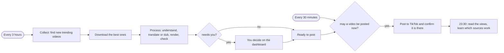
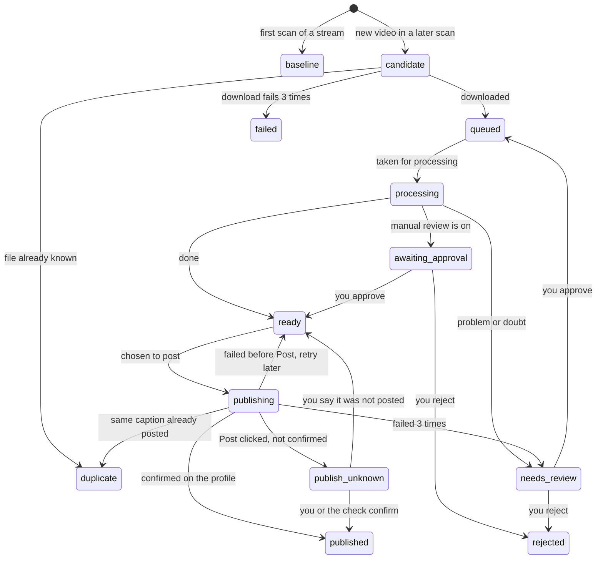
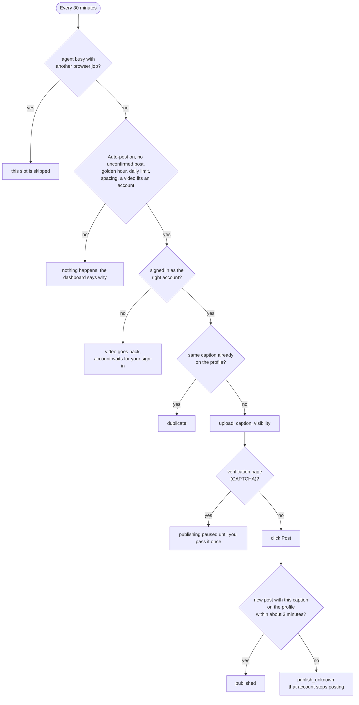
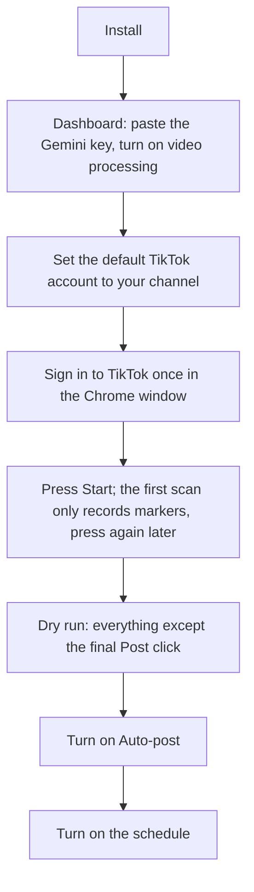

# Flows: what happens, and what you do

How TrendVN behaves, step by step. This document has **no technology**: no ports, tools, routes or file names. For what the parts are made of, why, and how to extend them, read [TECH.md](TECH.md). For installing, running and fixing, read [OPERATIONS.md](OPERATIONS.md).

Four actors:

| Actor | Role |
|---|---|
| **Schedule** | Starts work on a timer. Decides nothing. |
| **Agent** | Does what needs a real Chrome: look at sites, download, post, read views. Decides nothing; before it posts it must ask the worker. |
| **Worker** | Decides everything and remembers everything: which video is taken, which is posted, when. |
| **You** | Set the rules, review what is doubtful, press buttons. |

## 1. The whole system in one flow

## 2. Life of one video

| State | Meaning |
|---|---|
| `baseline` | Seen on the first scan of a stream. Only a marker, never processed. |
| `candidate` | New and worth taking; not downloaded yet. |
| `queued` | Downloaded, waiting to be processed. |
| `processing` | Being understood, translated or dubbed, rendered and checked. |
| `needs_review` | The system holds it for you: look-alike of an earlier video, off topic, sensitive, the AI is unsure, or an error. |
| `awaiting_approval` | Finished, waiting for your OK (only when manual review is on). |
| `ready` | Finished and checked; waits for a posting slot. |
| `publishing` | Being posted right now (one at a time). |
| `publish_unknown` | Post was clicked but not seen on the profile. Posting stops for that account until it is settled. |
| `published` | Confirmed on the public profile. |
| `duplicate`, `failed`, `rejected` | Ends: same file or caption already used, download failed, or you said no. |

Guarantees that never change:
1. After Post is clicked, nothing retries by itself: an unclear result stops that account instead of posting twice.
2. Only one video is being posted at any moment.
3. A late or stale report about a video is ignored; it cannot overwrite a newer result.
4. The first scan of a stream only records markers, so the system never reposts what was already trending.
5. A scan older than the last one is refused, and a report with one bad item is refused whole.

## 3. Automatic flows

### 3.1 Every 3 hours: collect and process

| Step | What happens | If it fails |
|---|---|---|
| 1 Check sessions | Each TikTok account is checked to be signed in as the right user. An expired one is reported once, with the command to sign in again. | You get a message; that account is skipped for posting. |
| 2 Settle unclear posts | Posts whose result was unknown are looked for on the public profile and marked published if found. It never posts again. | They stay unconfirmed. |
| 3 Collect | Sources are scanned (Douyin and Kuaishou always; TikTok and Instagram only through a US connection). Videos that pass the gates are scored: fresh (7 days by default), popular enough, not too long. The best are downloaded, at most 3 per run, only while fewer than 4 wait and the disk has 1 GB free. | A failing source is skipped; the rest still run. |
| 4 Housekeeping | Videos left half-way by a crash go back in the queue; old files and history are removed; a low disk is reported. | |
| 5 Process | Up to 4 videos, 2 at a time: duplicate check, the AI watches (music or speech, topic, sensitive?), the system chooses keep as is, add Vietnamese subtitles, or Vietnamese voice-over, then renders a vertical video and checks it. | A busy AI sends the video back to the queue; repeated failures park it for you. |

A step that fails does not stop the next one, and you are told once per step per 6 hours.

### 3.2 Every 30 minutes: may a video be posted?

The checks, in order: the Auto-post switch is on; the account has no unconfirmed post; it is a golden hour (default 11:00-14:00 and 19:00-23:00); the account's daily limit is not reached (default 2); enough time has passed since its last post (default 3 hours); then the best-scoring ready video whose topic that account takes. Accounts are tried in turn, the one that posted longest ago first.

### 3.3 23:30: learn from results

Views of posted videos are read from each profile. When at least 8 posts are older than 24 hours, the sources whose posts did better get a higher priority in later downloads. A summary message is sent to your phone if you set one up.

## 4. Manual flows

### 4.1 First run

Step C comes before D: the sign-in command only accepts the account named in C.

### 4.2 Dashboard buttons

| Button | What it does | Compared with the schedule |
|---|---|---|
| Update all | collect, then process | skips the TikTok session check and the settling of unclear posts |
| Collect | collect only | same as step 3 above |
| Process | process up to 4 videos | same as step 5 |
| Post now | post the video you chose | ignores golden hour, daily limit and spacing (your click is the consent); the safety checks stay |
| Dry run | everything except the final Post click, with a screenshot | not run by the schedule |
| Read views | read the views of posted videos | same as 3.3 |

If the same kind of work is already running, you are told and nothing starts.

### 4.3 Decisions on a video

| You choose | Result |
|---|---|
| Approve (doubtful video) | processed again with the doubt waived |
| Approve (waiting for OK) | becomes ready |
| Reject | removed from the flow; files are deleted later |
| Bring back ready to post | a video parked after repeated posting failures returns without a new AI call |
| Edit or reset caption | your text replaces the generated one until you reset it |
| "It is up on TikTok" / "It is not" | settles an unconfirmed post |

Also from the dashboard: settings, Gemini key, TikTok accounts and their topics, notification channel.

## 5. When something goes wrong

| Situation | What the system does by itself | What you do |
|---|---|---|
| TikTok session expired | skips that account, tells you once | sign in again |
| TikTok shows a verification page | pauses publishing, never tries to pass it | pass it once yourself |
| Post clicked but not seen | stops that account, tries to find it on the profile later | check TikTok, then answer "up" or "not" |
| AI busy or over its limit | sends the video back and retries later; after many tries parks it | nothing, or review the parked video |
| AI key refused | holds all videos and shows a banner | replace the key |
| Disk almost full | stops downloading, then stops rendering, tells you | free space |
| Power cut during work | on restart puts videos back in the queue; a half-finished post becomes unconfirmed | settle unconfirmed posts |
| Another job holds the browser | skips this turn | wait; the next turn runs |

Two things never run together: one browser job at a time (the schedule or a button), and one processing run at a time. The three schedules never overlap. Anything blocked says so instead of waiting silently.
