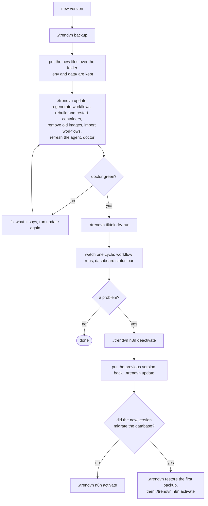

# Operations: install, run, update, fix

For owners and operators. What the system does is in [FLOWS.md](FLOWS.md); what it is made of is in [TECH.md](TECH.md). Every command is `./trendvn <command>` run in the project folder; `./trendvn help` prints the list.

## 1. Install

| Need | Detail |
|---|---|
| System | macOS or Linux (Windows: WSL2 with Chrome installed inside it) |
| Docker | Docker Engine with Compose v2; on a Mac, Docker Desktop (started once, with "Start when you sign in" on) |
| Python | **3.10 or newer** with `venv` for the agent. macOS ships 3.9: install 3.12 from python.org or `brew install python@3.12`. The `./trendvn` script finds the newest one itself |
| Chrome | Google Chrome (on a Mac in `/Applications`) |
| Disk | at least 4 GB free; the Docker image is about 2 GB |
| Accounts | a Gemini API key (https://aistudio.google.com/apikey); optionally a US proxy for the US sources |

On a Mac, keep the folder **outside** `Documents`, `Desktop` and `Downloads` (macOS does not let background jobs read them), keep the Mac awake while it should work (Settings: do not sleep on power), and run automation on **one** machine per TikTok channel. The double-click launchers in `macos/` (`Install.command`, `Open-dashboard.command`, `Sign-in-TikTok.command`, `Verify-TikTok.command`) do the same as the commands; if macOS blocks one, run `xattr -dr com.apple.quarantine ~/trendvn` once.

**1. Get the code** into a plain folder:

```bash
git clone -b develop git@github.com:Thuy200226/trendvn.git ~/trendvn && cd ~/trendvn
```

Or extract a package built by `./trendvn package` (after `shasum -a 256 -c` on its `.sha256` file).

**2. Install** (safe to run again; never destroys data). The first build takes 10 to 60 minutes.

```bash
./trendvn install --no-activate
```

It checks the machine, creates `.env` with its secrets, builds the agent's Python environment, generates and loads the n8n workflows, builds and starts the two containers, and installs the agent as a background service. `--no-activate` leaves the schedule off until you turn it on; `--no-service` skips the background service (run it with `./trendvn agent run`).

**3. Check**, then open the dashboard:

```bash
./trendvn doctor
```

```bash
./trendvn open
```

Yellow lines at this point (no Gemini key, not signed in, Auto-post off) are normal.

**4. Configure and sign in**, in this order (the full flow is [FLOWS.md](FLOWS.md) section 4.1): in More, Settings paste the Gemini key and turn on video processing; set the default TikTok account to your channel; then sign in once in the Chrome window that opens:

```bash
./trendvn tiktok login
```

**5. Rehearse**, then go live. Press Start on the Overview (the first scan only records markers; press again hours later), then:

```bash
./trendvn tiktok dry-run
```

It uploads and fills the caption but stops before Post and saves a screenshot. Set Post visibility to "Only me" for the first real posts. When satisfied, turn on Auto-post in the dashboard and:

```bash
./trendvn n8n activate
```

## 2. Daily use

| Command | Purpose |
|---|---|
| `./trendvn status` | containers, agent, which schedules are on |
| `./trendvn logs -f` | live log of worker and n8n (`logs agent -f` for the agent) |
| `./trendvn restart [worker\|n8n\|agent]` | restart one part, or all |
| `./trendvn down` | stop n8n and worker, keep data (the agent keeps running: `./trendvn agent stop`) |
| `./trendvn n8n deactivate` / `activate` | schedule off / on |
| `./trendvn doctor` | full diagnosis, each red line says how to fix it |

**Reading the dashboard.** The status bar is green only when setup is complete, nothing needs you, no video waits for your approval, and both the collector and the poster reported in the last 7 hours; orange says which is missing. Tabs: Overview, Queue (downloaded, waiting), Posting (finished videos with a Post now button), Need to see (decisions: unconfirmed posts and held videos), Posted, More (sources, settings, accounts, notifications, log). The meaning of each state and decision is in [FLOWS.md](FLOWS.md) sections 2 and 4.3.

**Settings** (More, Settings; every value is range-checked and a wrong one is refused):

| Setting | Default |
|---|---|
| Video processing / Auto-post / Review before posting | off / off / off |
| Vietnamese dubbing | on |
| Post visibility | public ("Only me" for safe tests) |
| Posts per day / minimum gap | 2 / 3 hours |
| Golden hours (local time) | 11-14 and 19-23 (empty = any time) |
| Video age / maximum length | 7 days / 180 seconds |
| Downloads per scan / queue size | 3 / 4 |
| Popularity threshold | Douyin 150,000 likes; Kuaishou and TikTok 1,000,000 views |
| AI calls per 24 hours / minimum certainty | 12 / 0.90 |

**Several TikTok accounts** (More, TikTok accounts and topics): add the account name, tick the topics it takes, save, then sign it in with the command shown on its card, `./trendvn tiktok login --account <id>`. Each account has its own Chrome profile and its own optional limits. Videos of a topic nobody takes are held for you.

## 3. Update, back up, move

```bash
./trendvn backup
```

Take a backup first (add `--with-session` to include the TikTok sessions, `--keep N` to keep the newest N). Then extract the new version over the running folder (`.env` and `data/` are kept) or `git pull`, and:

```bash
./trendvn update
```



Going back: code and workflows return by installing the previous version again. The database only moves forward, so when the version's entry in [../CHANGELOG.md](../CHANGELOG.md) mentions a migration, restore the backup from step one; a restore leaves the schedule off until you turn it on.

**Move to another machine** (this order avoids two machines posting to one channel):

```bash
./trendvn n8n deactivate
```

```bash
./trendvn backup --with-session
```

On the new machine: install with `./trendvn install --no-activate`, `./trendvn restore <backup file>`, `./trendvn doctor`, `./trendvn tiktok login` (TikTok may ask again), `./trendvn tiktok dry-run`, then `./trendvn n8n activate`. A weekly backup by cron needs a full PATH: `0 3 * * 0 PATH=/usr/local/bin:/opt/homebrew/bin:/usr/bin:/bin; cd /path/to/trendvn && ./trendvn backup --keep 8`.

**Uninstall:** `./trendvn uninstall` stops the services and containers and keeps the data; `--purge` also deletes data, sessions and the n8n volume (asks first, cannot be undone).

## 4. When something is wrong

| Symptom | Likely cause | Do |
|---|---|---|
| `install` stops at "Need Python 3.10" | only the system Python 3.9 | install Python 3.12, open a new terminal, run again |
| `install` refuses the folder | it is under Documents, Desktop or Downloads | move it, e.g. `~/trendvn` |
| No new videos in the queue | the first scan only records markers; thresholds too high | press Start again later; lower the popularity threshold |
| "TikTok/Instagram need a US IP" | exit IP is not in the US | set `TRENDVN_US_PROXY` in `.env`, `./trendvn agent restart` |
| "Posting: needs attention" | signed out or session ended | `./trendvn tiktok login` (add `--account <id>`) |
| Dashboard says TikTok asks for verification | CAPTCHA on a session | pass it once: `./trendvn tiktok trust` |
| A source says "verification or sign in" | the site shows a wall | the system never passes it; try later |
| Many videos in "Need approval" for one reason | wrong or refused AI key, quota used up, model changed | check the Gemini key and limit in Settings |
| "Agent is busy" on a button | the schedule or another button holds the browser | wait a few minutes |
| "Cannot reach the agent" | the agent service is not running | `./trendvn doctor`, then `./trendvn agent restart` |
| Phone message "Step 01 collect (or another) failed" | a step of the schedule failed; n8n itself still shows green | `./trendvn doctor`; open that run under Executions in n8n for the error |
| Phone message "agent /api/... still running after N minutes" | a browser job passed its limit and still holds the browser | `./trendvn agent logs`; if Chrome is stuck, `./trendvn agent restart` (an unfinished post is settled by the next check) |
| "File input not found" when posting | TikTok changed its page, or it loaded slowly | look at the failure screenshot in `data/agent/shots/` |
| Click Post but the post does not show | TikTok review or a network error | the system settles it on the next check; or answer "up" or "not" in Need to see |
| Container cannot call the agent although it runs | a firewall blocks the bridge | `./trendvn doctor` shows the address; on a Mac check `TRENDVN_AGENT_BIND=127.0.0.1` in `.env` |
| Dashboard from another device redirects to a login | it is not "this machine"; a password is required | set `TRENDVN_UI_PASSWORD` and `TRENDVN_UI_HOSTS`, or use an SSH tunnel |
| Disk full | videos and renders | see section 5 |

To stop posting at once, turn Auto-post off (effective at the next 30-minute check). To stop collecting, `./trendvn n8n deactivate`.

## 5. Keeping it healthy

- Files clean themselves up (see [TECH.md](TECH.md) section 4). To free space by hand, delete `data/worker/jobs/<id>/` and `data/worker/inbox/*` of videos already published or rejected. Never delete `data/worker/trendvn.sqlite3`: without it the system forgets what it posted and may repost.
- n8n keeps run history for 7 days.
- Linux: the agent starts after you sign in unless `sudo loginctl enable-linger $USER` was run once (`doctor` says so). A Mac only works while awake; `doctor` warns when it will sleep.
- Two copies on one machine need their own project name and ports ([TECH.md](TECH.md) section 9).

## 6. Command reference

| Command | Purpose |
|---|---|
| `./trendvn install [--no-activate] [--no-service]` | first installation |
| `./trendvn up`, `down`, `restart [worker\|n8n\|agent]`, `status`, `open`, `doctor` | run and inspect |
| `./trendvn logs [worker\|n8n\|agent\|all] [-f] [-n N]` | logs |
| `./trendvn build [--no-cache]` | rebuild the worker image |
| `./trendvn update` | apply a new version |
| `./trendvn n8n build\|import\|activate\|deactivate\|status\|export` | generate and load the workflows, schedule on or off, which are on, save the ones in n8n to JSON |
| `./trendvn agent install\|uninstall\|start\|stop\|restart\|status\|logs\|run\|venv\|update` | the browser agent service, its Python environment, yt-dlp and Playwright upgrade |
| `./trendvn tiktok login\|trust\|dry-run\|status\|verify\|stats [--account ID]` | sign in, pass a verification once, rehearse, check, settle unclear posts, read views |
| `./trendvn backup [--with-session] [--keep N]`, `restore <file> [--yes]`, `package` | backup, restore, a secret-free archive with checksum |
| `./trendvn migrate <old-folder-1.2> [--yes] [--no-service]` | move a running 1.2 installation into this folder |
| `./trendvn uninstall [--purge]` | remove the service and containers |
| `./trendvn test [lint\|unit\|container\|e2e\|all]`, `./trendvn fmt`, `./trendvn version` | tests, formatting (needs `pip install -r requirements-dev.txt`), version |
