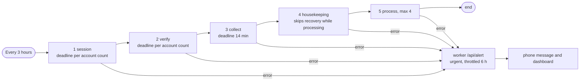

# Roadmap and review log (1.4 onwards)

Working documents: record requirements, design of each phase and results of 3 review rounds of each phase (so as not to lose when doing multiple sessions).
Convention for each phase: (1) do, (2) **review round 1 — static**(reread code, lint, code matching documents), (3)**round 2 — dynamic** (real run, real measurement),
(4) **round 3 — independent** (agent only reads code, or compares measurement data), (5) corrects all findings before moving on to the next phase.

| Phase | Content | Status |
|---|---|---|
| 0 | Run completely from the new folder, new data, stop using the old folder | and finish |
| A | Folder layout and module division (worker, agent) for easy reading and expansion | finished |
| B | Analysis quality (preserve / Vietsub / voiceover) and video quality | finished |
| C | Search and synthesize by topic, post to multiple accounts on multiple topics | finished |
| D | Performance and speed | done |
| E | Content as requested by channel owner + review of quality, performance, security, expansion (version 1.5) | completed (3 rounds) |
| F | Output quality: dubbing, sound, blurring of original subtitles, subtitles (version 1.6) | completed (3 rounds, 2 independent reviews); There is one thing that has not been verified, see the end of section |
| G | Multiple TikTok accounts: expired session, post lock, CAPTCHA, interface by account, profile backup | complete error correction; Some items are left to the discretion of the owner, see item |
| H | Performance: actually measure and then only change to the one with data (build, collect) | finished |
| I | Product quality: honest control panel, reason for not posting, errors in Vietnamese, the first installation order of | is mostly completed; For polishing, see section |
| J | Review of design and implementation ("is it optimal?"): measure, two independent reviews, fix the eight confirmed defects | fixed and tested; the rest is listed in the section's "Not fixed" |
| K | Workflow reliability and visibility (plan from the phase J evaluation): failed steps are seen, agent jobs have deadlines, housekeeping respects the processing lock | planned; not started |

## Phase 0 — Move completely to new folder (done)

- Stop agent and container of old directory (at master's explicit request), rerun using `./trendvn install` from new directory with **new database**.
- Keeps two things that are hard to recreate: the Gemini key and the TikTok login session (tested `logged_in: true`); All old video, queue, and n8n data will not be carried over.
- Deleting the old folder and old n8n volume is done by the owner himself (see instructions at the end of the report); The new directory does not depend on them.
- Check: `doctor` green (except full disk and user work), real collection from new system (Douyin read 49, Kuaishou 97), TikTok session still logged.
- Computer drive only has about 2 GB left (99% full): real risk for video editing; See end of report.

## Phase A — Module layout and division

Make: two applications into a Python package (`trendvn_worker`, `trendvn_agent`) divided by job; Every file has a responsibility; The longest function is 67 lines; testing divided by service; version pin formatting tool; redeployed the system running with `./trendvn update` (reinstalled the agent's background service according to the new layout).

**Review 1 — static.**ruff, black (pin copy), shellcheck, doclint are all clean; re-read the longest function and split `process_one` (98 lines) into steps `_source/_look_alike/_voice_or_subtitles/_checked_output/_write_manifest`, `_publish_one` (88 lines) into 5 steps. Detected**error caused by the split itself**: local variable `shot` obscures the function `shot()` in the post (any errors before clicking Post will become `UnboundLocalError`; the old code has a different name so it doesn't happen). Fixed by splitting the function and adding 11 tests running the post with fake browser (every branch: missing file selection box, expired login, pre/post-click verification, duplicate description, private post...) and 12 tests for `process_one` with fake ffmpeg/Gemini (no tests previously called it directly).
The e2e layout tester flickers once when the device is busy (measured when the page has not scrolled to the top): now measures after the page is still and clearly reports if it does not scroll to the top; Run again 6 times, even when the computer is full of CPU: green.

**Review 2 — dynamic.**`./trendvn update` on real system: agent background service rewritten to `-m trendvn_agent`; `doctor` green; real collection via new agent (Douyin reads 49, reaches threshold 4, downloads 2); `./trendvn test all` (end of Phase A: 189 tests on machine and in Docker image, real video editing with ffmpeg, 76 real Chrome tests on 7 screen sizes).**Review 3 — independent.** Two read-only agents compare the old code (`9dbd527`) with the new code. Agent: no errors or unexpected behavior changes (AST comparison of each function, constants, browser operation order, timeout, data path); 6 small notes have been resolved: `agent.sh` now recognizes the old `server.py` process when stopped, `SECURITY.md` still has the old name (`publisher.py`, `_looks_blocked`) and doclint now catches this type of error, the test mistakenly wrote to the real `data/agent/agent.log` and now writes to the temporary folder.

## Phase B — Video and analysis quality

Milestone (real video loaded from Douyin at the start of phase, run in image worker with real Gemini key):

| | Video 1: skit 1080×1920, 78.6 seconds, with Chinese hard subtitles | Video 2: live music 1920×1080, 152.9 seconds |
|---|---|---|
| Gemini decides | `mixed`, 12 lines of voice → **Vietsub**(correct) | `music` →**hold raw** (correct) |
| Pre-phase build | 30.8 seconds, 24.8 MB; Vietnamese subtitles overlap Chinese characters, appearing messy; fastest line 21 chars/sec | 68.5 sec, 59.8 MB |
| Build after phase | 24.9 seconds, 19.7 MB; Chinese characters are hidden behind a blurred strip, Vietnamese subtitles are located exactly on that strip; fastest line 17 chars/sec | (separate encoding measurement below) |

Done (technical details: `docs/PROMPTS.md` item 3): decision table kept / Vietsub / voiceover into a function with reason displayed on the video card; cover the original video's hard subtitles; extending the subtitle stream's display time too quickly; encoder `veryfast/crf 24` (SSIM 0.992 vs reference crf 12, about 40% smaller and faster); measure the volume during the test decoding; blocking the voice from reading unusually fast.

Lessons learned (and redirected accordingly):
- Cut/sync subtitles by sound level (silencedetect) **cannot be used** with real videos: Douyin skits always have background music so the sound is constantly loud; Gemini gives a time stamp of almost a full second (error of about ±1 second). This idea has been abandoned.
- Getting Gemini TTS to read quickly to fit the lyrics window makes it **miss entire sentences** (matches 79% of words when listening back with Gemini), default speed matches 100%. Keep default prompt, speed up with `atempo`, add blocker.
- Unchanged `loudnorm`: actual measurement brings music -10 LUFS to -14.1 and dialogue -14.6 to -14.5.

**Review 1 — static.**Reread all changes; ruff/black/shellcheck/doclint clean; constant in code matching document.**Review 2 — dynamic.**Run on real video as shown in the table above; `./trendvn test all`: 212 tests on the machine and in Docker images, 76 tests on real Chrome. Unverified: Gemini actually reported the correct position of the hard subtitles (video API overloaded with HTTP 503 all day; the new schema has been accepted by the API and the translucent strip has been constructed correctly with the hand position), so try again when the API is free.**Verify 3 — independently.**An agent tries to break with 486 combinations (11 source geometries × 18 range values × 3 constructors) in the image worker. Three real bugs, fixed and tested: (1) the audio line is absolutely silent (empty) causing `loudnorm` to output NaN and the AAC encoder rejects:**error from version 1.3**, now the "silent" video has no volume adjustment (also avoids amplifying the hiss to -14 LUFS) and the NaN error is retried once without correction; (2) the band at the bottom edge of the image is so small that the 4-pixel band is rejected by ffmpeg; (3) too large integer in `hard_subtitles` throws `OverflowError`. After repair: 486/486 works fine. Tested `decode_check` with corrupted/truncated file (threw `ValueError` immediately, didn't hang), very short sound, 10 minutes of sound: ok.

## Phase C — Search by topic and multiple accounts

Real survey before design (Real Chrome, customer not logged in): **Douyin and Kuaishou search cannot be used** (Douyin shows CAPTCHA page, Kuaishou returns `{"result":2}`; system never solves CAPTCHA). What works: Douyin's `jingxuan` page has 13 topic tabs, each for about 40 individual videos; Kuaishou only has one stream "推荐" for guests; TikTok (needs US IP) has category chip.

Measurements that underpin the design (520 real Douyin videos in 13 tabs): only 12% of videos in a tab reach the 150k overall stream heart mark, median video age is 39 days (7-day limit only passes 10%), 40% of videos are longer than 180 seconds. So the thread uses 15% of the hearts/views threshold and allows 4 times as much old; A hard threshold of the common thread will starve every small thread to death. Suggest topics with keywords (no Gemini votes): 67% of titles have keywords, 67% hit, over half of data retained for checking; The source's category itself is also noisy (the "Music" tab and cooking and rural videos), so the suggestion is only for **to choose to download**, Gemini will decide the final topic.

Made: 14 theme menu; table `accounts` (self-transferred database, tested on real database copy of 1.2: 58 videos remain the same); post per account (golden hours, limits, spacing, separate Chrome profile); tabbed Douyin collection in one page opening; choose split load between topics; account interface and API; `tiktok login --account`.

**Review 1 — static.**Reread all changes, ruff/black/shellcheck/doclint clean; detected and fixed when writing tests: common thread's topic hint is overwritten by tab in the correct order (tab knows better than keywords), `target` is no longer a save setting but the name of the default account (keeps the old API running).** Review 2 — dynamic.**On real system: Database v1.3 → v2 moves automatically; Real Douyin collects 250–270 videos/time (before 49) through 6 streams; Topical candidates in the right groups (comedy 10, pets 10, lifestyle 8, music 7, family 4); 82 real Chrome tests including adding account flow, tapping theme selection, saving, deleting; Gemini actually classifies live music videos as `music`, not recognizing lyrics as hard subtitles.**Review 3 — independent.**One agent tries to break: 2300 random sequences (about 175 thousand operations) vs. independent model, 0 violations; 6000 malicious input, indicating `ValueError`; Migrate database with 8 processes at the same time, no errors. Two real and risky errors,** has been fixed and tested **: (1) accounts that are not logged in are always selected first, burning the 3 best videos to "To be seen" and starving other accounts (now: accounts known to not be logged in are ignored, not counted as video errors, accounts that have just failed are ranked behind other accounts); (2) the confirmation box in the video card states the wrong account when no account claims that topic. Risks: reading the list of accounts outside the lock (deleting the account at the right time and still receiving posts), the video is finished but no account receives new collection blocking, Chrome profile logs into the wrong account (now check the real login name in the TikTok page before posting, tried on the real profile), the tab mistakenly receives a late response from the previous tab (now assigned according to the tab code in the request), the entire read stream is lost when a tab has an error, short Latin keywords match between letters (`cat` in `location`), backup/restore only takes care of profile `publisher`, TikTok chips do not rotate, old posts without accounts are charged to the current default account.

## Phase D — Performance and speed

Measure each step on real video before editing (horizontal video 153 seconds): Gemini about 65% of a video (30–100 seconds and often has long 503 errors), edit 40 seconds, preview 6.5 seconds, test 4 seconds, fingerprint 1.2 seconds; acquisition 107–205 s; console page 8–12 ms (no optimization needed).

| Job | Front | Rear |
|---|---|---|
| Process multiple videos | each video in turn | 2 videos at the same time (`TRENDVN_PROCESS_PARALLEL`), throughput nearly doubled because most of it was waiting for Gemini |
| Vertical music video without lyrics (preserved) | reconstructed 24 seconds, 24.8 MB file | reproduced 3.3 seconds, 13.8 MB, every pixel is the same as the original |
| Douyin collection (6 thread threads) | constant wait ~95 seconds | adaptive wait ~60–75 seconds (per tab 6–12 seconds, still 40–59 videos per tab); Kuaishou/TikTok hold fixed |
| Preview sent to Gemini | 2fps | 1fps (Gemini only takes 1fps); Encoding time remains constant because it is dominated by decoding |

Try and **does not change** because it is not faster: 9:16 frame filter (1080p decoding and image shrinking takes up more than half; `fast_bilinear`, layering, number of threads all fail), `-filter_complex_threads`. `thinkingConfig`/Gemini low resolution could not be measured during this session because the API was continuously overloaded (503), so it did not turn on; If enabled and the API rejects it, it will ruin every analysis.

**Review 1 — static.**Reread changes, add each tab time log to `agent.log` (`read jingxuan_pets: 40 videos in 9s`) for measurement. Runtime detection: adaptive waiter treats all graphql responses as "page replied", including configuration responses without video (Kuaishou returns 3 videos instead of 96): now only responses with video are counted.**Review 2 — dynamic.**Run the collection many times on a real system: Douyin 6 streams of 40–59 videos each (with fixed standby), each scan 60–75 seconds. Kuaishou direct comparison between fixed wait and adaptive wait**indeterminate**: page limits on repeated loading (0 to 98 videos with both encodings), so Kuaishou/TikTok keep fixed wait (lesson: don't compare on a page that is limiting you). True vertical music video created with full copy: 3.3 seconds, the image is identical to the original pixel by pixel, the volume is brought to -14.4 LUFS.
**Review 3 — independent.**A test agent breaking: 32 stressful scenarios for parallel processing (1–4 threads, 25–60 videos, 0–96% Gemini emulated errors, background thread fixes settings): each video processed exactly once, no hangs, no "database is locked", Gemini quota not exceeded; 33 sources synthesized via full-image reproduction (B-frame, mov, 0.5 second audio difference, two audio tracks, cover art...): all valid, audio-visual deviation ≤ 0.004 seconds; 3000 random stream reader attempts: no violations.** Real error, fixed and tested: **(1) two identical videos processed at the same time both passed the duplicate check (fingerprints were only recorded when finished): now check and record in the same transaction; (2) worker's new queue index is not used by the collector (video is finished and no one receives it, still blocking collection): connected; (3) the summary sentence "there are no videos" is incorrect when the two runs are finished in the wrong order; (4) `tiktok login` closes the window as soon as there is a cookie even if the wrong account is logged in: now wait until the correct name. Risk handled: roll stops after**hai** consecutive empty rolls; TikTok chip waiting to appear before quitting; "not logged in" flag clears after every post that passes through the login step and after `tiktok status`; "error" status is no longer carried by disabled/deleted accounts; Sign in manually to avoid knowing the account is not logged in; Reject any videos that are rotated/flipped away from the original image; `TRENDVN_PROCESS_PARALLEL` typing incorrectly does not cause the worker to die on startup.

Not done / not verified (to be frank): Real Gemini reports hard subtitle position (video API overloaded both days), American source (TikTok, Instagram) because of Vietnamese IP, real posting to many accounts (only one real account; many accounts are checked with a random model of 2300 strings and fake browser), real macOS, running for a long time with a real schedule.

## Phase E — Version 1.5: verified sensational content + system-wide review (2026-10-02)

Channel owner's requirements: the more sensitive and sensational the content, the better, as long as it has been proven to be attractive by other platforms; recheck quality, interface, logic, performance, "100% error-free", scalable layout; Run the test at least 3 times. Honest answer about "100%": **no one can prove 100%**; The lower part lists what has been verified (with numbers), what has not, and remaining risks.

**What to do.** (1) Content policy: only "hard limits" block videos (see docs/PROMPTS.md section 2.6), add topic `news`, caption description (`caption_style`), outreach hashtag. "Proven to be attractive" is done by collector's trending portal (TikTok/Kuaishou from 1 million views, Douyin from 150 thousand hearts, new in 7 days, score = interaction ÷ age^0.6), not by promise. (2) Two rounds of revisions following review (security; logic, performance, expansion), then a third round after independent review.

**Review 1 — static.**Compare current standards (OWASP Top 10:2025, ASVS 5.0, CWE Top 25 2025, SLSA v1.2, RFC 9700, Core Web Vitals) via skill `engineering-standards`; reread all changes; ruff, black, shellcheck, doclint, hidden character check (new) are all clean; documentation is compared to constants in the code (15 themes, function paths, account login API, performance metrics).** Review 2 — dynamic (on real system).**Run new version on real database copy (221 videos, version 3 → 5, no data loss, theme of `main` remains the same); real deployment using `./trendvn update` (n8n boots normally with `cap_drop: ALL`, RAM/process limits correct, project's old Docker image cleaned up); call real API (`housekeeping`, `media/pending` according to platform, error 400 instead of 500); open console in real browser: no console errors, tab runs (CSP by hash code works). Measured on a fake database of 20,000 videos: `record_stats` 200 entries 927 → 9 ms, page creation 52 → 39 ms, `status` 22 → 17 ms. Try the real Gemini again: still 503 "high demand" (see unverified part). Test suite: 437 unit tests on the machine and the same number in the Docker image with ffmpeg, 82 e2e tests with real Chrome (7 screen sizes, all button click threads).**3 — independent review (3 read-only agents, each writes their own test code).**
- Agent A (security, before fix): 4 real security bugs (console opens with fake `Host` from network; heartbeat too large corrupts settings causing 500 every page; `resolve_unknown` receives `javascript:`; server has unlimited connections/time) and a string of mishaps; All fixed (commit c6eda9a).
- Agent B (logic, performance, extension, before fix): candidate "latest 100 videos" instead of best, wrong data label, full disk is repeat risk, missing index, adding source must fix 9–11 files; fixed (commit ef6168a).
- C Agent (review of edits): ~1,000 random strings for disk cleanup, 20 old databases + 400 concurrent opens, 288 malicious requests to login portal (0 passes), 150 concurrent connections, 53+53+36+25 SSRF URLs, 100,000 text filter runs, 120 interface comparison data sets old/new, 100 queue operation sequences, and detected **2 errors + 11 risks**caused or missed by the fixes themselves: `/login` reads unlimitedly when `Content-Length` is negative; Login session cannot be revoked; disk cleanup mistakenly deleted shared files, deleted according to `mtime` set by yt-dlp, malformed `source_file` deleted also `inbox/`, recorded "done" for failed deletion; Quadratic regex crashes worker for 3–31 seconds; start loop error when a database line fails; Scan TikTok and skip the entire turn because of an empty chip; reverse proxy nginx opens passwordless console; unchecked video download redirection; silent disk warning; and minor text filter errors (opening date, time, "Mr.Co" being treated as a phone number/domain name).**All fixed and regression tested**, except items recorded in docs/SECURITY.md section 7 (byte-by-byte drip attack on server only mitigated by 48-thread limit; text filter is heuristic).

**Not done/unverified (to be honest).** (1) Gemini really recognizes hard subtitles of comedy videos: Video API reports 503 "overloaded" for two days; Only concert videos are analyzed for real (correct title, theme, musical theme description). (2) US source (TikTok, Instagram): no US IP yet. (3) Post as many accounts as possible: only have one real account and do not turn on self-posting; random model and test scenarios tested by simulation. (4) macOS, Docker Desktop (the connection source address may be different from the Docker bridge port: there is `TRENDVN_TRUSTED_PEERS` and the error message states the correct address). (5) yt-dlp reads proxy via environment variable: not running with real proxy yet. (6) CI GitHub: file already exists, not yet running on GitHub. (7) Run for many consecutive days with schedule on. (8) "Content is definitely viral/will never be removed": there is no way to guarantee; The more controversial the content, the higher the risk of being removed/reduced in distribution (docs/SECURITY.md section 1).

## Phase F — Version 1.6: output quality (2026-10-02 to 2026-10-05)

What to do: fix the biggest bug (the voice always reads the instructions), dubbing takes priority when appropriate and chooses the voice according to the speaker, balances the dubbing sound, conditionally blurs the original subtitles, removes the made-up subtitle lines. Measurements and reasons: `docs/QUALITY.md`; change: `CHANGELOG.md` section 1.6.

**Review 1 — static.**Reread all changes after the first independent review (20 files, +374 lines). Confirm the order of `except Transient` before `except RateLimited` is correct (`Transient` is a subclass of `RateLimited`). Lint, ruff, black (pin copy), clean doclint.**Check 2 — dynamic.**`./trendvn update` on real system: worker 1.5 → 1.6 (`doctor`: "Worker correct version of code"), n8n schedules are still disabled. The drive is only 1.8 GB free and the Dockerfile has changed order to `ARG` (450 MB ffmpeg layer must be reloaded), so delete the Docker build cache (897 MB, cache only) before building. `./trendvn test all` catches**two errors in the test that the test loop on the server ignores because there is no ffmpeg**: the TTS emulator writes to `*.wav.part` (ffmpeg cannot choose the format), and the test uses the same folder for many scenarios, so the new voice buffer is stuck. Fixed both.
**Review 3 — independent, twice.**
- 1st (2026-10-02): findings and corrections are in `docs/QUALITY.md` items 7 and 8 (fabricated lines, silent/prolonged voice, audio peak above 0 dBTP on loud music).
- 2nd time (2026-10-05, read-only agent, tested in container off network, with mutation testing for each fix): **2 real bugs, 6 risks, 8 fixes, no tests to block **. All processed. Items 1 to 6: new test is run on unmodified code and fails before fixing (only `-f wav`: if it is omitted, test for muxer error). Section 7: Mutation test, remove each fix (analysis key, valid port, memory and wait limit of shortened text, regex model TTS 3.x, empty sound check, peak limiter, `\\N`) then 8/8 have failed tests. Notes:
  1. **The approved video is queued forever when Google is busy creating voiceovers**: the delay counter is set to zero at each run because of the flag `approved` stay on line. Now reset once, when browsing (`Store.decide`). Reproduction before editing: 8 consecutive runs evenly `rate_limited`.
  2. The mp3/ogg to WAV conversion branch is broken with the name `.part`: add `-f wav` (test only runs in containers; tested for mutations: remove `-f wav` to test for muxer errors).
  3. Second voice generation: wait up to one round (25 seconds) instead of 100 seconds and 12 calls; one step faster instead of jumping from slow to fast (the second version cannot be closer to the window than the first, costing one call per day limit); all its errors keep the original version (previously `wave.Error`, `EOFError` damaged the dub version).
  4. Gemini: only 429 but the error details state the limit **by day** will skip the wait, and only if all error models do. 429 minutes are still waiting (previously, every 429 with the word "quota" was considered expired, each time it took one of 4 voice delays).
  5. The analysis file of the previous version (without description and model in the key) can still be used: otherwise, each video waiting for approval or waiting for voice will cost one more video call after deployment.
  6. Silent voice file deleted on rejection; `\N` (ASS line break) is no longer read as "N".
  7. New test for previously untested versions: locked analysis by description and model, broken answer not remembered, shortened speech memory, regex model TTS 3.x, hollow sound, case of voice lasting longer than the entire video (speech window less than 2 seconds at the end of the video; old test state cannot occur).
  8. Code deviation documentation (14.5/19 beat threshold, 429 handling, root downwindow, caching, peak limiter, API call overhead) and CHANGELOG missing fixes: updated.
- **Peak limiter (`alimiter`) has no dynamic tests that can differentiate it.** Tested 7 built-in background music in image worker: peak shift no more than 0.3 dB in both directions, all peaks below -2.7 dBTP. The measured value is only at the base of the reviewer's pulse (+3.9 → +0.3 dBTP, still not guaranteed to be below 0). Just test to make sure it's connected to the right place.

Final result: green `./trendvn test all`, including 511 tests on the machine (16 skipped because there is no ffmpeg), 511 tests in the container with real ffmpeg (not skipped), real video editing steps with ffmpeg, 82 real Chrome tests.

**Not done/unverified (to be frank).**(1) Run a complete voice-over video from start to finish on real Gemini:**did 2026-10-05 with the owner's consent**, in a temporarily isolated data folder, the source is a Chinese video of a person speaking by Gemini TTS created (no real Douyin video yet, one person said going all the way). Result: Gemini received `narration`, `dub_ok = true`, correct Vietnamese words; The first vocalization (slow beat) is 15% longer than the lyric window, so the second time is one step faster (correct new version) and choose the closer version; `route = voiceover`, −15.0 LUFS, −3.8 dBTP peak; Gemini listened and copied 74/74 words correctly, clear male voice, small original sound below. (2) Male voice other than Orus (the course's daily limit expires while listening to the test). (3) Error 429 details by date have not been compared with Google's actual response; If it's wrong, the system just waits for enough rounds (slower), the result will not be wrong. (4) Voice buffer lock does not include `tts_model`: change model between two runs to reuse voice of old model (noted, small risk). (5) Listen with human ears: "Listen to voice reading" in More → Settings.

## Phase H — Performance (2026-10-05): measure for real then only change what has data

Measurement context (read-only survey of an agent, then I measured it myself with real video): n8n runs collection and processing every 3 hours, each time only about 5 minutes of work in 180, so the seconds saved are mainly useful for CPU, disk drive and hand button clicks, not for output. The queue, Gemini turn counting and voice overlay on the edit is in `pipeline.py`/`store/` (another session is in charge), this part only includes `media/` and `collector/`.

**Converted (with measurements).**Original subtitle blur strip (`media/render.py::_blur_band`) calculated on**1/4**scaled version of the strip and then rescaled. Measured on real video that needs blurring (134 seconds, 43% of duration has blurred bands; run interlaced 3 times, container turned off network): build**44.8 seconds → 36.4 seconds (−19%) **, same capacity of 43.2 MB. Figure: SSIM of the band compared to the old version 0.988–0.996, average PSNR 47.7 dB (lowest 36.8 dB), placing the frames next to each other does not see any difference. Thin strips below 48 pixels keep the old way. New test `tests/worker/test_perf_blur.py` (graph shape, radius does not exceed the allowed limit, ffmpeg accepts all 42 combinations of video size × strip position, SSIM compared to the old version); Mutation check: removing relaunch, not dividing radius, removing time gate are all captured.

**Measured and NOT changed.**
- Attach `enable=` to `boxblur`/`eq` only: −5%, within noise threshold (42.4 s vs. 44.8 s, one run to 47.2 s).
- Encoder, remeasured after reducing filter cost (survey told to do so): `superfast` crf 24 is 19% faster (32.8 seconds → 26.5 seconds) but capacity **+35%** (43.2 → 58.2 MB), `ultrafast` crf 26 is 39% faster but +58% and SSIM 0.974. The general survey recorded "+1% capacity" because the clip was self-edited; On video it's completely different. The drive only has a few GB left and TikTok has to upload each file, so keep `veryfast` crf 24.
- Include QC checks (decoding the entire file) into the edit: saves about 4 seconds per video (4–5%) but loses an independent decode blocking the failed edit before reaching TikTok. Not worth the trade-off.
- Douyin collector timeout: add a time log line for each scroll and each tab switch (`agent.log`: `scroll 1/2: +20 videos, answer after 0.2s, settled after 1.2s`). 5 real scans (20 tab reads, 40 scrolls): when there is a post-roll response, it comes after 0.1–2.6 seconds (13 times: 0.1; 0.2; 0.2; 0.4; 1.4; 1.5; 1.7; 1.9; 1.9; 2.0; 2.1; 2.4; 2.6), so the 3-second waiting ceiling is in place (withdrawal 1.5 seconds will take 8/13 responses). 11 of the 20 tab reads had both empty scrolls (6 seconds of empty wait), totaling 81 seconds out of 196 seconds of tab reads (41%). The second roll after an empty roll never adds a video (0/11); Removing it saves about 6.6 seconds per scan (~13% of Douyin browsing time) but the sample is only 11 cases and the two-times-empty rule is intentionally set to prevent slow responses, so **remains unchanged**; Collect a few more days of log and then decide (count in `agent.log` the lines `scroll 2/2: +0 videos` after one `scroll 1/2: +0 videos`).
- Preexisting and still correct: Kuaishou fixed wait (Phase D), 9:16 filter, ffmpeg stream count, hash/ffprobe/cover art (each less than 1% of the time a video).

**Unmeasured / other session's work.** SQLite query at 20x data, Chrome memory over multiple scans, hypothesis "WAL `synchronous=FULL` slows down 4–9 seconds before Gemini call", actual TTS call time, `needs_review` not included in load queue (disk full risk) latent).

## Phase G — Multiple TikTok accounts (2026-10-05)

Survey using a read-only agent running code in a repository replica (dummy clock, temporary database, fake browser, 44 mutations on 4 multi-account modules). What has been maintained: limit/distance/golden hour per account, lease check at end, profile name per account, blocking account deletion, real database can be transferred to the second account. What's been fixed (each item has a failed test if the edit is removed):
1. **Expired TikTok session blamed on video.**Upload site moved to `/login` previously paid `failed`: eight runs made two out of four videos good at "To be seen" after three "failures" (and review costs one Gemini per video). Now return `signed_out` (postponed, excluding video errors, not logged in flag) and report when first detected, a notification for each account with name and command `./trendvn tiktok login --account ID` (phone: maximum every 6 hours). Checking the 3-hour session only sees cookies, but the TikTok session that ended still has cookies, so it** cannot clear the logout flag** was found by a real post (previously the flag flipped every 3 hours, wasting a useless Chrome opening); Only a login command or a post that has passed the login page can clear the flag; If the session check is detected first, the master will still receive a command notification.
2. **A suspended post (agent dies midway) blocks all accounts for up to 3 hours 45.** Now every time I request a post, `publishing` that is older than 45 minutes is changed to "unconfirmed" (`expire_stale_publishing`, shared with `housekeeping`); Only that account waits for the owner to confirm.
3. **CAPTCHA does not state an account.**Notifications, "Need to see" tags, button block reasons, and commands all state `trust --account ID`; Verification solution for another account that did not unblock (`set_challenge(active, account)`). Independent review found: `tiktok trust` for default account sending `account: None` and unblocking of**every** account (fast launcher on Mac always runs for primary account); now send `main`. Strange account codes must not be saved or copied into orders for the owner to copy; Corrupted flow no longer unblocks errors; Deleting an account unblocks it; The double-click suggestion on Mac is only available for the main account. If your old agent doesn't send your account, you can still remove it.
4. **Interface using global numbers for rules by account.** "Post now" confirmation box uses the limit and prime time of the account to post; An unconfirmed post only disables that account's Post button, not every video; `tiktok dry-run --account ID` previously quietly ignored `--account`, now rehearsing for that account.
5. **Backup** Chrome profile no longer carries cache and key files `Singleton*` (`pack_profiles` in `scripts/lib.sh`, tested); The gap "backup only takes care of publisher profile" has been closed before. `pack_profiles` returns code 10 when there is no profile (warning only) and `tar`'s code when packing error: `backup.sh` stops instead of writing a copy missing cookies (independent review reproduces: unreadable Cookies file outputs a 247-byte packet that still prints "Backed up"; `restore.sh` deletes the current profile and then unpacks the packet).
6. **Test gap:**8 mutants survived the entire test suite (session heartbeat only for active account, account name comparison, `login` accepts wrong account, `unresolved()` missing account, hand blocked by unconfirmed post of another account, post button selects logged out account, `default_account` ignore `enabled`...) are now captured, along with 4 new mutations of the above fixes (December 12).** Leave it for a reason (not done yet).**
- *Choose videos according to professional or general accounts:* accounts with four topics unlimitedly get videos from professional accounts (simulation: 3/4 pet videos, professional accounts post 1/2). It can be fixed by saving videos for the dedicated account that has a limit, but the trade-off is that the general account may be waiting: **needs the owner to prioritize**.
- *Collection backlog is global:* one account is full with 4 videos ready for collection to stop (`max_backlog = 4`); Modifying the contract of the collector, medium risk.
- *New unverified accounts can still be selected by the schedule* and *if accounts cannot be read but still posted* (intentional, behavior blocking test): change, all tests using `add_account` and then `claim` must change, small benefit because after the fix 1 wrong selection is harmless; Open failure detection is so that once TikTok changes the interface, it does not stop the entire system.
- One visit of `claim` every 30 minutes limits throughput (5 accounts × 4 posts: want 20, post 14); increase increases the posting rate from an IP.
- All accounts share the same IP and browser fingerprint; Vietnam fixed time zone; There is no command `tiktok forget` to delete the deleted account's records.

**Cannot be verified without a real second TikTok account (and the system never posts for real without the owner's consent):** Does TikTok keep the cookie `sessionid` after the end of the session, identifier format of the second account, CAPTCHA frequency when 2–3 accounts post from one IP, post and authenticate for the second account, Chrome behavior when two processes open the same profile or after restoring to another device, increases profile size by account, notifies real phone.

## Phase I — Product quality (2026-10-05)

Survey with a read-only agent that builds an isolated console (port 5699, dummy data, Chrome at 360, 768, 1440 px) and reads the code; Each item below is tested in code before editing, and the test fails if the edit is abandoned.
- **The first installation order did not work:** README, `install.sh`, `docs/MAC.md` told to log in to TikTok before setting the target account, but the login command only accepted that name (repeated for 10 minutes then `TIMEOUT`). Reversed two steps and used a different name ("Default TikTok Account"); clearly state the n8n schedule to turn on immediately after installation.
- **The "Fully automatic" bar may be wrong: ** is green only when setup is complete, there are no more things to watch, there are no videos waiting for approval (even after turning off "Manual review": the schedule to only post videos has been released) and both departments have reported for 7 hours (previously it was 30 hours, so the schedule to turn off all day is still green); The orange bar says which is missing, and distinguishes "not reported recently" (calendar may be turned off) from "error reporting" (owner needs to log in or see Status, not n8n).
- **No one said why the video hasn't been posted yet:** the "Ready to post" tag has a reason line in the correct order of the check schedule (switch off, waiting for approval, TikTok verification, another post is posting, account's unconfirmed post, account logged out, outside of prime time with open time, today's limit is met with number, **distance between two posts with remaining time**, the video just broke for 1 hour, or "will post next check"); The first version lacks spacing, the video has errors and the post is being submitted so I promise to post scheduled videos and will reject it (spacing is the most common reason between two posts).
- **The wrong Gemini key looks like many broken videos, in English:** 401/403 and 400 mention this key keeps videos in a queue (`blocked`) instead of moving each video to "To Watch" with a review button that doesn't help. Independent review shows that the status only has phone notifications (optional, maximum every 6 hours), so the banner is still green: now there is a `gemini_key_rejected` flag displayed in the banner and the top tab of the To See tab (counted in the To See number), automatically deleted when a Gemini call is successful or when a new key is saved. A model that refuses to lock (403 specific to that model) is ignored and a backup model is tried; Only when every model refuses will it be considered a false lock.
- **English/internal text leaked into the interface:** 11 reasons for keeping videos and form errors (eg `daily_limit must be an integer between 1 and 10`) now have a translation table (`vi_reason`, `vi_error`) and test scan of worker files where errors and reasons arise (domain, store, web/forms, tasks, pipeline); The sentence written in Vietnamese was not replaced by a shorter sentence (the original version swallowed the words "Gemini key was rejected by Google..." into "can try again with the Browse button"), the notification of the external service (Gemini HTTP...) kept the same words, two expressions that were too broad (`must be one of`, `must be true or false`) were anchored at the beginning of the sentence; Expired page after update returns a Vietnamese page, not JSON `{"error": ...}`; The event log is missing 9 labels (`account_added`, `caption_edited`, `challenge_on`, `expired`, `publish_deferred`...) but now it's enough, there is a test to scan all event names recorded by the worker.
- **Owner can't read title is deciding:** lists (Queue, Need to watch, Posted) show **Vietnamese description** (remove hashtag) with small source title below; The "Unconfirmed Posted" tag lists the account, description, and how long ago it was.
- **Mismatched count:** "Pending (60)" which only listed 30 lines now says "30 of 60"; The "To Watch" count counts all videos on hold (previously cut off at 30) and the tab says "30 of 35" when only partially visible; "Views (last 30 posts)" is "—" when no views have been read instead of 0; "Started..." flag no longer appears after reload (remove `?ok=` from address); Collect steps where all sources failed or were skipped now report an error instead of "Done".
- **After restarting the machine / disk full:**`./trendvn doctor` uses the same threshold as console and worker (GiB units: yellow below 2, red below 1, previously red was below 3 GB so always red on this machine) and added systemd's `linger` check (agent only runs on its own after the master logs in screen if not turned on `sudo loginctl enable-linger`;** this machine is not turned on**). OPERATIONS.md fixes code errors (the "Waiting for your approval" tab is in the Posting tab, three lines become four, hang handling, automatic cleanup, test number).
- **Measured, not an error:** found that the survey's "line break captions are lower than the actual width, two lines into 3–4 lines" of the survey does not reproduce: real libass gives the widest line 875/901 px (97%) at 1080×1920 and 592/602 px at 720×1280, and every 2-line block still outputs 2 lines.

**Leave (not done).** Green source tag "Active" when the last run of that source failed; private phone notifications when the calendar appears to be off; "Clean Now" button for disk; The reason for "duplicate videos" in duplicate image tags; accessibility (`aria-current` for scrolling navigation bar, skip links, items that reopen after 90 seconds of self-refresh, text "Score 900,000" without caption); The description and hashtags are still standard (always add `#xuhuong`, `#viral`: according to the owner's "accessible hashtag" request in version 1.5, so they don't change), and there is no effective table in the Vietsub/dubbed/maintained style.

### Third round independent review for Phase G, H, I (2026-10-05)

A read-only agent destroys the entire change tree (55 mutations in clone, measuring SSIM 90 real ffmpeg graphs, running test suite): 10 real or risky errors, 17 surviving mutations. Fixed everything and added a re-capture test: de-verified with the main account and unblocked another account; Rejected Gemini key does not appear on the control panel; The line "why hasn't it been posted yet" promises to post when the schedule will refuse (distance, video error, post being sent); Vietnamese sentence translation table; `backup.sh` swallowed packaging error; logout flag is cleared by session check every 3 hours and lost message is detected by session check first; `set_challenge` crashes when the save line is corrupted and strange code is copied into the command; The banner has the wrong words when the uploader reports an error and when there is still a video waiting for approval after turning off manual browsing; a model 403 stops the entire queue; Number Need to check card number deviation; two translation expressions are too broad; The thin strip test does not check anything and does not capture a radius that has not been divided into 4; missing character escape test of `headline()` and account connection between agent and worker; The two test classes are behind `unittest.main()`.
**Noted, not changed:** (1) the safety margin of the 45 minute mark (`STALE_PUBLISHING_SECONDS`) is just arithmetic: the total maximum wait times of the agent when posting is estimated at 32 minutes and nothing extends `updated` during posting; A post that is actually older than 45 minutes will become "unconfirmed" (no loss, no duplicate posts; `verify` can only restore public posts). (2) `pack_profiles` not tested on macOS bash 3.2 (bash 5 only). (3) Phase H's −19% and SSIM measurements made on real video are in this machine's `data/worker/inbox`; The review agent does not have that video so it should be re-measured on the synthetic clip: 90 graphs, 0 errors, SSIM compared to the old version median 0.994 (range from 48 pixels), lowest 0.916 in 360-point wide video, lowest from 540 points or more 0.988; thinner strip of 48 identical pixels (1,000).

## Source language maintenance — 2026-10-25

Documentation, comments and docstrings now use English. Required Vietnamese runtime strings retain their values through escapes. macOS launcher names and documentation-lint history markers were updated consistently.

Verification: all 156 Python files retain the same executable AST after normalizing docstrings and the intentional launcher/serialization/doclint changes; all six generated workflows retain the same parsed JSON values. CLI help output is byte-for-byte unchanged. The 606-test host suite reports the same pre-existing backup-permissions failure and 18 skips before and after this change. No live services were updated or posts published.

Independent review verified 407 tracked text files across the three repositories, 86 relative Markdown links, 32 JSON examples, 36 shell examples and 10 safe old/new Bash output comparisons. Findings fixed: residual Vietnamese tilde letters, one misleading password-entry instruction, three unaccented Vietnamese documentation phrases, and shellcheck’s multiline-quote warning. No additional runtime regression was found in the focused review.

## Design and implementation review — 2026-10-27 to 2026-10-28 (phase J)

Question from the owner: is the design and implementation as optimal as it can be? Answer: **no, and it cannot be claimed**; the foundations are sound, eight real defects were fixed, the rest is listed below.

**Review 1 - static.** 119 Python files, 11.4k lines, 582 functions: 5 functions over 60 lines (longest `run_platform`, 74, now split) and 3 files over 300 lines (`ui/tabs/more.py` 361, `store/publishing.py` 354, `n8n/build.py` 309): small against the standard, not refactored here. Pinned ruff 0.16.9, black 26.5.1 and shellcheck run in a container (they are not installed on this Mac): clean, after black reformatted the files edited here.

**Review 2 - dynamic (on this Mac, not on the real system).** Host suite on macOS Python 3.9 before: 606 tests, 2 failures (`int.bit_count()`, bsdtar exit code); the same suite was green in the container (Python 3.12, GNU tar), which hid both. After: 631 tests OK (18 skipped without ffmpeg) on the host and 631 OK in the worker image (Python 3.12, real ffmpeg, plus the real video-render check). Docker Desktop measured: a connection to a published port reaches the container from the bridge gateway (`172.29.0.1`, what `TRENDVN_GATEWAY` expects), and `host-gateway` reaches an agent bound to `127.0.0.1` from Python and from n8n's Node. No real system exists on this Mac (no `.env`, no `data/`, no containers), and the installer refuses a folder under `~/Documents`, so nothing was measured against live Douyin, TikTok or Gemini.

**Review 3 - independent (two read-only agents, Python 3.12 containers without network, fakes for Chrome and Gemini).** Worker: 300 random operation sequences of 600 steps (175,086 operations: 6,637 restarts, 6,670 forced publishing expiries) against a reference model, 0 violations; 8 threads x 600 queued videos, each claimed once, no "database is locked"; `EXPLAIN QUERY PLAN` for every statement; 22 API routes without a token, 14 form routes x 3 CSRF cases, 7 path-traversal forms, markup in 20+ displayed fields: all refused or escaped. Timings (p50/p95) at 20k / 100k videos: `GET /` 25/27 ms and 86/97 ms, `/api/status` 12/14 and 40/44, `publish_claim` 23/24 and 82/87; no write transaction spans a network call or ffmpeg. **The Phase H hypothesis "`synchronous=FULL` adds 4-9 s before the Gemini call" is refuted**: a write transaction costs 0.7-0.9 ms (about 5 per video); that time is hash+probe 0.1-0.3 s, fingerprint 0.8 s and the analysis proxy 2.2-6.7 s. Agent and n8n: `choose_downloads` 20,000 random cases (0 violations), 171 hostile redirect targets (0 requests off the CDN), 220 publisher runs with a fault at every browser operation (0 double posts, 0 "live but retryable", no code touches CAPTCHA elements), 45 wrong-token calls on every route (0 jobs run), 20 concurrent jobs (1 run, 19 busy), Douyin adaptive wait median 65 s / p90 70 s (matches the 60-75 s measured live).

**Fixed (each with a test that fails without the fix; 14 mutations of the eight fixes, all caught).**
1. A scan that saw a known video again reset `updated` (`store/ingest.py`): retention of finished videos' files, the 21-day expiry, the 45-minute publishing expiry and the daily post count all run on it. `tests/worker/test_queue.py`, `test_retention.py`.
2. One video that always failed transiently starved the queue (it was claimed first on every run; reviewer's simulation: 0 of 8 runs processed anything). `claim()` orders by `updated` (longest in the queue first), `MAX_DEFERRALS = 10` parks it for the owner, approval resets the count. `tests/worker/test_queue.py`, `test_pipeline.py`.
3. The download room went to the first platform in `SOURCES` (Douyin 18, Kuaishou 1 in 16 cycles in the simulation, with any weights). `collect` scans every platform of a country first, then `fetch_pooled` chooses once from the pool. `tests/agent/test_topic_collection.py`.
4. A CAPTCHA after the file input was reported as `failed` (a strike, no pause). `_challenge_if_shown` in `publisher/post.py`. `tests/agent/test_publisher.py`.
5. The pre-click caption check compared 25 normalised characters, the post-click check 60. `studio.set_caption`. `tests/agent/test_publisher.py`.
6. `pack_profiles` treated tar exit 1 as benign, which only GNU tar means; on macOS an unreadable `Cookies` file produced a backup without the session (reproduced: exit 0, an archive of empty folders). `tests/tools/test_tools.py` (the real unreadable-file test, and fake `tar` scripts for both flavours).
7. `int.bit_count()` needs Python 3.10; the macOS host suite failed on it. `tests/worker/test_analysis.py`.
8. The verification pause was reported before `/api/publish/finish`; a failure there lost the result and made a false "unconfirmed post" 45 minutes later. The result is now sent first and retried (3 tries, a 4xx is final). `publisher/jobs.py`. `tests/agent/test_publisher.py`.

**Not fixed (found by the reviews; next phase, roughly in this order).**
- *Worker risks:* "Post now" refuses when the account with the fewest posts has an unconfirmed post even if another account takes the topic and is free (`store/publishing.py:174`, `ui/view.py:54`); `/api/housekeeping` puts `processing` videos older than 30 minutes back without `process_lock` (arithmetic: one slow video can take ~40 minutes, so it could be processed twice; not reproduced); `attempts` is shared by download failures and processing (a video that needed 3 download tries is parked by its first interrupted processing).
- *Agent risks:* a fresh video of the current scan cannot be downloaded when the worker's best-100 list holds older candidates with higher frozen scores (`run.py`; reproduced with a fake, frequency on the real database unknown); one platform's exception ends the rest of the session (`run.py`: parse/score errors are outside any `try`; 67 of 4,000 fuzzed items crash `qualifies`/`score`); parsers drop a whole response when one item is odd, silently (752 of 4,000 single-field mutations; a schema change then looks like "no videos"); `parse_douyin` does not check `aweme_id`, so one bad id makes the worker reject the whole stream; `./trendvn tiktok ...` opens the same Chrome profile without `browser_lock`; `data/agent/shots` is never cleaned (the disk is the recurring risk); the agent has no job deadline (about 20 Playwright calls without a timeout); `collect` asks two IP services even for CN-only sources and n8n 2.38.7 calls `api.n8n.io` with diagnostics off - neither is in `docs/SECURITY.md` section 5 (`N8N_DISABLED_MODULES=mcp-registry`, `N8N_VERSION_NOTIFICATIONS_ENABLED=false`, `N8N_TEMPLATES_ENABLED=false` exist in 2.38.7).
- *Gemini accounting (deliberately not changed):* a timeout deletes its `api_calls` row, so timed-out requests are not counted by the local 12/day limit, and the socket timeout is 100 s while real video calls take 30-100 s. Counting them would let one poison video use up the day's allowance, and whether Google bills them is unknown; no change without a measurement (see "Traps" in AGENTS.md).
- *Waste:* `capture()` sleeps 18 s after its last failed attempt; `_confirm_on_profile` sleeps 45 s after its last check; the analysis proxy and fingerprint are rebuilt on every transient retry (3-7.5 s CPU, measured); `_failed_lately` reads the whole `jobs` table per account inside `BEGIN IMMEDIATE` (73% of `publish_claim` at 100k videos); `wrong_account` loads the whole TikTok feed to read a handle.
- *Dead code:* the `observations` table is written and never read; `status()["jobs"]` (100 rows in every `/api/status`) is used only by tests, as are `Store.accounts_for_topic` and `Store.local_now`; never referenced: `domain/states.py`, `Store.account_by_username`, the `awaiting_media` check in `attach`, the seeded settings `discovery_connected` and `publisher_connected`.
- *Small:* the same `source_id` twice in one batch and deeply nested JSON give a 500 instead of a 400; `/?err=<text>` shows any text in the red banner (escaped, but a link can show misleading text); `title` NULL would roll back `finish`; `{"platforms":"douyin"}` (a string) scans all four sources; n8n's 25-minute publish timeout is shorter than the agent's worst case (~31 minutes) and the verify step (300 s) than three accounts; `worker_client` waits 900 s by default while the browser lock is held; `.part` files stay until the 24-hour sweep; the macOS `launchd.log` is never rotated.

**Decisions that are the owner's.** (1) *n8n:* measured cost 2 GB of image, ~380 MiB RAM idle, a second secret store, 555 lines of build code and 1,445 lines of workflow JSON, outbound calls, and an execution list that is always green because every node tolerates errors (a stale credential shows as "schedule may be off" only after 7 hours); a scheduler thread in the worker that reuses `tasks.py` (estimated 60-100 lines) would give the same timers and show the real state. Worth it only if the owner never edits flows in n8n. (2) *Score scale across platforms:* pooled ranking compares Douyin (likes x 25 stand in for views) with Kuaishou (views); the reviewer saw best scores of 1.8M vs 17.1M, so Kuaishou may now take most slots. Watch the per-platform `downloaded` numbers in `agent.log` for a few days; a per-platform scale factor is the fix if it is wrong.

**Not verified.** Everything touching real Chrome, TikTok, Douyin, Kuaishou or Gemini; that the stricter pre-click caption check accepts every caption TikTok's editor really renders (it uses the key of the post-click check, which has confirmed real posts, but the editor text and the profile text are different surfaces: watch for a `caption` failure screenshot); the effect of the pooled ranking on the real platform mix; `MAX_DEFERRALS = 10` is a judgement (a real outage lasts days; parking after 10 deferrals of one video is far enough away that it should not park the queue, but this was not run against a real outage); ordering by `updated` means a video the owner approves goes behind the queue (it used to go first by age); the macOS backup was tested with a real unreadable file on bsdtar and with fake `tar` scripts, not with a real Chrome profile.

## Phase K: workflow reliability and visibility (plan, 2026-10-28)

Why: the evaluation in [WORKFLOWS.md](WORKFLOWS.md) section 5 found the workflow layer, not the core, to be the weak part. This phase fixes what the evidence supports and nothing else; the question "is n8n worth keeping" (K7) is the owner's and is decided last.

**Measurable goals.**
(a) A failed workflow step reaches the owner within one cycle (3 hours) instead of staying silent for up to 7 hours; (b) no agent job outlives its deadline, and every n8n timeout is longer than the matching deadline, so an orphaned job can no longer make the next step skip with a 409; (c) housekeeping never puts back a video that is being processed; (d) one platform failing does not stop the others; (e) `data/agent/shots` stays bounded.

| Item | Change | Where | Test that must fail without it | Risk |
|---|---|---|---|---|
| K1 | Failed steps are reported. Nodes use `continueErrorOutput` and the error output goes to a new worker route `/api/alert` that calls `store.emit("urgent", ..., key="workflow:<step>")`, so the existing 6-hour throttle applies. `/api/notify` is not used: it sends every message without a throttle. | `n8n/build.py`, `web/api.py` | route test (throttle, secret-free text); `build.py --check` | low; the workflow JSON changes, run `./trendvn n8n import` |
| K2 | Every agent route gets a deadline; session and verify scale with the number of enabled accounts (one Chrome launch each), because the current 10 and 5 minute n8n timeouts are likely too short with 3 accounts (estimate, 3 x ~110 s for verify). On expiry the browser is closed, the lock is freed and the job is logged. The n8n timeouts come from the same table plus a one-minute margin. Starting points before measuring: the current timeouts minus one minute (collect 14, publish 24 minutes). | `server.py`, `n8n/build.py` | fake job that never ends frees the lock; the n8n timeouts are above the deadlines | medium: a deadline that is too short kills a real post; publish keeps the post-click rule (unknown, never failed) |
| K3 | `/api/housekeeping` skips the recovery of `processing` videos while `process_lock` is held. | `web/api.py`, `store/queue.py` | video claimed and slow; housekeeping leaves it | low |
| K4 | One platform's exception is recorded and the next platform still runs; each item is parsed on its own and the first parse error is logged; `data/agent/shots` keeps the latest 20; the `tiktok` commands take the browser lock. | `collector/run.py`, `collector/sources/*.py`, `publisher/screenshots.py`, `browser.py` | fuzz of parsers (an odd item no longer drops 19 good ones) | low to medium |
| K5 | Dashboard Update also runs the TikTok session check (as workflow 01 does), or says plainly that it does not. | `tasks.py` | task steps test | low |
| K6 | n8n stops calling out: `N8N_DISABLED_MODULES=mcp-registry`, `N8N_VERSION_NOTIFICATIONS_ENABLED=false`, `N8N_TEMPLATES_ENABLED=false`; `docs/SECURITY.md` section 5 lists the remaining calls. | `compose.yaml`, `docs/SECURITY.md` | `./trendvn test lint` (compose valid) | low; confirm the three names against the pinned n8n version first |
| K7 | Decision, not work: replace n8n by a scheduler thread in the worker (estimated 60-100 lines reusing `tasks.py`). Revisit after K1-K2: K1 removes n8n's worst weakness, the silent failure. | n/a | n/a | owner's call |

Target flow of workflow 01 after K1-K3 (compare with section 2.1 of WORKFLOWS.md):

**Rollout.** No database migration in K1-K6, so the update is the ordinary one in [DEPLOY.md](DEPLOY.md) section 9 and rolling back means installing the previous package again. Order: K3 and K4 first (worker and agent code, no workflow change), then K2, then K1 and K6 (they change the workflow JSON and `compose.yaml`; run `./trendvn n8n import` and `./trendvn update`). After each, `./trendvn doctor`, `./trendvn tiktok dry-run` and one watched cycle.

**How each item is closed.** Failing test first, fix, mutation check (remove the fix, a test must fail), then the three reviews of the convention above. Measure the deadlines before choosing them: the numbers in the table are the current n8n timeouts minus a margin, not measurements.

**Not verified.** Everything above is a plan. The agent's real job durations (verify with several accounts, a full collect) have not been measured on a live system, and `continueErrorOutput` and the three n8n variables must be checked against the pinned n8n 2.38.7 before they are relied on.
