# Luồng Tìm Kiếm Bán Hàng & Đăng Bài Gắn Giỏ Hàng Affiliate (Search & Affiliate Flow)

Tài liệu này chuẩn hóa toàn bộ luồng nghiệp vụ từ bước tìm kiếm sản phẩm bán chạy, chống trùng kho video, tìm video review trên Douyin, so khớp link Affiliate của chính tài khoản TikTok, đến xử lý lồng tiếng AI và đăng bài gắn giỏ hàng.

---

## 1. Sơ đồ Luồng Toàn Diện (Mermaid Diagram)

```mermaid
flowchart TD
    subgraph S1["BƯỚC 1: KHỞI TẠO TÌM KIẾM BÁN HÀNG"]
        A1["Người dùng tick chọn 'Tìm video bán hàng'<br>& Chọn Ngành hàng (vd: Điện tử & Phụ kiện)"] --> A2{"Kiểm tra ô nhập liệu"}
        A2 -->|"Để trống (Khám phá xu hướng)"| B1["Lấy danh sách Top Sản Phẩm Bán Chạy<br>theo ngành hàng đã chọn"]
        A2 -->|"Nhập tên/model cụ thể (vd: MCHOSE ACE68)"| B2["Kiểm tra Model/Sản phẩm nhập vào"]
    end

    subgraph S2["BƯỚC 2: CHỐNG TRÙNG VỚI KHO VIDEO (STORE DEDUPLICATION)"]
        B1 --> C1["Quét CSDL jobs:<br>- Đã đăng (published)<br>- Đang chờ/xử lý (queued, processing)<br>- Đã sẵn sàng/chờ duyệt (ready, awaiting_approval)"]
        C1 --> C2["LOẠI BỎ các sản phẩm ĐÃ CÓ video khỏi danh sách gợi ý"]
        C2 --> C3["Hiển thị danh sách Top Sản Phẩm BÁN CHẠY MỚI (chưa làm video)"]
        
        B2 --> D1{"Kiểm tra sản phẩm nhập vào<br>đã có video trong CSDL chưa?"}
        D1 -->|"Đã có video trong CSDL"| D2["HIỂN THỊ CẢNH BÁO XÁC NHẬN:<br>'Sản phẩm này đã có video [Trạng thái].<br>Bạn có muốn tìm thêm video tương tự không?'"]
        D2 --> D3{"Lựa chọn của Người dùng"}
        D3 -->|"Không / Xem video cũ"| D4["Dừng tìm & Chuyển tới xem video đã có"]
        D3 -->|"Có, tiếp tục tìm"| E1["Chấp thuận tìm video mới cho sản phẩm"]
        D1 -->|"Chưa có video"| E1
        C3 -->|"Người dùng chọn 1 sản phẩm"| E1
    end

    subgraph S3["BƯỚC 3: TÌM VIDEO REVIEW CHÂN THỰC TRÊN DOUYIN"]
        E1 --> F1["Tạo truy vấn review thương mại Douyin:<br>'<Tên/Model sản phẩm> 测评 开箱 推荐'<br>Lọc theo tương tác cao nhất (sort_type=1)"]
        F1 --> F2{"Kiểm tra phiên đăng nhập Douyin"}
        F2 -->|"Chưa có phiên / Hết hạn"| G1["Thông báo: 'Chờ bạn đăng nhập Douyin...'<br>Hiện nút [Đăng nhập Douyin]"]
        G1 --> G2["Mở Chrome thật cho chủ quét mã QR"]
        G2 --> F2
        F2 -->|"Đã có phiên sẵn sàng"| H1["Mở Douyin trích xuất 10-20 video review triệu view"]
        H1 --> H2["Lọc bỏ video rác, video hàng cũ/hỏng, video sai model"]
        H2 --> H3["Hiển thị danh sách thẻ video ứng viên kèm lượt tim/xem"]
    end

    subgraph S4["BƯỚC 4: SO KHỚP LINK AFFILIATE TRONG TÀI KHOẢN TIKTOK"]
        H3 --> I1["Người dùng chọn video Douyin ưng ý"]
        I1 --> I2["Đọc bảng commission_links của CHÍNH tài khoản TikTok đã chọn"]
        I2 --> I3{"Đã có link hoa hồng của sản phẩm?"}
        I3 -->|"Đã có link đã lưu"| J1["Tự động binding link vào Job (jobs.product_binding)"]
        I3 -->|"Chưa có link"| J2["Hiển thị lời nhắc dán link chia sẻ Showcase TikTok vào chat"]
        J2 --> J3["Người dùng dán link Showcase từ app TikTok -> Lưu vào commission_links"]
        J3 --> J1
    end

    subgraph S5["BƯỚC 5: XỬ LÝ VIDEO AI TỐI ƯU KÍCH CẦU MUA HÀNG"]
        J1 --> K1["Tải video Douyin gốc chất lượng cao, sạch logo"]
        K1 --> K2{"Video có giọng đọc tiếng Trung?"}
        K2 -->|"Có giọng đọc"| L1["Gemini AI dịch & viết kịch bản bán hàng tiếng Việt:<br>- Hook 3s đầu thu hút tò mò<br>- Nêu bật ưu điểm & giải quyết nỗi đau<br>- Thuyết minh tiếng Việt tự nhiên (Gemini TTS)"]
        K2 -->|"Không có giọng đọc (chỉ có nhạc)"| L2["Giữ nhạc gốc, chèn Vietsub tiếng Việt kích cầu"]
        L1 --> M1["Ghép khung dọc chuẩn 9:16 + Vietsub nổi bật + Thuyết minh AI"]
        L2 --> M1
        M1 --> M2["Tự động sinh mô tả & hashtag kích thích mua hàng:<br>'... 🛒 Mua ngay tại giỏ hàng góc trái video! #tiktokshop #review'"]
    end

    subgraph S6["BƯỚC 6: ĐĂNG ĐÚNG TÀI KHOẢN TIKTOK & GẮN GIỎ HÀNG"]
        M2 --> N1["Khóa chặt tài khoản: Gán cứng account & target<br>là CHÍNH tài khoản TikTok đã chọn từ lúc search"]
        N1 --> N2["Mở Chrome Studio trong hồ sơ riêng của tài khoản đó"]
        N2 --> N3["Tải video lên TikTok Studio Creator"]
        N3 --> N4["Điền tiêu đề, mô tả và CTA giỏ hàng"]
        N4 --> N5{"Đính kèm Giỏ hàng (Product Anchor)"}
        N5 -->|"Tìm thấy Product Anchor trong Studio"| P1["Gắn đúng sản phẩm từ Showcase của tài khoản"]
        N5 -->|"Studio web chưa mở Product Anchor"| P2["Fallback: Nhấn mạnh CTA trỏ về Showcase trang cá nhân"]
        P1 --> Q1["Hoàn tất đăng bài (Khách mua nhận đúng hoa hồng Affiliate)"]
        P2 --> Q1
    end
```

---

## 2. Chi Tiết Các Trường Hợp (Cases & Business Rules)

### Case 1: Khám phá sản phẩm bán chạy theo ngành (Top Trending Discovery)
- **Điều kiện:** `sales == True`, `category` được chọn (vd `electronics`), ô nhập liệu để trống.
- **Hành vi hệ thống:**
  1. Tổng hợp danh sách các sản phẩm đang bán chạy nhất trong ngành hàng đó (từ cơ sở dữ liệu sản phẩm xu hướng).
  2. Truy vấn kho `jobs` trong SQLite: loại bỏ các sản phẩm đã có video ở các trạng thái `published`, `queued`, `processing`, `ready`, `awaiting_approval`.
  3. Trả về danh sách các sản phẩm bán chạy còn mới (chưa làm video) để người dùng chọn bằng 1 click.

### Case 2: Người dùng gõ tìm sản phẩm đã có trong kho video (Duplicate Alert)
- **Điều kiện:** Người dùng nhập cụ thể tên sản phẩm (vd `MCHOSE ACE68`), nhưng sản phẩm này đã có video trong hệ thống.
- **Hành vi hệ thống:**
  1. Phát hiện độ tương đồng model/tên sản phẩm với các job đang tồn tại.
  2. Trả về thông báo cảnh báo thân thiện:
     > *"⚠️ Sản phẩm này đã có video trong hệ thống (Trạng thái: [Sẵn sàng đăng / Đang xử lý / Đã đăng])."*
  3. Kèm 2 nút hành động:
     - `[Tiếp tục tìm video mới]`: Bổ sung tham số `allow_duplicate=True` để tìm video khác cho sản phẩm này.
     - `[Xem video đã có]`: Điều hướng người dùng tới tab `Đăng bài` hoặc `Hàng đợi` để xem video sẵn có.

### Case 3: Tìm kiếm video review trên Douyin
- **Điều kiện:** Đã xác nhận sản phẩm cần tìm.
- **Hành vi hệ thống:**
  1. Tạo từ khóa tiếng Trung chuẩn thương mại: `<Model/Tên> 测评 开箱 推荐`.
  2. Sử dụng bộ lọc Douyin tìm video có lượt tương tác và lượt tim cao nhất (`sort_type=1`).
  3. Kiểm tra ranh giới model chính xác (chống nhầm biến thể Pro/Max/Plus).
  4. Loại bỏ 100% video hàng cũ, sửa chữa, rác công nghệ (`二手`, `翻新`, `报废`).

### Case 4: So khớp Link Affiliate của chính tài khoản TikTok đã chọn
- **Nguyên tắc an toàn:** Mỗi tài khoản TikTok có Showcase riêng, người dùng nhận hoa hồng từ tài khoản nào thì video phải đăng trên tài khoản đó.
- **Hành vi hệ thống:**
  1. Đọc bảng `commission_links` theo `account_id` của tài khoản đang chọn.
  2. Nếu tìm thấy link sản phẩm: tự động gắn kết `jobs.product_binding`.
  3. Nếu chưa có link: hướng dẫn người dùng dán link chia sẻ Showcase từ ứng dụng TikTok vào chat để lưu hoa hồng.

### Case 5: Xử lý video và Lồng tiếng AI (Voiceover & Dubbing)
- **Hành vi hệ thống:**
  1. Nếu video có giọng đọc tiếng Trung gốc: Trích xuất âm thanh, Gemini phân tích kịch bản và sinh lời thuyết minh tiếng Việt kích thích mua hàng (Hook 3s, chỉ ra ưu điểm, giải quyết nỗi đau).
  2. Sinh giọng đọc tiếng Việt qua Gemini TTS với tốc độ chuẩn.
  3. Ghép Vietsub chuẩn font chữ, đưa vào khung dọc 9:16 (1080x1920).
  4. Chèn lời nhắc CTA cố định vào mô tả: *"🛒 Mua ngay tại giỏ hàng góc trái video! #tiktokshop #review"*.

### Case 6: Đăng bài đúng tài khoản & Gắn giỏ hàng sản phẩm tương ứng
- **Quy tắc đối soát hoa hồng (Strict Affiliate Matching - Bắt buộc):**
  1. Đăng bài vào chính tài khoản TikTok đã chọn lúc tìm kiếm (`account` và `target`).
  2. Mở Chrome Studio trong hồ sơ riêng của tài khoản đó.
  3. **So khớp giỏ hàng nghiêm ngặt (Strict Match):**
     - Tìm kiếm chính xác theo `product_id` hoặc tên sản phẩm tương ứng từ Showcase của chính tài khoản đó.
     - **Tuyệt đối KHÔNG tự ý chọn bừa sản phẩm khác (No random fallback):** Nếu sản phẩm tương ứng chưa được thêm vào Showcase của kênh, hệ thống hủy thao tác đính kèm và thông báo rõ ràng cho chủ kênh. Điều này ngăn chặn triệt để tình trạng video review sản phẩm A (bàn phím) nhưng giỏ hàng lại gắn sản phẩm B (ốp điện thoại), bảo vệ uy tín kênh và tuân thủ chính sách TikTok Shop.
     - Sau khi tìm thấy đúng sản phẩm, tự động chọn radio button, bấm "Tiếp", xác nhận tên hiển thị và bấm "Thêm" để ghim giỏ hàng màu vàng vào video.
  4. Người xem bấm vào giỏ hàng mua đúng sản phẩm thì hoa hồng đổ về đúng tài khoản TikTok của người dùng.
