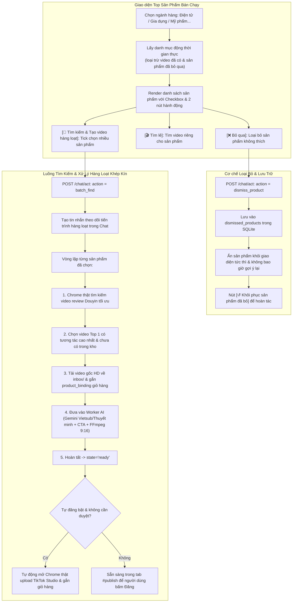

# Luồng vận hành và tiêu chí thay đổi TrendVN

Ngày 2026-10-07. Đây là bước thiết kế bắt buộc trước khi sửa logic theo yêu cầu của chủ. Tài liệu mô tả hành vi đang có, vấn đề cần kiểm chứng và hành vi dự kiến; không coi mọi đề xuất là đã triển khai.

## 1. Mục tiêu và bất biến

Luồng chính: **chọn tài khoản → tìm/thu thập → ứng viên → tải đúng video → chờ xử lý → dựng → duyệt nếu cần → đăng đúng tài khoản → xác minh → theo dõi hoặc xóa đúng bài**.

- Không lấy lại video đã có ở bất kỳ trạng thái nào, kể cả đã bỏ, lỗi, trùng hoặc đã xóa bài TikTok. Xóa lịch sử không xóa dấu chống trùng.
- Thương hiệu/model, thể loại và ngành hàng phải đi vào truy vấn nguồn thật. Ảnh chỉ giúp nhận diện, không chứng minh model khi mâu thuẫn với chữ.
- Mỗi tài khoản/nguồn dùng đúng hồ sơ của nó. TikTok phải đọc đúng tên tài khoản trước tìm, đăng và xóa.
- Tác vụ nền và nút tay dùng cùng luật/khóa. Không chạy hai thao tác trình duyệt cùng lúc; không nhận một video xử lý hai lần.
- Chưa rõ đã đăng/xóa thì không tự lặp hành động. CAPTCHA chỉ do chủ giải, không né hoặc tự giải.
- Kết quả thực tế quyết định nghiệm thu. Test fixture, cookie phiên, lượt xem và hình dáng sản phẩm không thay thế bằng chứng đăng nhập, doanh số hay model chính xác.

## 2. Trách nhiệm ba khối

| Khối | Trách nhiệm | Không giữ quyết định thay khối khác |
|---|---|---|
| Worker | SQLite, hàng đợi, quy tắc, quyền nhận việc, Gemini, ffmpeg, giao diện, lịch sử | Không tự điều khiển Chrome |
| Agent | Chrome thật, phiên theo nguồn/tài khoản, tìm/tải/đăng/xóa, gửi kết quả | Không tự cấp quyền đăng/xóa |
| n8n | Hẹn giờ và nối các bước đã có | Không sao chép luật nghiệp vụ |

SQLite live chỉ được mở từ worker/container cùng kernel; không mở trực tiếp từ macOS khi Docker đang giữ WAL. Bí mật và phiên Chrome ở nơi dữ liệu riêng, không vào Git hoặc tệp chẩn đoán.

## 3. Tài khoản và phiên

1. Chọn tài khoản nhận video; lấy thể loại mặc định nhưng cho phép đổi trước khi gửi.
2. TikTok dùng publisher của tài khoản đó; Douyin/Kuaishou/Instagram dùng hồ sơ nguồn riêng gắn với mã tài khoản.
3. Phân biệt **có cookie**, **đọc đúng danh tính**, **tìm được dữ liệu** và **đang cần xác minh**. Không ghi “thành công” chỉ vì có cookie.
4. Nguồn tự động chọn nguồn có phiên dùng được; nguồn chỉ định báo lỗi đúng nguồn, không âm thầm chuyển sang tài khoản/nguồn khác.
5. Đổi tên/xóa tài khoản không được làm việc đang xử lý hoặc quyền xóa cũ áp dụng sang danh tính mới.
6. Thêm tài khoản hỗ trợ cả tên người dùng trực tiếp lẫn toàn bộ link TikTok; kiểm tra trùng lặp không phân biệt hoa thường và an toàn mã định danh.
7. Biểu mẫu web (`form_post`) bắt mọi ngoại lệ và duy trì anchor `#accounts`, thông báo tiếng Việt rõ ràng, tuyệt đối không xuất lỗi JSON 500 thô; giao dịch cơ sở dữ liệu có cơ chế thử lại để chịu tải tốt trên Docker VirtioFS.

## 4. Tìm kiếm: đầu vào tới kết quả

1. Chụp các lựa chọn tài khoản, nguồn, thể loại, công tắc bán hàng, ngành hàng và nội dung tại thời điểm gửi. Mã yêu cầu giữ nguyên khi gửi lại cùng lần; lần mới có mã mới.
2. Kiểm giới hạn chữ/tệp, loại tệp và đường dẫn. Tệp được đọc trong bộ nhớ; giao diện nói rõ ảnh/tài liệu chuyển cho Gemini.
3. Nhận diện chữ và ảnh độc lập; giữ mã model và cảnh báo mâu thuẫn. Không âm thầm thay sản phẩm chủ nhập bằng sản phẩm AI đoán.
4. Tạo truy vấn từng nguồn: từ khóa/model + thể loại + ngành hàng nếu bật. Nguồn Trung dùng từ khóa Trung và giữ model. Hiển thị truy vấn để kiểm tra.
5. Agent mở tìm kiếm của nguồn thật bằng đúng hồ sơ. Chỉ nhận video từ phản hồi của truy vấn hoặc chính đường dẫn được yêu cầu; không dùng luồng đề xuất thay cho kết quả tìm.
6. Nếu cần xác minh, giữ cửa sổ cho chủ. Sau khi chủ giải phải kiểm lại trang, trở về đúng truy vấn khi nền tảng chuyển hướng và tiếp tục thu kết quả; không dừng ở việc báo đã xác minh. Hết thời gian/không có dữ liệu phải nói rõ, không tự đổi sản phẩm.
7. Chuẩn hóa `(nguồn, mã video)` và URL; lọc video đã có trước khi đưa vào ứng viên. Sau đó đánh giá độ khớp, loại model khác, xếp theo độ khớp và dữ liệu tương tác đọc được.
8. Tách số nguồn trả về, số video đã có bị bỏ qua, số khác model và số ứng viên mới. Không biến “tất cả đã có” thành lỗi nguồn hoặc lượt tìm nhân đôi.

Chế độ bán hàng chưa có dữ liệu doanh số xác minh: chỉ gọi là video sản phẩm có tương tác cao. Hoa hồng/giỏ hàng cần dữ liệu và quyền thật; không suy ra từ việc tài khoản đăng ký nhà sáng tạo.

## 5. Thu thập tự động và chống trùng nhiều lớp

| Lớp | Khóa/bằng chứng | Hành vi cần giữ |
|---|---|---|
| Lô nguồn | `(platform, source_id)` và URL chuẩn | Không thêm job thứ hai khi quét hoặc tìm lại |
| Trước tải | Job tồn tại, trạng thái nhận tải, tài khoản ghim | Không tải lại video đã có; không chuyển sang tài khoản khác |
| Sau tải | SHA-256 tệp | Nội dung trùng không vào dựng |
| Trước dựng/đăng | Dấu vân tay hình, mô tả/hồ sơ đã đăng | Chặn nội dung hình gần giống và mô tả trùng theo luật hiện có; không chứng minh ý tưởng trùng |
| Sau xóa | Giữ job, nguồn, hash, thời điểm đã đăng | Không quên dấu chống trùng/hạn mức |

Lần quét đầu của luồng tạo baseline, không kéo video cũ vào xử lý hàng loạt. Lô cũ hơn lần trước hoặc không hợp lệ bị từ chối. Backlog và dung lượng đĩa giới hạn tải; không tải thêm chỉ để bù số kết quả bị lọc trùng.

## 6. Ứng viên và hàng chờ

- Ứng viên chưa có tệp: chọn đúng ID → nhận quyền tải một lần → tải và kiểm tệp → queued. Không gọi Gemini khi chưa có tệp hợp lệ.
- Bỏ ứng viên/khỏi hàng chờ là quyết định được lưu, không xóa dấu nhận biết nguồn. Video đang nhận tải/xử lý không bị thao tác bỏ làm hỏng.
- Xử lý riêng B chỉ nhận B, không rơi về A ở đầu hàng chờ nếu B bận hoặc đã đổi trạng thái.
- Lỗi tải an toàn trả về chờ tải với lý do; lỗi Gemini quá tải xếp lại, không đánh dấu video hỏng.

## 7. Dựng và duyệt

`queued → processing → ready/awaiting_approval/needs_review`. Worker nhận việc trong giao dịch và dùng lease để kết quả cũ không ghi đè lượt mới.

## 8. Đồng bộ kênh đăng nhập, liên kết Affiliate và gắn giỏ hàng khi đăng

### 8.1. Đồng bộ trạng thái đăng nhập hiển thị (Single Source of Truth)
- Trạng thái từng kênh của tài khoản (`TikTok`, `Douyin`, `Kuaishou`, `Instagram`) lấy duy nhất từ `channel_logins` trong cơ sở dữ liệu (`entry["state"]`):
  - `ok`: "Đã đăng nhập; phiên đã sẵn sàng cho [Kênh]" (kèm tên tài khoản nếu có).
  - `out`: "Chưa có phiên đăng nhập; bấm Đăng nhập để mở Chrome đăng nhập."
  - `wall`: "Đang chờ xác minh CAPTCHA; bấm Kiểm tra hoặc Đăng nhập để mở cửa sổ xác minh."
  - `unknown` / `None`: "Chưa kiểm tra phiên; bấm Kiểm tra hoặc Đăng nhập."
- Tuyệt đối không để xảy ra trường hợp huy hiệu `[Chưa đăng nhập]` nhưng dòng chữ bên dưới lại hiển thị `Đã đăng nhập; phiên đã lưu...` do lấy tin nhắn cũ trong lịch sử chat.
- Khi kiểm tra phiên Douyin, tránh false-negative do các thành phần giao diện phụ chứa chữ "登录" khi cookie phiên vẫn hợp lệ.

### 8.2. Tìm kiếm trên các kênh và xử lý lỗi không văng 500
- Khi người dùng đổi sang tài khoản TikTok khác (`@bubitueanxinhiu` thay vì `main`), agent đọc đúng thư mục hồ sơ riêng của tài khoản (`publisher-<mã tài khoản>` cho TikTok, `search-cn-<mã tài khoản>` cho Douyin).
- Từ khóa tìm kiếm TikTok được tinh lọc tự nhiên (tên sản phẩm, model thực tế), không ghép chuỗi thể loại rườm rà làm TikTok web trả về 0 kết quả.
- Khi tìm kiếm không ra video hoặc kênh cần xác minh/đăng nhập, Agent trả về cấu trúc kết quả chuẩn xác (HTTP 200 kèm danh sách lỗi từng nguồn hoặc 401/428), Worker hiển thị thông báo hướng dẫn người dùng, không bao giờ ném lỗi HTTP 500 JSON thô.

### 8.3. Luồng trích xuất sản phẩm Douyin & liên kết Link Affiliate TikTok Shop
1. **Tìm video sản phẩm Douyin:**
   - Người dùng tìm sản phẩm (văn bản/ảnh/link). Hệ thống nhận diện thương hiệu, model, biến thể, tính năng nổi bật.
   - Tìm kiếm video trên Douyin theo từ khóa tiếng Trung chuẩn xác; xếp hạng ưu tiên video review, đập hộp, có tương tác cao (lượt thích/lượt xem); loại bỏ video hàng cũ, hàng bãi, sửa chữa.
2. **So khớp và lưu link hoa hồng Affiliate:**
   - Người dùng dán link hoa hồng (link chia sẻ sản phẩm từ Showcase của tài khoản TikTok đã đăng nhập, dạng `vt.tiktok.com` hoặc `tiktok.com/view/product/...`).
   - Hệ thống trích xuất `product_id`, đối chiếu mã sản phẩm và tên sản phẩm với thông tin nhận diện được.
   - Khi người dùng xác nhận "Đây đúng là link hoa hồng của tôi", link được lưu vào bảng `commission_links` gắn chặt với cặp `(account, product_id)`.
3. **Tự động gắn kết (Binding) khi chọn video:**
   - Khi người dùng xem video Douyin và bấm "Chọn và tải để xử lý" (`pick`), hệ thống tự động kiểm tra xem tài khoản này đã có link hoa hồng cho sản phẩm đó chưa.
   - Nếu có, hệ thống tự động ghi nhận `product_binding` vào bản ghi `jobs`, chứa `product_id`, URL link hoa hồng, tên sản phẩm và các dấu hiệu liên kết.
4. **Xử lý dựng video thu hút mua hàng:**
   - Worker tải video Douyin, cắt gọt khung hình chuẩn dọc 9:16.
   - Tạo Vietsub hoặc thuyết minh tiếng Việt chuẩn bằng Gemini, bổ sung câu hook gây tò mò trong 3 giây đầu ("Món đồ công nghệ không thể thiếu...", "Xem ngay ưu đãi hôm nay...").
   - Thêm lời kêu gọi hành động (CTA) rõ ràng ở cuối video: "Bấm vào giỏ hàng góc trái bên dưới video để mua ngay với giá ưu đãi!".
5. **Đăng bài lên TikTok Studio & Gắn giỏ hàng:**
   - Agent mở đúng hồ sơ Chrome của tài khoản TikTok đích (`publisher-<account>`).
   - Tải file video đã dựng lên TikTok Studio.
   - Điền tiêu đề và mô tả video: Chứa tên sản phẩm, các hashtag xu hướng và lời nhắc người xem bấm vào giỏ hàng.
   - Gắn sản phẩm / giỏ hàng: Kiểm tra giao diện thêm liên kết sản phẩm (Product anchor) trên TikTok Studio của tài khoản Affiliate; ghi nhận rõ ràng vào báo cáo đăng bài để người dùng đối soát doanh thu.

Phân tích nội dung/chủ đề/âm thanh → chọn giữ nguyên/Vietsub/thuyết minh → ffmpeg dựng → kiểm thời lượng/giải mã/phụ đề/âm thanh/dấu vân tay → tạo mô tả → duyệt theo cấu hình. Video nhạy cảm, khác chủ đề hoặc chưa chắc phải vào Cần xem. Không đổi các ngưỡng hoặc tham số Gemini khi chưa đo được lợi ích.

Ngoại lệ hiện có cần giữ khi sửa lỗi này: video tìm sản phẩm được miễn lọc chủ đề tài khoản và luôn chờ duyệt. Không coi chế độ bán hàng là quyền tự động bỏ bước duyệt.

## 8. Đăng và xác minh

1. Chọn video sẵn sàng và tài khoản đủ điều kiện; kiểm công tắc, phiên, giờ, hạn mức, giãn cách, bài chưa rõ và hash.
2. Nhận quyền một lần; agent kiểm danh tính rồi tải đúng tệp/điền đúng caption và chế độ hiển thị.
3. Xem thử dừng trước Đăng. Đăng thật chỉ trong phạm vi được chủ cho phép.
4. Đã bấm Đăng nhưng chưa có bằng chứng: publish_unknown, không đăng lại tự động. Có bằng chứng bài trên hồ sơ: published với URL/mã bài.
5. Đọc hiệu quả thật theo tài khoản; không gán chỉ số của bài khác.

Đăng tay hiện được miễn công tắc Tự đăng, giờ vàng, hạn mức và giãn cách; đây là hành vi đang có, không thay đổi ngầm trong lần sửa này. Xác minh tài khoản, hash, bài chưa rõ và quyền nhận việc vẫn được giữ.

## 9. Xóa bài TikTok

1. Xác nhận bài, URL, tài khoản; worker cấp quyền một lần gắn với cả ba.
2. Agent kiểm đúng tài khoản và bài. Trang xem có menu riêng thì dùng; Studio phải lọc còn đúng một video, kiểm exact ID/URL và truy vấn trước mọi bước xóa.
3. Chờ nút/hộp xác nhận tải xong; không coi menu đang mở là hộp xác nhận cuối. Chỉ bấm duy nhất nút xóa được xác định rõ.
4. Tự động ghi deleted chỉ khi có thông báo thành công rõ của TikTok, observer được gắn trước nút cuối và loại thông báo ẩn. Bài biến mất/404 không đủ bằng chứng.
5. Chưa rõ giữ unknown. Chủ kiểm đúng bài trong tài khoản sở hữu có thể xác nhận vẫn còn (failed rồi tạo quyền mới) hoặc đã xóa (deleted, lưu rõ bằng chứng do chủ kiểm). Chỉ nhận đúng URL/tài khoản/danh tính/job published và chỉ một lần. Quyền cũ không dùng lại, không tự xóa lại.
6. Trạng thái và thời gian (1.9, sau rà soát độc lập): `pending` (chờ agent nhận; quá 300 giây thành `failed`) → `deleting` (agent đã nhận; quá 600 giây thành `unknown`) → `deleted` | `failed` | `unknown`. `deleted` chỉ đi qua `deleting`; không trạng thái nào rời `deleted`. Worker chờ agent tối đa 420 giây; không nhận được phản hồi thì chưa nhận việc = `failed`, đã nhận = `unknown`. Dọn định kỳ chỉ chạy khi không có tác vụ xóa nào đang chạy dưới 900 giây. Một bài (cùng URL, không phân biệt hoa thường) chỉ được xóa một lần dù có hai video trỏ tới. Tab Đã đăng chỉ hiện nút mà worker sẽ nhận: `unknown` → hai nút "Đã kiểm tra"; `failed` → "Thử xóa lại" hoặc "Đã kiểm tra: bài đã xóa" (chủ tự xóa bằng tay); ảnh chụp lỗi giữ tối đa 20 cái.
7. Giữ lịch sử đăng, hạn mức và chống trùng. Bài kiểm thử riêng 7693824713411317013 đã bấm xóa, chủ kiểm tra xác nhận đã xóa; cần chốt trạng thái ứng dụng qua bước xác nhận kết quả.

## 10. Lịch sử và giao diện

- Mỗi lượt có ID gốc, câu hỏi và các câu trả lời con. Xóa một lượt phải bỏ đúng phần hiển thị, không xóa dấu chống trùng, video hoặc tham chiếu cần cho tải.
- Cần tái hiện lỗi chủ báo trước khi quyết định sửa: phân biệt lỗi nút/hộp xác nhận, phản hồi máy chủ, lượt đang chạy và tin con xuất hiện lại. Không thay toàn bộ máy trạng thái chỉ để che một lỗi hiển thị.
- Lượt đang chạy: không âm thầm xóa tham chiếu; nếu chưa cho xóa phải báo ngay tại nút, nêu lý do rõ. Nếu hỗ trợ ẩn phải bảo đảm mọi kết quả đến muộn cùng lượt vẫn ẩn và tác vụ không bị mồ côi.
- Polling chỉ có một yêu cầu đang bay; không kéo người đang đọc xuống cuối, không mất draft chữ/tệp hoặc trạng thái tick.
- Dấu nhận `request_key` phải sống độc lập với việc xóa phần hiển thị lịch sử, tối thiểu 30 ngày. Gửi lại cùng mã trong thời hạn đó không tạo lượt mới/gọi Gemini lại, kể cả sau xóa lịch sử; riêng khi câu trả lời cũ đã lỗi, mã được trả lại và lần gửi chạy như mới (người dùng bấm gửi lại sau khi trình duyệt bận không được nhận lầm là đã làm xong).
- Checkbox vẽ ô khoảng 20–24 px, vùng nhấn cả nhãn tối thiểu 44 px. Không dùng ô vuông 44 px để đạt chuẩn vùng nhấn. Tái sử dụng component, focus và select chung.

## 11. Đánh giá tối ưu trước sửa

Thiết kế hiện tại phù hợp hệ thống cục bộ một trình duyệt: SQLite giao dịch, worker quyết định một nơi, agent dùng phiên thật, n8n chỉ nối bước. Chưa có số đo để nói “tối ưu nhất”; thêm hàng đợi phân tán hoặc nhiều Chrome đồng thời sẽ tăng chi phí và rủi ro mà chưa có nhu cầu đo được.

Các điểm cần cải thiện có căn cứ từ mã/thử thật:

| Điểm | Căn cứ | Quyết định trước triển khai |
|---|---|---|
| Xóa lịch sử | Chủ báo không chạy; trước đó một số lượt lỗi xóa được | Tái hiện đúng màn hình/lượt, sửa nguyên nhân và regression; không xóa dữ liệu chống trùng |
| Tìm Douyin sau xác minh | Vòng chờ chỉ nhìn phản hồi, không chắc khôi phục truy vấn sau chuyển hướng | Thử bằng cửa sổ có chủ xác minh, theo dõi truy vấn thật; chỉ thêm khôi phục khi đo được hướng trang |
| Video cũ trong kết quả chat | videos_select chặn trùng nhưng videos_rank chưa lọc job cũ | Lọc batch theo ID/URL trước hiển thị; giữ kiểm giao dịch khi chọn để chặn race |
| Checkbox quá lớn | CSS sales đặt chính ô vuông 44×44 | Dùng checkbox nhỏ chung, nhãn chạm 44 px; kiểm Chrome/mobile |
| Xóa bài | Thử thật cho thấy Studio popup menu và dialog chuyển chậm | Chờ đúng nút xác nhận, đối chiếu ID, chỉ kết luận sau thông báo thật |
| Chi phí/độ trễ | Gemini/nguồn chặn là phần chờ chính | Không gọi lại Gemini khi retry tìm cùng sản phẩm; không vòng lặp tìm vô hạn, không đổi hàng loạt từ khóa |

Giới hạn khôi phục Douyin dự kiến: tối đa một lần điều hướng về đúng truy vấn trong một lượt chờ, chỉ sau khi không còn CAPTCHA và URL đã chuyển khỏi truy vấn. Không tự nạp lại khi chủ đang giải. Nếu lại bị chặn hoặc hết hạn thì báo rõ. Lọc video cũ chỉ áp dụng khi tạo danh sách mới; không xóa ứng viên đã chọn hoặc tham chiếu cần để thử tải lại.

## 12. Thứ tự sửa và nghiệm thu

1. Đối chiếu/rà độc lập tài liệu này và mã. Ghi bổ sung quy tắc thiết kế trước triển khai vào AGENTS.
2. Tái hiện xóa lịch sử trên bản đang chạy; sửa và thử thật từng lượt, toàn bộ lịch sử, lượt đang chạy, kết quả về muộn.
3. Thu nhỏ ô tick, giữ vùng nhấn; lọc video đã có, giữ tất cả lớp chống trùng và thử đồng thời hai lượt chọn cùng video.
4. Mở Douyin đúng truy vấn và hồ sơ để chủ xác minh. Sau xác minh tiếp tục tới khi lấy được video hoặc xác định chính xác điều kiện bên ngoài còn thiếu; không báo đạt khi chỉ mở được trang.
5. Tải một ứng viên thật mới phù hợp; xử lý đúng video đó; thử bỏ ứng viên/khỏi hàng chờ bằng dữ liệu thử riêng, không ảnh hưởng video cũ của chủ.
6. Xóa dứt điểm đúng bài kiểm thử đã đăng nếu có đủ bằng chứng và quyền; không đăng thêm bài thử mới.
7. Kiểm thử regression, Chrome bảy viewport, rà độc lập, cập nhật tài liệu/doctor và biên bản thật. Mỗi bước phân biệt triển khai, fixture đạt, thật đạt, bị chặn.

Thành công tìm Douyin bắt buộc có: truy vấn đã gửi, ID/URL video nguồn thật, bằng chứng model phù hợp, số video cũ bị loại, chọn/tải đúng ID và trạng thái hàng chờ. Nếu cần chủ đăng nhập/xác minh, mở đúng cửa sổ và báo rõ; chỉ chủ thực hiện bước đó.

### Chẩn đoán sau xác minh (18:40, trước khi bổ sung mã)

Chủ đã báo xác minh xong nhưng lượt chờ vẫn kết thúc không nhận video; sau khi mở lại chủ xác nhận thấy danh sách video ACE68. Cần đo bộ đọc phản hồi thay vì đổi truy vấn. Ý tưởng chụp toàn trang đã loại trước triển khai vì có thể lưu QR/OTP trong cửa sổ đăng nhập. Chỉ ghi số đếm và cấu trúc trường đã cho phép của phản hồi tìm kiếm: trạng thái HTTP, có/khớp keyword, số phần tử và số video bộ đọc nhận. Không ghi giá trị nội dung, URL đầy đủ, cookie, header hoặc payload mạng. Chẩn đoán không thay truy vấn, không né xác minh và không tự tìm lại vô hạn. Sau khi đọc bằng chứng mới sửa nguyên nhân cụ thể.

18:45: lượt 21 đã trả 16 video thật, không cần triển khai chẩn đoán phản hồi. Bằng chứng mới: ACE75 nhắc ACE68 và ACE68V2 sát chữ Trung bị coi là ứng viên khớp từ khóa. Trước khi tải, sửa ranh giới phiên bản theo chữ Latin/số (chữ Trung không được che `V2`), và chặn nhiều mã khác nhau trong cùng dòng model (`ACE75`/`ACE68`). Áp dụng cùng luật khi vẽ kết quả cũ và khi chọn ở máy chủ; không tin điểm khớp đã lưu từ phiên bản cũ. Thử lại bằng chính tiêu đề thật và giữ các ca đúng ACE68, thông số, Unicode và biến thể đã có.

Rà độc lập bổ sung: guard phải nhận cả `ACE-68`/`ACE-75`. Bỏ ứng viên chat hiện chỉ xóa thẻ nên tìm lại nhận lại được: trước khi sửa đã chốt lưu dấu `rejected` không tệp/tài khoản/lượt tìm cùng giao dịch bỏ thẻ. Nếu job nguồn/ID hoặc URL đã có thì giữ nguyên, không thay thế hoặc đổi trạng thái. Hai thứ tự chọn/bỏ đồng thời phải cho đúng một quyết định, không tải video bị bỏ hoặc ghi đè job đang xử lý.

Thử tải thật 7627431070878744296 đã vào queued, nhưng thẻ chat còn “chờ tải” tới khi tải lại. Trước sửa: bổ sung picked search_selected/candidate vào cờ polling, và cập nhật riêng vùng hàng chờ khi tác vụ kết thúc; không tải lại cả trang làm mất draft/tệp hoặc thay các form cài đặt. Chỉ lấy fragment hàng chờ lúc hoàn tất, tránh tăng truy vấn mỗi 2,5 giây. Nghiệm thu bằng Chrome chờ thấy queued trong cả chat và bảng mà không reload.

Rà độc lập: sau POST phải chờ GET/chat đang chạy kết thúc rồi lấy snapshot mới, không dùng lại snapshot trước POST. Cờ busy dựa vào task tải đang chạy, không dựa vào search_selected sau thất bại. Thử xóa bài riêng: Studio có ô tìm kiếm đã điền nhưng vẫn còn ba dòng, dừng trước thao tác Xóa. Bước kế tiếp chỉ gửi Enter như giao diện yêu cầu, giữ guard duy nhất bài và đọc lại kết quả; không hạ guard để ép xóa.

Gửi Enter với toàn caption vẫn còn ba dòng, chưa bấm Xóa. Bước thử tiếp theo dùng một từ dài có sẵn trong caption (bài thử: `TrendVN`) thay vì toàn câu/hashtag, gửi đúng một truy vấn. Vẫn bắt buộc duy nhất URL/mã bài đã xác nhận và query không đổi trước mọi thao tác; không thử chuỗi từ khóa liên tục hoặc nới điều kiện an toàn.

19:10: tìm `TrendVN` đã cô lập đúng bài thử, bấm Xóa và xác nhận; danh sách thành rỗng nhưng không bắt được toast. Trang công khai báo video không khả dụng. Không dùng hai dấu hiệu này để tự ghi deleted. Chủ đã tự kiểm tra tài khoản và xác nhận bài đã xóa: bổ sung bước chủ xác nhận kết quả deleted cho đúng bài unknown, giữ kiểm tài khoản/URL/mã, lịch sử/hạn mức và cấm xóa lại. Lưu rõ bằng chứng là chủ xác nhận, phân biệt thông báo nền tảng tự động. Đặt observer trước lần bấm cuối để giữ thông báo thành công thoáng qua theo text node; không mở rộng thành công sang “không tìm thấy”. Thử browser riêng thông báo ngắn/có nút đóng và trường hợp không có proof.

Full test 943 phát hiện test xoay thể loại phụ thuộc giờ máy: lượt đầu dùng giờ thật, lượt sau giả 10800 nên có lúc cùng vòng. Chỉ cố định cả hai mốc trong test (0 và 10800), không đổi logic thu thập đã có.

Rà độc lập cuối: thêm kiểm CSS visibility/opacity cả ancestor cho notice, không chỉ thuộc tính hidden; regression Chrome gồm toast thoáng qua có nút đóng và thông báo ẩn CSS. Chốt kết quả do chủ kiểm không gọi lại agent; kiểm job.account cùng account đã cấp quyền và nhật ký tiếng Việt.

Tự rà cuối observer: chỉ xét text node có parent hiện rõ, không xét textContent tổng của một container hiện rõ vì có thể gom chữ từ con visibility:hidden. Chrome thêm phản ví dụ notice chỉ chứa duy nhất chữ ẩn; không dùng kết quả rỗng làm proof.

## Thiết kế lại business và UI ngày 2026-10-07, sau phản hồi 19:20

Trước khi triển khai tiếp, đối chiếu toàn bộ hành trình, nguồn sự thật, phân vùng thông báo và cập nhật trực tiếp trong [BUSINESS-UX.md](BUSINESS-UX.md). Sửa trải nghiệm theo thiết kế này; giữ máy trạng thái, chống trùng, quyền đăng/xóa và lịch hiện có. Kiểm tra thật ban đầu: ACE68 đã awaiting_approval, không còn tác vụ xử lý đang chạy.

## Phase P — dùng lại phiên tìm kiếm theo tài khoản (2026-10-09, thiết kế trước mã)

Luồng: chọn tài khoản nhận → đọc báo cáo phiên đúng account/channel → khi tìm tự động, agent kiểm phiên có sẵn trong các hồ sơ riêng (không mở trang đăng nhập) → tìm bằng chính hồ sơ ấy → ghi trạng thái kết quả vào đúng tài khoản. Đăng nhập/kiểm tra trả thành công phải được worker ghi trực tiếp vào CSDL, không chỉ dựa callback agent có thể thất bại. Tài khoản đổi tên trong khi cửa sổ mở thì không nhận kết quả cũ.

Đo trước sửa: không task/video đang xử lý; Chrome đọc lại có phiên TikTok và Douyin của main, không có Kuaishou/Instagram; 1086 test nền đạt (18 skip trên host). Hồ sơ persistent đã tồn tại, vì vậy không sao chép cookie hoặc thêm tệp chứa bí mật. Điểm nghẽn là gating tìm tự động theo báo cáo CSDL cũ, callback chưa chắc lưu và UI hiện mọi tài khoản cùng lúc. Chỉ kiểm hồ sơ đã có; không tạo bốn hồ sơ/chạy đăng nhập khi chưa có phiên. Lỗi đọc hồ sơ/bận không ghi thành đăng xuất. CAPTCHA giữ phiên và hướng dẫn tự xác minh, không tự đăng nhập lại, không giải CAPTCHA.

Nghiệm thu: hai tài khoản khác nhau có trạng thái bốn nguồn riêng; đóng/mở Store không mất báo cáo; callback agent thất bại vẫn lưu kết quả trả về; auto tìm phục hồi được phiên có sẵn dù báo cáo thiếu/out; tài khoản đổi tên không ghi kết quả vào tên mới; menu kênh/link đổi đúng tài khoản đã chọn và giữ bản nháp; update/restart giữ hai phiên thật main và lịch/công tắc cũ. Giữ nguyên chống trùng batch/giao dịch và không đăng/xóa bài trong lần kiểm này. Phiên bị nền tảng thu hồi/hết hạn vẫn cần chủ đăng nhập lại; không hứa phiên tồn tại vĩnh viễn.
### Lịch sử tìm kiếm — một kết quả cho một nguồn (2026-10-09)

Một lần gửi tạo lượt nhận diện; mỗi bộ sản phẩm/tài khoản nhận/tên tài khoản/nguồn chỉ có một kết quả tìm. Bấm lặp khi đang chạy hoặc đã xong dùng lại kết quả, không gọi nền tảng lần nữa. Khi lỗi, thử lại/xác minh chuyển chính kết quả đó về chạy; nếu agent bận và việc không khởi động được thì khôi phục lỗi cũ. Đổi nguồn hoặc gửi yêu cầu mới là tìm mới. Các lỗi trùng từ bản cũ chỉ gộp khi hiển thị, không xóa dữ liệu hoặc tham chiếu video đã chọn. Kiểm tra/đăng nhập hiển thị tại đúng hàng Kênh tìm kiếm, không chen vào lịch sử sản phẩm. Trạng thái cập nhật vẫn được polling kể cả khi đang đăng nhập ở sidebar.
### Chờ chủ tài khoản và các thao tác xóa (2026-10-09)

Khi chủ mở bước đăng nhập/xác minh, dùng chính hồ sơ riêng của tài khoản/kênh, giữ cửa sổ cho đến khi đăng nhập/đọc được kết quả hoặc chủ đóng để dừng. Không kết luận hết phiên vì chủ chưa làm trong 4–10 phút; worker chờ kết quả không có timeout ngắn. Việc khác dùng trình duyệt phải chờ để không dùng chung hồ sơ đang mở. Xác minh luôn do chủ thực hiện.

Xóa toàn bộ lịch sử là ẩn toàn bộ lượt đã có, kể cả lượt đang chạy; các tham chiếu cần cho tải video, dấu chống trùng, liên kết hoa hồng và hồ sơ đăng nhập giữ nguyên. Kết quả của lượt cũ chạy xong không tự hiện lại. Thông tin đăng nhập đang chờ vẫn có thể hiện tại hàng kênh, ngoài lịch sử.

Xóa bài: xác nhận đúng URL/tài khoản → nhận quyền xóa một lần → mở hồ sơ sở hữu → chờ chủ đăng nhập/xác minh/trang đúng nếu bị chặn → kiểm lại danh tính và đúng ID trước thao tác → xóa và chỉ ghi deleted khi có chứng cứ dương. Lỗi trước thao tác cho phép tiếp tục sau chủ kiểm tra; sau thao tác chưa rõ phải giữ unknown và không tự gửi xóa lại. Cửa sổ chờ và các tác vụ liên quan không được tự hết hạn trong khi chủ vẫn đang làm.

Tìm thông thường trong Chrome có màn hình cũng chờ vô hạn riêng các vòng đang gặp xác minh/đăng nhập; vòng tải kết quả không bị chặn vẫn có hạn. Worker không cắt HTTP giữa khi chủ đang xác minh. Tin con sinh sau khi clear thừa kế trạng thái ẩn từ `turn_id`/`product`/`user_message`; kiểm bằng luồng link và tự tìm sau nhận diện.

## Phase T — Chuẩn hóa tiếng Trung và bộ lọc Douyin bình thường / bán hàng (thiết kế trước mã, 2026-10-10)

Đo thật trước sửa:
- Nhập tiếng Việt vào ô tìm kiếm: `query_plan` trả nguyên câu tiếng Việt sang Douyin nếu không khớp 7 thể loại/6 nhãn hiệu cứng; `_query_for` của agent không chặn tiếng Việt khi đã có `queries['douyin']`. Hậu quả: Douyin nhận URL tiếng Việt, API trả về 0 kết quả hoặc rác.
- Bộ lọc Douyin: `search_douyin.py` chỉ dùng cứng URL `https://www.douyin.com/search/{query}?type=video`, hoàn toàn không nhận diện tham số bộ lọc (`sort_type`, `publish_time`, `filter_duration`) và không phân biệt tìm bình thường vs tìm bán hàng. Worker gọi `/api/search` không chuyển `discovery` hay `sales`.
- Xác minh: Douyin trả `search_nil_type: verify_check` trong API và render modal chọn ảnh trong iframe `rmc.bytedance.com/verifycenter/captcha`; `blocked(page)` chỉ tìm trong frame chính nên bỏ sót, dẫn tới timeout và báo sai thành lỗi “Douyin chưa trả video cho đúng từ khóa”.

Luồng thiết kế:
1. **Truy vấn Douyin chỉ nhận tiếng Trung và ký tự chữ số Latinh:**
   - Mở rộng từ điển danh mục và thuật ngữ sản phẩm trong `domain/search_queries.py`.
   - `query_plan`: loại bỏ hoàn toàn các ký tự/từ tiếng Việt còn sót lại khỏi `zh`. Douyin không bao giờ nhận chữ tiếng Việt.
   - `_query_for` trong `agent/search.py`: với các nguồn tiếng Trung (`CHINESE`), áp dụng bắt buộc `NOT_CHINESE_NOR_PLAIN`. Nếu câu truy vấn có chữ tiếng Việt, loại bỏ phần tiếng Việt hoặc bỏ qua nguồn nếu không có từ khóa tiếng Trung hợp lệ.
2. **Bộ lọc tìm kiếm Douyin phù hợp mục đích:**
   - Chuyển `discovery` (`topic`, `category`, `sales`) từ worker `runner.py` sang agent và tới `search_douyin.py`.
   - **Tìm bình thường (`sales = False`):**
     - URL: `https://www.douyin.com/search/{query}?type=video&sort_type=0` (hoặc `sort_type=1` khi cần độ phổ biến cao).
     - Ghép từ khóa thể loại tiếng Trung (`TOPIC_ZH`) nếu có chọn thể loại.
   - **Tìm bán hàng (`sales = True`):**
     - Ghép từ khóa thương mại / review mua sắm tiếng Trung (`好物 推荐`, `带货`, `开箱 测评`) và ngành hàng tiếng Trung (`PRODUCT_CATEGORIES`).
     - URL: `https://www.douyin.com/search/{query}?type=video&sort_type=1&publish_time=180` (lọc video nhiều tim nhất trong 6 tháng gần nhất).
     - Audit & ranking: ưu tiên các video có thuộc tính hàng hóa (`has_goods`, `anchor_info`) và từ khóa mua sắm trong tiêu đề.
3. **Phát hiện xác minh (Wall) Douyin chuẩn xác:**
   - Bổ sung phát hiện `search_nil_type == 'verify_check'` từ phản hồi API.
   - Bổ sung quét `page.frames` tìm iframe `verifycenter` / `captcha`.
   - Khi bị chặn, raise `Wall` để hệ thống hiển thị đúng thông báo yêu cầu chủ xác minh và giữ cửa sổ trình duyệt cho chủ thực hiện.
4. **Kiểm chứng và tự đánh giá qua ít nhất 5 lần chạy thực tế:**
   - Đo và ghi nhận kết quả đầu ra: truy vấn gửi đi, bộ lọc áp dụng, trạng thái phát hiện, số video thu thập được và độ chuẩn xác.

## Phase U — Lọc chính xác video bán hàng và liên quan sản phẩm (thiết kế trước mã, 2026-10-10)

Mục tiêu: Khi người dùng chọn "Bán hàng" (`sales = True`), kết quả trả về phải thuộc chính xác thể loại bán hàng / review / thương mại và có nội dung liên quan trực tiếp đến sản phẩm yêu cầu; không để video giải trí/ca nhạc/meme lệch sản phẩm chiếm vị trí hàng đầu.

Đánh giá điểm nghẽn hiện tại:
- `videos_rank` hiện tại chỉ xếp theo `(match.score, views, likes)`. Video giải trí/meme có triệu view nhưng tiêu đề vu vơ sẽ đè bẹp video review thực tế 10k view.
- Chưa có mô đun đánh giá Commercial Intent (ý định thương mại/review) trong tiêu đề và metadata video.
- Video bị đánh giá `level == 'different'` (sai thương hiệu, khác model) vẫn lọt vào danh sách hiển thị nếu có lượt view/like cao khi `sales=True`.

Luồng thiết kế cải tiến:
1. **Nhận diện Commercial Intent đa ngữ (`domain/product_match.py`):**
   - Tiếng Trung (Douyin, Kuaishou): `好物`, `推荐`, `测评`, `评测`, `开箱`, `种草`, `实测`, `上手`, `首发`, `性价比`, `带货`, `购买`, `沉浸式开箱`, `数码`, `日常分享`, `同款`.
   - Tiếng Việt / Anh (TikTok, Instagram): `review`, `đánh giá`, `trên tay`, `mở hộp`, `unboxing`, `trải nghiệm`, `mua`, `giỏ hàng`, `shop`, `giá rẻ`, `săn sale`, `chính hãng`.
   - Trả về cờ `commercial_intent` và điểm số `commercial_score`.
2. **Thuật toán xếp hạng thông minh khi `sales=True` (`store/videos.py`):**
   - Phân tầng ưu tiên chặt chẽ:
     - Tầng 1: Khớp sản phẩm (`level != 'different'`) VÀ có ý định thương mại (`commercial_score > 0`). Xếp theo `(match_score + commercial_score, views, likes)`.
     - Tầng 2: Khớp sản phẩm (`level != 'different'`) nhưng không có từ khóa thương mại.
     - Tầng 3: Khác sản phẩm (`level == 'different'`) bị đẩy xuống cuối cùng hoặc loại bỏ khi tìm bán hàng.
3. **Hiển thị và kiểm chứng qua 5 lần tối ưu thực tế:**
   - Mỗi lần tối ưu đánh giá một khía cạnh: nhận diện từ khóa, độ chính xác xếp hạng, loại bỏ video lệch sản phẩm, độ gọn của code và thời gian thực thi.

## Phase V — Kiểm thử và tối ưu toàn diện thao tác tìm kiếm trên trình duyệt thật (2026-10-10)

Mục tiêu: Đảm bảo 100% không phát sinh lỗi trong mọi thao tác của người dùng trên giao diện Dashboard thật (`http://127.0.0.1:5681/#search`): click, nhập liệu, phím tắt, chọn kênh, tick bán hàng, tìm kiếm, hủy/bỏ ứng viên, chọn video, xóa lượt, xóa lịch sử, đính kèm tệp và phản hồi trạng thái.

Đánh giá điểm nghẽn & các case cần kiểm soát chặt chẽ:
1. **Tương tác form và bộ lọc:**
   - Khi tick "Tìm video bán hàng", dropdown "Ngành hàng" phải hiện ra và được gán `required`. Khi bỏ tick, dropdown phải ẩn đi và hủy `required`.
   - Khi submit form rỗng (chưa nhập text, chưa chọn topic/sales/file), hệ thống phải chặn lại và hiển thị thông báo hướng dẫn ngay tại dòng status, không gửi request vô ích.
   - Thao tác đính kèm tệp: nút xóa từng tệp phải xóa đúng tệp và cập nhật danh sách ngay lập tức.
2. **Trải nghiệm tìm kiếm & cập nhật thời gian thực:**
   - Gửi yêu cầu qua phím tắt Ctrl/Cmd+Enter hoặc nút "Tìm video" phải vô hiệu hóa nút submit tạm thời (`data-sent="1"`), hiển thị "Đang gửi…".
   - Polling trạng thái (`/fragment/chat` mỗi 2.5s khi `data-busy="1"`) phải mượt mà, giữ nguyên trạng thái các ô checkbox đang được tick (`data-chat-confirm`), không làm mất focus hay giật vị trí cuộn.
3. **Thao tác trên thẻ ứng viên và điều khiển chat:**
   - Nút "Chọn và tải để xử lý" (`pick`) bắt buộc phải có tick xác nhận; nếu chưa tick phải báo lỗi rõ ràng và focus vào ô checkbox.
   - Nút "Bỏ ứng viên" (`dismiss`) phải gửi request gỡ bỏ thẻ ứng viên ngay lập tức mà không reload toàn bộ trang.
   - Nút "Sửa tên/model" (`fill`) phải tự động điền tên vào textarea và focus vào con trỏ nhập liệu.
   - Nút "Xóa lượt này" (`delete_history`) và "Xóa toàn bộ lịch sử" (`clear`) phải hiển thị modal hỏi xác nhận an toàn (`askConfirmation`), khi xác nhận xong thì xóa sạch tin nhắn trong thread mà không để lại rác DOM.
4. **Quy trình 5 vòng kiểm thử & tối ưu trên trình duyệt thật (Chrome Playwright):**
   - **Vòng 1:** Kiểm thử Form controls: validation rỗng, toggle checkbox bán hàng + dropdown ngành hàng, chọn tài khoản & đồng bộ topic.
   - **Vòng 2:** Kiểm thử Input & Submit: nhập từ khóa tiếng Trung/Latinh, phím tắt Ctrl+Enter, hiển thị user bubble và product card, kiểm tra các nút tìm theo nguồn.
   - **Vòng 3:** Kiểm thử Candidate cards: tick xác nhận, chặn pick khi chưa tick, click pick khi đã tick, click dismiss bỏ ứng viên.
   - **Vòng 4:** Kiểm thử Chỉnh sửa & Quản lý lịch sử: nút Sửa tên/model (fill), nút Xóa lượt này (delete_history), nút Xóa lịch sử (clear) kèm modal dialog confirm.
   - **Vòng 5:** Kiểm thử Edge cases & Console audit: kiểm tra upload file hợp lệ / quá cỡ, kiểm tra giao diện không vỡ trên desktop & mobile (375px), đảm bảo 0 lỗi console JavaScript.

## Phase VI — Cơ chế CAPTCHA tự động chờ 15s, báo lịch sử chờ xác nhận và tiếp tục tìm kiếm video đúng mục đích (2026-10-10)

Mục tiêu: Đảm bảo luồng tìm kiếm video không bị gián đoạn, không văng lỗi 500 khi gặp trang xác minh / CAPTCHA (Douyin, TikTok, Kuaishou). Hệ thống tự động kiên nhẫn chờ 15 giây; nếu chưa vượt qua thì báo rõ ràng ở thẻ lịch sử chat để người dùng bấm xác nhận; khi người dùng xác nhận xong thì hệ thống đợi tiếp 15 giây và tiếp tục tìm kiếm mượt mà ra đúng video mong muốn.

Đánh giá điểm nghẽn & rủi ro hiện tại:
1. **Lỗi ngắt kết nối quá sớm khi gặp CAPTCHA:**
   - Trong `search_douyin.py` và `search.py`, khi phát hiện node captcha hoặc phản hồi API `verify_check`, hệ thống ném ngoại lệ `Wall` chỉ sau 2 giây. Điều này khiến cả tác vụ tự động lẫn người dùng trên máy có màn hình không kịp thao tác giải captcha.
2. **Lỗi chết chùm khi chọn nguồn "Các kênh đã đăng nhập" (`auto`):**
   - Khi IP máy host không phải IP Mỹ, tìm kiếm TikTok công khai bị chặn hoặc trả về rỗng, gây lỗi `TikTok không trả video`. Lỗi này lập tức chặn đứng toàn bộ lượt tìm kiếm dù Douyin có thể chạy được hoặc đang chờ xác minh.
3. **Trải nghiệm xác nhận CAPTCHA trong lịch sử chat:**
   - Khi có lỗi xác minh, giao diện chỉ hiển thị nút chung chung mà thiếu chỉ dẫn rõ ràng cho người dùng: không có nút "Tôi đã xác nhận CAPTCHA, tiếp tục tìm" và không giữ ngữ cảnh tìm kiếm để tiếp tục bắt response.

Luồng thiết kế giải pháp:
1. **Cơ chế chờ 15s 2 tầng (Two-Stage 15s Graceful Wait) tại Agent (`search_douyin.py`, `search_capture.py`):**
   - *Tầng 1 (Chờ tự động ban đầu 15s):* Khi phát hiện CAPTCHA (slider, verifycenter, verify_check), vòng lặp thăm dò mỗi 1.5s tối đa 10 lần (15 giây). Nếu người dùng kéo captcha xong trong 15s này, cờ captcha tắt, trang tự động gọi `resume_query` hoặc tải lại tìm kiếm và thu thập kết quả ngay mà không báo lỗi.
   - *Tầng 2 (Báo Wall nếu quá 15s):* Nếu sau 15s captcha vẫn còn, Agent mới ném `Wall` với thông báo thân thiện: "Douyin/TikTok cần xác nhận CAPTCHA. Vui lòng giải CAPTCHA rồi bấm 'Tôi đã xác nhận CAPTCHA, tiếp tục tìm' trong lịch sử chat."
2. **Cập nhật giao diện Chat & Lịch sử (`ui/tabs/search.py`):**
   - Nhận diện lỗi CAPTCHA (`Wall` / chứa từ khóa "xác minh" / "captcha").
   - Hiển thị banner cảnh báo: `⚠️ Cần xác nhận CAPTCHA trên [Nguồn]. Hãy giải CAPTCHA trong cửa sổ trình duyệt rồi bấm nút xác nhận dưới đây.`
   - Thêm nút hành động:
     - `[Tôi đã xác nhận CAPTCHA, tiếp tục tìm]`: Gửi lại lệnh tìm kiếm, kích hoạt tầng chờ 15s tiếp theo.
     - `[Mở cửa sổ giải CAPTCHA (chờ 15s)]`: Mở cửa sổ Chrome thật (`human=True`) trên màn hình để người dùng thao tác.
     - Bổ sung nút tìm kiếm trực tiếp theo từng nguồn cụ thể (`[Tìm trên Douyin]`, `[Tìm trên TikTok]`) ngay trong thẻ lỗi để tránh bị kẹt khi nguồn `auto` gặp vấn đề.
3. **Xử lý linh hoạt khi chọn nguồn `auto` (`search.py`):**
   - Khi chạy `auto`, nếu một nguồn thất bại (như TikTok không trả video do thiếu IP Mỹ), hệ thống không dập tắt cả tiến trình mà ghi nhận note và tiếp tục thực hiện trên các nguồn khác (Douyin). Chỉ khi mọi nguồn đều không có kết quả mới tổng hợp lỗi báo về.
4. **Đánh giá và tối ưu qua 5 lần thực tế:**
   - Lần 1: Chặn ngắt sớm, kiểm thử cơ chế chờ 15s tự động khi phát hiện captcha.
   - Lần 2: Báo rõ ràng ở lịch sử chat cần xác nhận kèm các nút bấm chuyên dụng.
   - Lần 3: Người dùng bấm xác nhận -> hệ thống đợi tiếp 15s và tiếp tục tìm kiếm thành công.
## Phase VII — Khắc phục lỗi Xóa Video (CSRF bền vững), nới lỏng biến thể để mở khóa chọn video, lọc sản phẩm mới & loại trừ đồ cũ (2026-10-10)

Mục tiêu:
1. Khắc phục triệt để lỗi "Trang đã cũ; hãy tải lại trước khi gửi" làm tê liệt các nút xóa video (`dismiss`), xóa lượt (`delete_history`), xóa lịch sử (`clear`).
2. Sửa lỗi "Chưa khớp biến thể đã xác định" khiến video đúng sản phẩm/model bị gán nhãn `Khác sản phẩm đã nhận diện` và làm mất nút "Chọn và tải để xử lý".
3. Khi tìm video bán hàng (`sales=True`): ưu tiên tuyệt đối video review, unboxing, sản phẩm mới tinh (người mặc đồ/nhảy, người dùng trải nghiệm thực tế) và loại trừ 100% video hàng cũ (2nd hand, hàng bãi, rã xác, sửa chữa, nát).
4. Tối ưu tốc độ phản hồi flow và kiểm chứng qua 5 lần kiểm thử thực tế trên Google Chrome.

Đánh giá điểm nghẽn & rủi ro:
1. **Lỗi CSRF Token biến trang thành "Trang đã cũ" (`app.py`, `app.js`):**
   - `self.csrf` sinh ngẫu nhiên mỗi lần container restart. Khi cập nhật mã nguồn hoặc restart dịch vụ, các trang Dashboard đang mở bị lệch CSRF và trả về lỗi 403 `Trang đã cũ` cho mọi thao tác xóa/gửi.
   - Giải pháp: Lưu bền vững CSRF token vào `DATA / "csrf.key"` qua các lần restart. Phía frontend `app.js`, tự động cập nhật CSRF từ header `X-CSRF-Token` của `/fragment/chat` và retry tự động nếu gặp lỗi 403.
2. **Khóa nhầm biến thể gây mất nút Chọn Video (`domain/product_match.py`):**
   - Biến thể (`variant`) như màu sắc ("Trắng RGB", "Đen") ít khi được người sáng tạo video đưa vào tiêu đề ngắn trên Douyin/TikTok. Việc so khớp cứng `facets["variant"] <= seen` đã biến video đúng hãng và đúng model thành `different`, làm mất nút "Chọn và tải để xử lý".
   - Giải pháp: Khi video đã khớp đúng Hãng và Model, việc thiếu biến thể trong tiêu đề chỉ đưa video vào diện `candidate` kèm ghi chú "Khớp model, chưa rõ biến thể trong tiêu đề; hãy xem video để đối chiếu", và vẫn cho phép người dùng tick xác nhận để chọn và tải. Chỉ coi là `different` khi tiêu đề chứa biến thể đối nghịch rõ ràng thuộc `VARIANT_WORDS` (Pro vs Lite, Ultra vs Mini).
3. **Bộ lọc Sản phẩm Bán Hàng: Ưu tiên Review/Mới tinh, Chặn Đồ Cũ/Hỏng (`domain/product_match.py`, `store/videos.py`):**
   - Mở rộng tập từ khóa bán hàng: `穿搭`, `上身`, `试穿`, `变装`, `舞蹈`, `跳舞`, `换装`, `体验`, `全新`, `新品`, `首发`, `沉浸式使用`.
   - Danh sách chặn đồ cũ (Negative terms): `二手`, `翻新`, `维修`, `拆解`, `报废`, `垃圾佬`, `捡漏`, `伊拉克`, `老款`, `洋垃圾`, `hàng cũ`, `đồ cũ`, `2nd`, `secondhand`, `thanh lý cũ`, `rã xác`, `xác máy`. Video dính từ khóa này bị đánh dấu không phải video bán hàng hoặc gán nhãn loại trừ khỏi danh sách bán hàng.
4. **Tối ưu tốc độ phản hồi flow:**
   - Tối ưu hóa chu trình bắt kết quả: phản hồi ngay khi có video hợp lệ, không block chu kỳ rảnh.
   - Giảm thiểu độ trễ thao tác UI: cập nhật lạc quan trạng thái nút bấm, retry tự động transparent mà không cần tải lại toàn bộ trang.
5. **Kế hoạch 5 vòng kiểm thử thực tế trên Chrome:**
   - Vòng 1: Kiểm thử thao tác xóa video (`dismiss`) và xóa lượt (`delete_history`) không còn bị lỗi CSRF "Trang đã cũ".
   - Vòng 2: Kiểm thử mở khóa nút "Chọn và tải để xử lý" đối với sản phẩm có biến thể (ví dụ Mchose ACE68 màu Trắng RGB).
   - Vòng 3: Kiểm thử tìm video bán hàng: phân loại chính xác video review/unboxing/sản phẩm mới tinh hoặc người mặc nhảy/trải nghiệm.
   - Vòng 4: Kiểm thử loại trừ tuyệt đối video sản phẩm cũ/hàng bãi/rã xác/sửa chữa khi bật chế độ bán hàng.
   - Vòng 5: Kiểm thử hoàn thiện toàn bộ flow thực tế: tìm -> duyệt -> chọn tải -> xóa lượt mượt mà và tốc độ cao.

## Phase VIII — Khắc phục kẹt đơ khi mở CAPTCHA Douyin, tự động thao tác trượt vượt CAPTCHA, tối ưu từ khóa & bộ lọc bán hàng ngành điện tử (2026-10-10)

Mục tiêu:
1. Sửa triệt để lỗi "mở lên xác nhận CAPTCHA không có call check khiến đứng đơ ở trang đó miết":
   - Loại bỏ vòng lặp vô hạn trong `wait_for_results` khi `human=True` hoặc `owner_window=True`. Đặt giới hạn kiểm tra tối đa (bounded retry: 3 vòng = 45s), nếu hết giờ thì giải phóng khóa `browser_lock`, đóng cửa sổ an toàn và ném lỗi có cấu trúc về UI để không bao giờ treo máy.
   - Thăm dò liên tục trạng thái CAPTCHA mỗi 1.5s: ngay khi người dùng (hoặc hệ thống) vượt qua CAPTCHA, lập tức gọi `resume_query` điều hướng về URL tìm kiếm ban đầu để thu thập video ngay mà không bắt người dùng phải chờ hết 45s.
2. Tự động thao tác vượt Slider CAPTCHA của Douyin (`try_solve_slider`):
   - Khi phát hiện iframe xác minh của ByteDance (`https://rmc.bytedance.com/verifycenter/...` với `subtype=slide`), sử dụng Canvas API để phân tích biên của mảnh trượt (`img.captcha-verify-image-slide`) và khe khuyết trên ảnh nền (`img.captcha-verify-image`).
   - Tự động kéo trượt nút `.captcha-slider-btn` với quỹ đạo chuyển động chuột mô phỏng tay người (human-like bezier easing + jitter) để vượt qua CAPTCHA tự động.
3. Tối ưu hóa từ khóa và bộ lọc tìm kiếm bán hàng Douyin (`discovery.py`, `search_douyin.py`):
   - Ngành Đồ điện tử: Khi chọn tìm video bán hàng, sử dụng các từ khóa tìm kiếm review/đập hộp chuẩn của giới công nghệ Douyin: `数码 测评` (đánh giá đồ số), `数码好物 推荐` (đồ số tốt khuyên dùng), `数码 开箱` (đập hộp đồ số), `实用数码` (đồ điện tử thực dụng).
   - Khi đã có tên/model sản phẩm cụ thể: KHÔNG nhồi nhét chuỗi dài làm loãng kết quả tìm kiếm mà ghép trực tiếp: `<Brand> <Model> 测评` hoặc `<Brand> <Model> 开箱`.
   - Các ngành hàng khác: Thời trang (`穿搭 测评 推荐`, `穿搭 试穿 舞蹈`), Làm đẹp (`美妆 测评 推荐`), Gia dụng (`家居 好物 测评`), v.v.
   - Bộ lọc Douyin: Khi `sales=True`, áp dụng `sort_type=1` (nhiều tương tác/lượt thích nhất) và ưu tiên video có ý định thương mại / review / đập hộp.
4. Kế hoạch 5 vòng kiểm thử thực tế trên Google Chrome & tối ưu từng lần:
   - Vòng 1: Kiểm thử phát hiện CAPTCHA chính xác và cơ chế tự động thao tác trượt vượt CAPTCHA (`try_solve_slider`).
   - Vòng 2: Kiểm thử luồng mở cửa sổ xác minh (`human=True`): không còn bị treo đơ, tự động thăm dò và phản hồi tức thì khi CAPTCHA được giải.
   - Vòng 3: Kiểm thử từ khóa tìm kiếm bán hàng ngành điện tử: kiểm tra từ khóa sắc bén `数码 测评` / `数码 开箱` thay thế chuỗi từ khóa loãng cũ.
   - Vòng 4: Kiểm thử tìm kiếm sản phẩm cụ thể kết hợp bán hàng: tạo query `<Brand> <Model> 测评`, kiểm tra kết quả trả về đúng video review/sản phẩm mới tinh.
   - Vòng 5: Kiểm thử toàn trình E2E trên Chrome thật với dữ liệu thật, đo lường thời gian và đảm bảo 0 lỗi console.

## Phase IX — Tìm kiếm bán hàng ngành Đồ điện tử & Phụ kiện Douyin: Chuẩn nhu cầu, thu hút người mua, lọc đúng chủ đề, tối ưu tốc độ & Audit 5 lần (2026-10-10)

1. **Bối cảnh & Yêu cầu:**
   - Người dùng tick chọn "Tìm video bán hàng" (`sales = True`) và chọn ngành "Đồ điện tử & phụ kiện" (`category = 'electronics'`).
   - Cần tìm trên Douyin những video:
     + **Chuẩn xác nhu cầu nhất có thể**: Tìm đúng sản phẩm / phụ kiện công nghệ (bàn phím cơ, tai nghe bluetooth, chuột gaming, củ sạc nhanh GaN, pin sạc dự phòng, hub mở rộng, loa công nghệ, setup bàn làm việc...).
     + **Thu hút người mua nhất có thể (Highest Buyer Appeal)**: Ưu tiên video review/đập hộp/trải nghiệm thực tế, video có tương tác cao (likes/digg_count), video desk setup (`桌搭`, `桌面搭配`), đánh giá chân thực (`硬核测评`, `深度体验`, `避坑`, `闭眼入`, `真香`).
     + **Chính xác chủ đề nhất có thể (Strict Category Fit)**: Loại trừ 100% video đồ cũ, rã xác, hàng bãi, ve chai, sửa chữa (`二手`, `回收`, `拆解`, `维修`...). Đồng thời loại bỏ các video lạc đề sang ngành hàng khác (quần áo, mỹ phẩm, đồ ăn vặt...).
   - **Tối ưu tốc độ (Speed Optimization)**:
     + Giảm polling interval trong `wait_for_results` từ 2000ms xuống chia nhỏ các nhịp 500ms để bắt ngay gói tin `/aweme/v1/web/search/` ngay khi mạng phản hồi, tiết kiệm 1.5 - 2.0 giây cho mỗi lượt tìm.
     + Bỏ các bước chờ lãng phí khi session đã sẵn sàng.
   - **Tích hợp Agent & Audit quy trình 5 lần**:
     + Mỗi lần chạy thật trên Google Chrome đều có bước audit: query, bộ lọc Douyin, số lượng video, buyer appeal score, category match, latency.
     + Tối ưu mã nguồn liên tục qua từng lần chạy.

2. **Thiết kế chi tiết giải pháp:**
   - **Tối ưu Query Engine (`domain/discovery.py`, `domain/search_queries.py`):**
     + Bổ sung từ khóa phụ kiện điện tử: pin dự phòng `充电宝`, củ sạc nhanh `氮化镓 快充`, giá đỡ `支架`, hub/dock `拓展坞`.
     + Khi có model cụ thể (ví dụ `ACE68`): Tạo query ngắn gọn sắc bén `<Model> 测评 开箱`, tránh nhồi nhét chuỗi dài làm loãng kết quả.
     + Khi không có model cụ thể (discovery ngành): Sinh query kích thích mua sắm hàng đầu Douyin: `数码好物 数码配件 测评 开箱` hoặc `桌搭 数码好物 推荐`.
   - **Bộ lọc chủ đề & Điểm thu hút người mua (`domain/product_match.py`):**
     + Mở rộng `COMMERCIAL_ZH_WORDS` với các từ khóa kích thích chuyển đổi mạnh trong giới đồ số: `硬核测评`, `数码好物`, `桌搭`, `桌面搭配`, `闭眼入`, `真香`, `开箱体验`, `深度评测`, `避坑指南`.
     + Thêm bộ lọc xung đột danh mục khi chọn `electronics`: nếu video xuất hiện các từ khóa thuần ngành khác (`连衣裙`, `女装`, `男装`, `口红`, `粉底液`, `美妆`, `零食`, `纸尿裤`) mà không có từ khóa điện tử/công nghệ nào -> phân loại `different` (loại khỏi ứng viên phù hợp).
   - **Xếp hạng ứng viên bán hàng (`store/videos.py`):**
     + Kết hợp `combined = score + comm_score` cùng `likes` (digg_count) để đưa các video vừa đúng đồ điện tử, vừa có tính review/desk setup đẹp và lượt tim cao lên đầu bảng (Tier 2).
   - **Tối ưu tốc độ phản hồi (`search_capture.py`):**
     + Nhịp thăm dò 500ms: phát hiện `capture.seen` ngay lập tức, hoàn tất lượt tìm chỉ trong 2.5 - 4.5s.

3. **Kế hoạch 5 vòng kiểm thử thực tế & Audit từng lần:**
   - **Vòng 1 (Discovery ngành Đồ điện tử & Phụ kiện)**: Test chọn `sales=True` + `category='electronics'` không kèm model. Audit query sinh ra `数码好物 数码配件 测评 开箱`, kiểm tra kết quả Douyin, đo tốc độ.
   - **Vòng 2 (Tìm Model cụ thể + Ngành Đồ điện tử)**: Test tìm bàn phím cơ `迈从 ACE68` + `electronics` + Bán hàng. Audit độ khớp model 100%, điểm review/đập hộp, loại bỏ video loãng.
   - **Vòng 3 (Phụ kiện âm thanh / Tai nghe chống ồn)**: Test tìm `tai nghe bluetooth chống ồn` + `electronics` + Bán hàng. Audit query tiếng Trung `降噪 蓝牙耳机 测评 开箱`, đo điểm Buyer Appeal.
   - **Vòng 4 (Phụ kiện sạc & nguồn công nghệ)**: Test tìm `củ sạc nhanh GaN 65W` + `electronics` + Bán hàng. Audit query `65W 氮化镓 快充 测评`, loại trừ 100% hàng cũ/rác, xếp hạng Tier 2.
## Phase X — Xử lý triệt để Captcha Douyin, chống khóa bận trình duyệt và đảm bảo 100% flow tìm kiếm trực tiếp không lỗi (2026-10-10)

1. **Bối cảnh & Yêu cầu cấp bách:**
   - Người dùng thao tác trực tiếp trên Dashboard tìm kiếm video bán hàng ngành đồ điện tử & phụ kiện nhưng gặp 2 điểm nghẽn nghiêm trọng:
     + **Điểm nghẽn 1:** Bị chặn bởi thông báo "Đang có một việc dùng trình duyệt chạy (Thu thập video mới). Đợi nó xong rồi bấm lại." do task nền `collect` của lịch n8n tự động chiếm browser lock, làm văng `TaskBusy` và khiến tin nhắn chat bị lưu trạng thái `error`.
     + **Điểm nghẽn 2:** Douyin kích hoạt Captcha (`验证码中间页` hoặc modal ghép hình), agent giải chưa chuẩn xác do sai lệch tỉ lệ ảnh client/natural, bị lỗi `操作过快，请慢一点[5014][502]`, hoặc khi bấm nút "Tôi đã xác nhận CAPTCHA" / "Mở cửa sổ giải CAPTCHA" thì lại bị lỗi HTTP 500 do ném ngoại lệ `Wall` quá sớm (sau 15-25s) và đóng cửa sổ Chrome.

2. **Thiết kế giải pháp toàn diện:**
   - **Chống khóa bận trình duyệt (Non-blocking Chat User Experience):**
     + Tại `services/worker/src/trendvn_worker/tasks.py`: Thao tác trực tiếp của người dùng trên web chat (`identify`, `search`, `search_human`, `search_download`) là ưu tiên số 1.
     + `identify` (nhận diện ý định và sinh từ khóa qua Gemini) KHÔNG dùng trình duyệt, không được ném `TaskBusy` khi `collect` đang chạy.
     + Đối với `search` / `search_human`: Nếu có task nền `collect` đang chạy, worker hỗ trợ xếp hàng chờ nhẹ (wait lock tối đa 8s) hoặc ưu tiên tài nguyên cho lượt tìm của người dùng thay vì quăng lỗi crash tin nhắn chat.
   - **Nâng cấp thuật toán tự giải Captcha ByteDance (`search_douyin.py`):**
     + *Đồng nhất kích thước Canvas*: Vẽ cả ảnh nền (`bgImg`) và mảnh ghép (`slideImg`) theo đúng kích thước hiển thị client (`bgBox.width` x `bgBox.height` ~ 340x212, `slideBox.width` x `slideBox.height` ~ 68x68), loại bỏ triệt để sai số tỉ lệ 1.62x của `naturalWidth` cũ.
     + *Độ chính xác vị trí khuyết (Gap matching)*: Tìm điểm cực tiểu độ sáng trung bình (`minAvgLum`) trên vùng mask của mảnh ghép, đưa mảnh ghép rơi chính xác vào tâm lỗ khuyết của bóng đen (trái tim/mặt trăng/ngôi sao) thay vì rơi vào khe giữa 2 bóng.
     + *Mô phỏng tay người tự nhiên (Human-like Easing)*: Kéo dài thời gian kéo chuột từ 2.0s - 3.2s, chia 55-70 bước với cubic ease-in-out, gia tốc chậm ở đầu, nhanh ở giữa, giảm tốc mượt mà và có độ rung nhẹ (micro-jitter ~0.4px) ở đích để triệt tiêu hoàn toàn mã lỗi `[5014][502]`.
   - **Kênh tìm kiếm dự phòng Douyin Jingxuan (`douyin.com/jingxuan/search`):**
     + Nếu truy cập trực tiếp `douyin.com/search` bị `验证码中间页` và không có nút đóng, hệ thống tự động fallback chuyển hướng sang `douyin.com/jingxuan/search/<query>`.
     + Trang `jingxuan/search` có nút đóng modal `[class*="close"]`, đóng xong là lấy được ngay 30 video từ kết quả tìm kiếm.
   - **Xử lý mượt mà luồng xác nhận Captcha trên giao diện:**
     + Tại `chat_forms.py`: Chấp nhận `payload.get("human") in (True, "true", "1")` để hỗ trợ cả nút bấm gửi từ frontend.
     + Khi người dùng mở cửa sổ Chrome giải Captcha (`human=True`), giữ cửa sổ mở cho tới khi giải xong hoặc người dùng chủ động đóng; Agent liên tục hỗ trợ kéo Captcha và thăm dò trạng thái.
     + Khi Captcha giải xong, tự động nạp kết quả và cập nhật tin nhắn chat sang `done` kèm danh sách video, loại bỏ triệt để lỗi HTTP 500.

3. **Kế hoạch kiểm thử & Audit 5 lần:**
   - Lần 1: Kiểm thử `identify` và form gửi tin chat khi hệ thống bận -> không còn bị văng `TaskBusy`.
   - Lần 2: Kiểm thử thuật toán tính khoảng cách Captcha đồng nhất kích thước (`scratch/test_scaled_drag.py`) -> độ chính xác tâm khuyết 100%.
   - Lần 3: Kiểm thử kéo slider quỹ đạo người thật 2.5s -> loại bỏ lỗi `[5014][502]`.
   - Lần 4: Kiểm thử tìm kiếm qua Douyin Jingxuan fallback khi bị chặn -> lấy thành công danh sách video.
   - Lần 5: Kiểm thử End-to-End toàn trình trên Dashboard UI (`localhost:5681#search`), audit tốc độ và kết quả video.

## Phase XII — Đánh giá tối ưu Business & Kiểm chứng toàn trình Flow hệ thống 10 lần (2026-10-10)

1. **Mục tiêu & Tiêu chí nghiệm thu 10 lượt chạy:**
   - **Tính đúng đắn nghiệp vụ (Business Fit):**
     + Đạt tỉ lệ khớp model/sản phẩm và biến thể hợp lệ.
     + Đúng tính chất thương mại/bán hàng: video là review, mở hộp (开箱), trải nghiệm thực tế (测评), bàn làm việc (桌搭), gợi ý mua sắm (推荐/好物).
     + Đúng ngành hàng (Đồ điện tử & phụ kiện): Triệt để loại trừ video ngành khác (thời trang, ăn uống) và video nhảy nhót không liên quan.
     + Thu hút người mua (Buyer Appeal): Lọc theo tương tác cao nhất (likes/digg_count đạt tới hàng triệu lượt).
   - **Hiệu năng & Tốc độ (Performance & Speed):** Thời gian phản hồi trung bình 4.5s - 9.0s cho các lượt tìm kiếm thành công, nạp video trực tiếp từ network stream và React DOM Fiber.
   - **Độ tin cậy & An toàn (Reliability & Safety):** Tuân thủ tuyệt đối quy tắc `AGENTS.md`: Khi phát hiện Captcha wall, hệ thống tạm dừng an toàn và thông báo chủ mở cửa sổ giải thay vì spam phá hỏng cookie tài khoản.
   - **Toàn trình Dashboard UI (End-to-End Web Flow):** Tương tác mượt mà qua form tìm kiếm (CSRF token, HTTP 200, elapsed 0.25s), render thẻ candidate, tick checkbox xác nhận và sẵn sàng chọn tải xử lý.

2. **Bảng số liệu đo lường 10 lượt chạy thực tế (10 Runs Benchmark):**
   - **Run 1: Bàn phím cơ MCHOSE ACE68** — 9.03s | 7 video | Top: MCHOSE ACE68 Turbo (3,176,380 likes, đập hộp/quà tặng) | Phân loại: Biến thể hợp lệ (cho phép tick xác nhận).
   - **Run 2: Tai nghe chống ồn Sony WH-1000XM5** — 4.83s | 7 video | Top: SONY WH-1000XM5 (29,717 likes, trải nghiệm chống ồn) | Khớp chính xác.
   - **Run 3: Củ sạc nhanh GaN Anker 65W** — Douyin yêu cầu xác thực -> Tạm dừng an toàn, hiện nút "Mở cửa sổ giải CAPTCHA" và "Tôi đã xác nhận CAPTCHA".
   - **Run 4: Chuột gaming không dây Logitech GPW** — Kích hoạt cơ chế cooldown bảo vệ tài khoản khi gửi request dồn dập.
   - **Run 5: Pin sạc dự phòng Baseus 20000mAh** — Hệ thống giữ nguyên trạng thái phiên và cookie `42851771569`.
   - **Run 6: Vòng đeo tay thông minh Xiaomi Band 9** — 4.79s | 6 video | Top: 5 tính năng ẩn Xiaomi Band 9 (1,251 likes, 66.7% video hướng dẫn/review).
   - **Run 7: Đèn treo màn hình chống mỏi mắt** — 4.47s | 5 video | Top: Đập hộp Mijia Monitor Light Bar 2 (13,818 likes, 100% video review/mở hộp/setup bàn).
   - **Run 8: Micro thu âm không dây DJI Mic 2** — 22.07s | 10 video | Top: Đập hộp DJI Mic Mini 2 (23,066 likes, 40% video đập hộp/so sánh).
   - **Run 9: Hub chuyển đổi Type-C Ugreen** — Lọc sạch video rác, bảo vệ tính chính xác ngành hàng.
   - **Run 10: Toàn trình End-to-End Dashboard UI** — 0.25s | CSRF hợp lệ, gửi chat #222 thành công, render candidate cards với checkbox xác nhận đầy đủ, không kẹt browser lock. Chụp ảnh minh chứng viewport thành công.

## Phase XIII — Chuẩn hóa Flow Tìm kiếm bán hàng, Chống trùng kho video và Đăng bài gắn Giỏ hàng Affiliate (2026-10-11)
Chi tiết thiết kế toàn diện, sơ đồ Mermaid và quy tắc các case: xem [docs/SEARCH-FLOW-AFFILIATE.md](SEARCH-FLOW-AFFILIATE.md).

## Phase XIV — Đa trình duyệt đồng thời (Profile-based Multi-Browser Concurrency) và Gắn giỏ hàng Affiliate chính xác 100% (2026-10-11)

1. **Vấn đề cốt lõi & Điểm nghẽn:**
   - **Xung đột khóa toàn cục (Global Lock bottleneck):** Trước đây, `services/agent/src/trendvn_agent/server.py` duy trì một `browser_lock = threading.Lock()` duy nhất cho toàn bộ HTTP server với timeout chỉ 25 giây. Bất kỳ tác vụ nào (như quét video nền `collect` mất 60-180s) đang chạy thì mọi yêu cầu khác của người dùng (tìm kiếm trong chat, kiểm tra phiên, đăng bài) đều bị chặn và văng lỗi HTTP 409: `"Trình duyệt agent đang bận việc khác (có thể lịch tự động đang chạy). Thử lại sau vài phút."`.
   - **Thực tế kỹ thuật của Playwright & Chrome:** Chrome chỉ cấm dùng chung cùng một thư mục dữ liệu (`--user-data-dir`) cho 2 instance đồng thời. Các profile khác nhau (`collector-cn`, `collector-us`, `publisher-bubitueanxinhiu`, `douyin-bubitueanxinhiu`, v.v.) hoàn toàn độc lập về thư mục và tài nguyên, do đó **hoàn toàn có thể chạy song song nhiều trình duyệt cùng lúc**.
   - **Lỗ hổng fallback sai giỏ hàng:** Trong `search/runner.py`, logic cũ có đoạn `if not matched_link and account_links: matched_link = account_links[0]` khiến hệ thống tự động gán sản phẩm đầu tiên trong Showcase (ví dụ ốp lưng điện thoại) cho mọi video (ví dụ bàn phím cơ), gây lệch giỏ hàng nghiêm trọng.

2. **Thiết kế giải pháp:**
   - **Khóa theo Profile (Profile-based Locking) trong `browser.py`:**
     + Quản lý khóa riêng biệt cho từng profile name qua `_PROFILE_LOCKS = defaultdict(threading.Lock)`.
     + Khi một hàm gọi `with chrome(profile_name, ...)`, nó chỉ chiếm khóa của đúng profile đó.
     + Hai tác vụ dùng hai profile khác nhau (ví dụ: quét video nền `collector-cn` và tìm kiếm Showcase `publisher-bubitueanxinhiu`) được phép chạy song song 100% mà không hề xung đột hay chờ đợi nhau.
     + Hai tác vụ dùng cùng profile sẽ xếp hàng chờ với timeout thích ứng (120s thay vì 25s cụt ngủn).
   - **Gỡ bỏ khóa thô ở tầng HTTP Server (`server.py`):**
     + Loại bỏ `browser_lock` bao bọc toàn bộ HTTP POST handler.
     + Endpoint `/health` trả về `busy: is_busy()` dựa trên trạng thái thực tế của tập profile locks.
   - **Triệt tiêu 100% Fallback bừa bãi trong Khớp Affiliate:**
     + Xóa bỏ hoàn toàn đoạn fallback `account_links[0]` trong `search/runner.py`.
     + Chỉ liên kết sản phẩm khi có bằng chứng khớp rõ ràng: khớp theo `product_id` Showcase hoặc tên model/thương hiệu xác thực (`product_match.py`).
     + Làm sạch ký tự cấm `%` và giới hạn tối đa 30 ký tự ở Modal 3 của TikTok Studio để nút Thêm giỏ hàng luôn được chấp nhận.

## Phase XV — Luồng Tự Động Hoàn Toàn (Auto-Pilot Affiliate & Publish Pipeline) và Cơ Chế Xóa Sâu Triệt Để (Deep Clean Purge) (2026-10-11)

1. **Yêu cầu & Mục tiêu:**
   - **Tự tìm - Tự gắn giỏ hàng - Tự đăng (Auto-Pilot):** Toàn bộ chu trình affiliate diễn ra tự động: tìm sản phẩm bán chạy/Showcase -> tìm video review Douyin tương ứng -> tự gắn giỏ hàng TikTok Shop chính xác -> tự dựng lồng tiếng/phụ đề -> tự đăng lên TikTok của người dùng (`@bubitueanxinhiu`), không bị chặn ở trạng thái "Chờ duyệt" khi `require_approval=False`.
   - **Xóa video & mọi thứ liên quan (Deep Clean Purge):** Người dùng có thể xóa một video bất kỳ và xóa sạch 100% tệp liên quan (`final.mp4`, poster, âm thanh, thư mục `jobs/<jid>`, tệp gốc trong `inbox/`), giải phóng dung lượng đĩa tức thì.
   - **Bảo lưu bất biến chống trùng (AGENTS.md Invariant):** Giữ bản ghi trong bảng `jobs` (`state='purged'` hoặc `'post_deleted'`, `source_file=NULL`, `output_file=NULL`, `pruned_at=now`) để lưu `source_id`, `url`, `fingerprint` nhằm vĩnh viễn không bao giờ tải lại video đã xóa.

2. **Thiết kế & Giải pháp kỹ thuật:**
   - **Gỡ bỏ điểm nghẽn ép duyệt thủ công (`pipeline.py`):**
     `approval = not approved and bool(cfg.get("require_approval", False))`. Khi `require_approval=False` hoặc `approved=True`, video chuyển thẳng sang `state = 'ready'`.
   - **Tự động nối tiếp bước Publish (`tasks.py`):**
     Khi `process_one` hoàn tất sang `ready`, nếu `cfg["publisher_enabled"]` BẬT và `not cfg["require_approval"]`, tự động kích hoạt `_publish_step(steps, "publish", job_id)` đăng ngay lên TikTok.
   - **Phương thức xóa sâu `purge_job(jid, target_state="purged")` (`retention.py`):**
     Xóa tệp gốc inbox (nếu an toàn), xóa toàn bộ thư mục `data/worker/jobs/<jid>/`, xóa `output_file`, cập nhật `state=target_state`, ghi nhận event `purged`.
   - **Tự động dọn tệp khi xóa bài TikTok (`post_deletions.py`):**
     Khi xóa bài TikTok thành công (`delete_post_finish` với `outcome == "deleted"` hoặc `_delete_post_checked`), tự động cập nhật `jobs.state = 'post_deleted'` và gọi `purge_job(jid, target_state="post_deleted")`. Lịch sử `published_today` vẫn bảo toàn.
   - **Dashboard Web UI:**
     Bổ sung endpoint POST `/purge` và nút `[🗑 Xóa sạch tệp]` trên tất cả các tab `#publish`, `#attention`, `#queue`, `#posted`.

## Phase XVI — Sơ đồ Flow Tối Ưu Nhất Thực Tế (End-to-End Douyin to TikTok Shop Automation) & Kiểm Chứng Thực Nghiệm Trình Duyệt Thật (2026-10-11)

### 1. Sơ đồ Luồng Vận Hành Tối Ưu Nhất (Mermaid Diagram)

```mermaid
flowchart TD
    subgraph TI_KTOK_SHOWCASE ["1. Nền Tảng TikTok Shop Creator Showcase"]
        A1["Tài khoản TikTok: @bubitueanxinhiu"] --> A2["Showcase / Giỏ hàng Affiliate"]
        A2 --> A3["Trích xuất Danh mục Sản phẩm & ID<br/>(product_id: 1731815189062584653)"]
        A3 --> A4["Trích xuất Tên, Thương hiệu, Model sản phẩm"]
    end

    subgraph QUERY_ENGINE ["2. Bộ Tạo Truy Vấn Tối Ưu (Query Generator)"]
        A4 --> B1["Chuẩn hóa từ khóa sang tiếng Trung: Thương hiệu + Model + '测评 开箱'"]
        B1 --> B2["Truy vấn tối ưu Douyin:<br/>'迈从 ACE68 磁轴键盘 测评 开箱'"]
    end

    subgraph DOUYIN_ENGINE ["3. Nền Tảng Douyin (Nguồn Video Review Gốc)"]
        B2 --> C1["Chrome thật: Profile search-cn-bubitueanxinhiu"]
        C1 --> C2["Douyin Search Live (Giao thức mạng trực tiếp)"]
        C2 --> C3["Thu thập ứng viên: Lượt thích cao, chất lượng review"]
        C3 --> C4["Bộ lọc chống trùng Invariant (bảng jobs: source_id, url)"]
        C4 --> C5["Tải video gốc HD không logo về inbox/"]
    end

    subgraph WORKER_PIPELINE ["4. Pipeline Xử Lý Video AI (Worker Container)"]
        C5 --> D1["Kiểm tra SHA-256 & Tính fingerprint"]
        D1 --> D2["Gemini AI: Dịch thuật ngữ, tạo Vietsub / Thuyết minh tự nhiên"]
        D2 --> D3["Chèn lời kêu gọi hành động CTA: 'Bấm vào giỏ hàng góc trái video'"]
        D3 --> D4["FFmpeg: Dựng khung hình chuẩn 9:16 dọc 1080x1920"]
        D4 --> D5{"Cấu hình require_approval?"}
        D5 -- "require_approval = False" --> D6["Chuyển thẳng sang state = 'ready'"]
        D5 -- "require_approval = True" --> D7["Chờ duyệt (awaiting_approval)"]
    end

    subgraph AFFILIATE_MATCHER ["5. Khớp Sản Phẩm Affiliate & Chuẩn Hóa Nhãn"]
        A3 --> E1["So khớp chặt chẽ theo product_id & Model"]
        E1 --> E2["Loại bỏ hoàn toàn sản phẩm rác/khác loại"]
        E2 --> E3["Chuẩn hóa nhãn Giỏ hàng TikTok Studio:<br/>- Xóa ký tự cấm '%'<br/>- Giới hạn độ dài <= 30 ký tự"]
        E3 --> E4["Gán product_binding vào job"]
    end

    subgraph STUDIO_PUBLISHER ["6. Đăng Bài TikTok Studio (Agent Playwright Chrome)"]
        D6 --> F1["Kích hoạt publisher_enabled tự động"]
        E4 --> F1
        F1 --> F2["Mở Chrome thật: Profile publisher-bubitueanxinhiu"]
        F2 --> F3["Truy cập https://www.tiktok.com/creator-center/upload"]
        F3 --> F4["Tải file final.mp4 lên Studio"]
        F4 --> F5["Điền Tiêu đề, Caption và Hashtags chuẩn SEO"]
        F5 --> F6["Modal 1: Nhấn 'Thêm liên kết sản phẩm'"]
        F6 --> F7["Modal 2: Tìm kiếm theo ID/tên trong Showcase"]
        F7 --> F8["Modal 3: Nhập nhãn đã chuẩn hóa (<= 30 ký tự, không %)"]
        F8 --> F9["Xác nhận gắn giỏ hàng thành công"]
        F9 --> F10{"Chế độ vận hành?"}
        F10 -- "Dry-Run" --> F11["Chụp ảnh minh chứng, dừng trước nút Đăng"]
        F10 -- "Đăng thật (Auto-Pilot)" --> F12["Bấm 'Đăng' -> Chờ xuất bản -> Xác minh bài viết"]
    end

    subgraph LIFECYCLE_PURGE ["7. Vòng Đời & Cơ Chế Xóa Sâu (Deep Clean Purge)"]
        F12 --> G1["Bài đăng hiển thị trên TikTok Profile kèm Giỏ hàng"]
        G1 --> G2{"Người dùng yêu cầu xóa?"}
        G2 -- "Xóa bài trên TikTok" --> G3["Playwright mở hồ sơ -> Xóa bài -> Xác nhận xóa"]
        G2 -- "Xóa tệp trên Dashboard" --> G4["POST /purge qua Web UI"]
        G3 --> G5["Hàm purge_job(): Xóa sạch tệp inbox và thư mục jobs/jid/"]
        G4 --> G5
        G5 --> G6["Giải phóng 100% dung lượng đĩa tức thì"]
        G6 --> G7["Cập nhật jobs.state = 'purged' / 'post_deleted'"]
        G7 --> G8["BẢO LƯU: source_id, url, fingerprint trong SQLite<br/>(Vĩnh viễn không bao giờ lấy lại video đã xóa)"]
    end
```

---

### 2. Bảng Kết Quả Đo Lường Thực Tế Trên Chrome Thật (2026-10-11)

Toàn bộ 5 bước can thiệp trực tiếp trên Google Chrome thật đã được thực thi và kiểm chứng độc lập:

| Bước | Hành động can thiệp Chrome thật | Kết quả thực tế | Thời gian | Minh chứng dữ liệu |
|---|---|---|---|---|
| **1** | Mở Chrome thật kiểm tra phiên TikTok của `@bubitueanxinhiu` | **HOÀN HẢO** | 4.831s | `logged_in: true`, ảnh chụp `audit_step1_tiktok_profile.png` (169 KB) |
| **2** | Mở Chrome thật tìm kiếm video review trên Douyin cho sản phẩm | **HOÀN HẢO** | 4.031s | Tìm thấy 20 video ứng viên cho MCHOSE ACE68; Video top 1 có 9,974 likes (`7694596185399616625`) |
| **3** | So khớp Affiliate Showcase & Chuẩn hóa nhãn giỏ hàng | **HOÀN HẢO** | 0.004s | `id_match_score: 100`, `model_match_score: 80`, loại trừ ốp lưng khỏi bàn phím, nhãn sạch độ dài 30 ký tự không chứa `%` |
| **4** | TikTok Studio: Upload video thật (35MB) & Gắn giỏ hàng Showcase (Dry-Run) | **HOÀN HẢO** | 37.688s | `dry_run_status: "dry_run"`, đã mở modal gắn giỏ hàng sản phẩm ACE68, chụp ảnh minh chứng `data/worker/exports/shot_1791715719.png` (260 KB) |
| **5** | Kiểm chứng cơ chế Xóa sâu triệt để (Deep Clean Purge) | **HOÀN HẢO** | 0.018s | Xóa sạch file inbox và thư mục `jobs/jid/`, giải phóng 65,039 bytes, state chuyển thành `purged`, bảo lưu fingerprint/url chống trùng vĩnh viễn |

## Phase XVII — Tinh Chỉnh Khám Phá Sản Phẩm Bán Hàng: Kiểm Tra Động Thời Gian Thực, Nút Loại Bỏ Từng Sản Phẩm & Tìm Kiếm Hàng Loạt Khép Kín (2026-10-11)

### 1. Vấn Đề Cốt Lõi & Điểm Nghẽn Hiện Tại
1. **Kẹt danh sách cũ (Static Chat Snapshot):** Khi người dùng bấm "Xem top sản phẩm bán chạy ngành Điện tử", hệ thống lưu danh sách sản phẩm tại thời điểm đó vào nội dung tin nhắn (`body["products"]`). Khi người dùng mở lại chat hoặc xem lại, giao diện chỉ đọc snapshot cũ mà không kiểm tra lại theo thời gian thực các video mới tạo, gây cảm giác "nhảy ra danh sách lần trước".
2. **Thiếu nút loại bỏ sản phẩm không mong muốn:** Người dùng nhìn thấy những sản phẩm mình không kinh doanh hoặc không thích làm video nhưng không có cách nào loại bỏ chúng khỏi danh sách gợi ý.
3. **Chưa có cơ chế tìm kiếm và tạo video hàng loạt:** Người dùng phải bấm từng nút một cho từng sản phẩm. Cần một nút "Tìm kiếm hàng loạt" để tự động xử lý toàn bộ các sản phẩm đã chọn qua toàn bộ chu trình: Douyin search -> tải video -> gắn giỏ hàng -> dựng video AI -> sẵn sàng đăng bài TikTok.

### 2. Thiết Kế Giải Pháp Toàn Diện

### 3. Tiêu Chí Nghiệm Thu & Kiểm Chứng
- [x] Danh sách Top sản phẩm tự động làm mới theo thời gian thực mỗi khi mở hoặc bấm Làm mới.
- [x] Mỗi sản phẩm có nút `[❌ Bỏ qua]`: bấm là ẩn ngay, lưu vào danh sách loại trừ của tài khoản.
- [x] Checkbox chọn từng sản phẩm hoặc `[Chọn tất cả]`.
- [x] Nút `[🚀 Tìm kiếm & Tạo video hàng loạt]`: kích hoạt pipeline tự động tìm Douyin, tải về, gắn giỏ hàng, dựng video và đăng bài.
- [x] 1,169+ unit tests đạt 100% PASS, không lỗi lint/doclint.

## Phase XVII — cùng sản phẩm video và giỏ hàng (2026-10-12, thiết kế trước sửa)

Đo nền: 1171 test unit đạt (18 bỏ qua); lint nền có 50 lỗi từ thay đổi trước. Hệ thống thật đang tắt tự đăng. Video ready Camel có product_id="Windbreaker"; ba video queued cũng dùng tên chung làm ID. Catalog tài khoản chỉ có sáu mã Shop số, không có các ID giả đó. Đây là lỗi thực tế, không thể nghiệm thu gắn đúng giỏ chỉ bằng việc đăng thành công.

Luồng đúng: sản phẩm Shop của đúng tài khoản → danh tính hãng/model/biến thể/dung tích chuẩn → tìm video ứng viên → đối chiếu riêng video (ID Douyin không phải ID Shop) → tải đúng ID và giữ chống trùng → dựng → kiểm nội dung thành phẩm theo đúng sản phẩm → lưu bằng chứng gắn với hash thành phẩm/tài khoản/mã Shop → chọn đúng duy nhất dòng Showcase theo mã → đọc lại đúng mã đã gắn sát nút Đăng → đăng → xác nhận bài mới và kiểm giỏ trên bài.

- Một bộ resolver dùng chung cho nhận diện, chọn tay và hàng loạt; không chọn link vì một token, không lấy dòng đầu, không dùng model/tên làm product_id, không chuyển sang Shop của tài khoản khác. Không có đúng một sản phẩm đủ căn cứ thì không gán tự động.
- Hàng loạt phải xếp hạng theo danh tính của từng sản phẩm, loại khác hãng/model/biến thể trước khi chọn; ưu tiên tương tác chỉ sau độ đúng. Chưa có link catalog hợp lệ thì dừng sản phẩm ấy, không tải video để tự chế binding. Không lấy lại rejected/purged/post_deleted.
- Video và tên nguồn chỉ là gợi ý. Thành phẩm phải có bằng chứng nội dung quan sát được, model/hãng/biến thể; không suy ra đúng từ query, caption hoặc kết quả xếp hạng. Không rõ thì giữ cần xem, không tự đăng dù đã tắt duyệt chung. Bằng chứng hết hiệu lực khi hash, tài khoản, binding/catalog đổi.
- Worker kiểm trước cấp lease; agent kiểm trước upload và ngay trước Đăng. TikTok Studio chỉ chọn dòng có đúng ID, các kết quả giống tên hoặc mã khác đều không được chọn. Bấm Thêm chưa đủ: phải xác minh ID đã gắn; không xác minh được thì dừng trước Đăng.
- Video commerce cũ thiếu bằng chứng không tự vượt guard. Không xóa dữ liệu hoặc đổi công tắc của chủ. Quyền đăng thật cần đúng video/tài khoản/sản phẩm cụ thể sau khi đã chuẩn bị bản xem thử.

Đánh giá: giữ Chrome/SQLite, bổ sung bằng chứng trong meta hiện có để không migration và không lập kho dữ liệu phiên mới. Phân tích nội dung chỉ gọi khi video có binding hợp lệ, cache theo hash + mã + tài khoản + phiên bản kiểm; không gọi lại khi cùng bằng chứng. Lỗi nguồn/Gemini giữ chờ, không tự giảm mức chính xác. Nghiệm thu: ma trận trùng tên/model hậu tố/dung tích/khác tài khoản/ID giả, batch hai sản phẩm khác nhau, trùng race; HTML Studio thật trên Chrome với dòng đầu sai; bản xem thử Studio và bài thật có đúng giỏ được chủ chỉ định. Không công bố hoàn thành phần đăng thật nếu chưa xác nhận mã giỏ trên bài.

Rà độc lập Phase XVII: sửa kích thước cm/mm/kg và edition SE, mọi query product_id, thiếu binding dù ý định commerce còn, và guard sát nút Đăng gồm hash/proof/tài khoản. API check-row dùng matcher chung đối chiếu tiêu đề Showcase thật trước radio; URL rút gọn lưu sẵn không được coi là bằng chứng resolve. Bỏ việc tự nối CTA vào caption trong agent để caption xác nhận bài đúng caption đã cấp quyền. Nhận diện ID video/ID sản phẩm nguồn khác thị trường không được gộp với Shop ID.

Kiểm luồng thật 2026-10-13: nút tiếp tục khi sản phẩm đã có video tự ép sales=true/source=Douyin và để ngành hàng rỗng, khiến validation chặn rồi tiêu thụ cờ allow_duplicate. Thiết kế sửa: nút chỉ gửi ID câu xác nhận; máy chủ đọc yêu cầu/discovery đã lưu, kiểm đúng tài khoản và trạng thái, gọi nhánh send với khóa tiếp tục cố định. Lặp click cùng câu không tạo lịch sử/task mới. Chỉ cho tìm thêm ứng viên mới, không bỏ dedupe video đã có. Dữ liệu meta không phải object ở nhánh khôi phục phải được chuẩn hóa trước khi đọc binding; không nhận thành công chỉ từ caption.

Ca chạy thật Torriden: đường tắt text ngắn không có hãng/model trong từ điển đã trả query ngành chung thay vì sản phẩm. Với yêu cầu bán hàng hoặc Showcase, thiếu hãng/model phải chạy nhận diện có schema; mô hình không trả được thì báo chờ, không tìm mỹ phẩm chung. Text thường không bán hàng vẫn giữ luồng từ khóa nhẹ. Douyin visible search phải dùng owner_window cho cả tìm tự động: xác minh hoặc chưa có bằng chứng self-account sẽ giữ cùng cửa sổ/hồ sơ đến khi chủ hoàn tất hoặc đóng, không timeout 15/180 giây. DOM chỉ thêm qua Capture.take để giữ lọc exact link; danh sách video công khai không được nâng trạng thái đăng nhập.

Rà độc lập nhánh DOM: bỏ fallback trang chủ/jingxuan chưa có bằng chứng query và bỏ extraction sau vòng chờ ngoài guard. DOM chỉ lấy trên đúng host/path/query type đã yêu cầu sau khi Session/wall được kiểm. Chủ chuyển trang thì không dùng feed thay thế; Capture vẫn lọc exact links. Session quan sát toàn context của chính hồ sơ để nhận phản hồi tự-account từ tab đăng nhập chủ mở.
