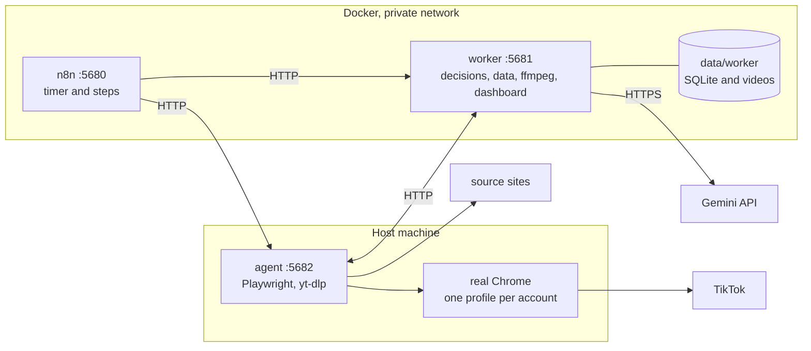

# Technology and design

What the parts are made of, why they are built this way, and how to extend them. For what happens step by step see [FLOWS.md](FLOWS.md); for installing and fixing see [OPERATIONS.md](OPERATIONS.md). A visual of section 1 is in [diagrams/architecture.drawio](diagrams/architecture.drawio).

## 1. Components and topology



| Component | Runs | Technology | Responsibility |
|---|---|---|---|
| worker | container | Python 3.12 standard library only, ffmpeg, SQLite (WAL), threaded HTTP server; image from a base pinned by digest | every decision and all data: queue, rules, Gemini calls, rendering, dashboard |
| n8n | container | official image, version pinned; workflows generated from `n8n/build.py` | timer and steps only |
| agent | host, background service (systemd `--user` or launchd) | Python 3.10+, Playwright driving the installed Chrome (no bundled Chromium), yt-dlp | scan, download, post, read views; never decides |

Ports 5680 (n8n), 5681 (worker), 5682 (agent). Published ports bind to `TRENDVN_BIND` (`127.0.0.1` by default); the agent binds the project's Docker bridge address (Linux) or `127.0.0.1` (macOS, where containers reach it as `host-gateway`). The three share one bearer secret (`TRENDVN_TOKEN`).

## 2. Design decisions

| Decision | Why | Cost |
|---|---|---|
| The worker decides, the agent does, n8n only times | rules are testable without a browser; editing a workflow cannot break a safety rule | three processes |
| Real Chrome driven by Playwright, no site APIs | no TikTok API access; the sessions are the owner's own | depends on page layout; on a wall (CAPTCHA, login) it stops and reports, never tries to pass |
| Worker on the standard library only | no install step, small attack surface, reproducible image | hand-written HTTP and SQL helpers |
| One SQLite file | one machine, one owner; measured fine at 100k videos (section 7) | single writer, single machine |
| The AI advises, code verifies | every Gemini answer is checked by hard rules; a bad answer parks a video, it never reaches posting | extra validation code |
| Leases, and "unclear means stop" | a stale result cannot overwrite a newer one; nothing retries after Post is clicked | an unclear post needs a human |
| Pinned where a change would break us (worker base image by digest, n8n by tag, Playwright, black and ruff) | reproducible builds | manual bumps; yt-dlp and the apt ffmpeg float on purpose (sites change fast) |
| Failures are reported, not hidden | n8n marks every run green, so each failing step reports to the worker (one message per step per 6 hours) | alert route and wiring to maintain; with no notification channel set an alert is dropped silently |
| An agent job past its limit is reported, not killed | ending Chrome mid-post could leave a post nobody can account for | a stuck Chrome needs an agent restart |
| Download candidates of all platforms scanned together are ranked in one pool | source weights only mean something when platforms compete; topic round-robin keeps one busy topic from taking every slot | scores of different platforms must be comparable |
| n8n kept for timing only | a timer and a run history | about 2 GB of image and ~380 MiB RAM idle; replacing it is open (ROADMAP) |

## 3. Code layout and extension points

```
services/worker/src/trendvn_worker/   domain/ (pure rules) -> store/ (SQLite, one concern per mixin) -> ai/, media/ -> web/, tasks.py, pipeline.py -> ui/ (one file per tab)
services/agent/src/trendvn_agent/     collector/ (sources/<site>.py, rules, capture, download, run), publisher/, browser.py, server.py, limits.py
n8n/        build.py (generates the workflows), manage.py (import, activate, export), workflows/*.json
scripts/    install, backup, restore, doctor, package, doclint, service templates
tests/      worker, agent, tools, e2e (real Chrome)
macos/      double-click launchers (install, open the dashboard, sign in, verify)
data/       worker/, agent/, backups/  (created at run time, never packaged or committed)
```

One responsibility per file; a function over about 60 lines is split into named steps.

| To change | Do |
|---|---|
| add a source | a file in `collector/sources/` (`parse_<site>` (or a variant such as `parse_instagram_codes`), `scan_<site>`, `CDN`), one line in its `__init__.py`, one line in `REGISTRY` of `domain/platforms.py`; labels, thresholds and notices follow from the registry, and `RegistryContractTests` (`tests/agent/test_collector.py`) fails when a line is missing |
| add a dashboard tab | a module in `ui/tabs/` with `render(view)` and one line in `TABS` of `ui/page.py` |
| add a setting | `DEFAULTS` and `validate_settings`, `DASHBOARD_SETTINGS` (`store/reporting.py`), the input in `ui/tabs/more.py`, the form in `web/forms.py`, a test (five places, deliberately) |
| change scoring | `score` in `collector/rules.py` |
| change when a post is allowed | `publish_claim` in `store/publishing.py`; neither agent nor n8n changes |
| change what the AI is asked | `ai/prompts.py`, raise `PROMPT_VERSION`, run `./trendvn test unit`, compare a few videos with Review before posting on |
| add a topic | one row in `domain/topics.py` (prompt, schema and dashboard follow); voice tone and pace in `domain/voices.py`, never as instructions in the spoken text |
| change a schedule | `n8n/build.py`, then `./trendvn n8n build` and `import`; `test lint` fails when the committed JSON differs. Edits made in the n8n editor are overwritten by the next `update` unless saved with `./trendvn n8n export` and moved into `build.py` |

**Where each rule lives.**

| Question | Where |
|---|---|
| which videos qualify, and their score | `collector/rules.py` (`qualifies`, `score` = engagement / max(age, 6 h)^0.6 x source weight) |
| which candidates are downloaded | `collector/run.py` (`fetch_pooled`) and `collector/rules.py` (`choose_downloads`) |
| new or already seen | `store/ingest.py` (`ingest`, `attach`: same source id, same SHA-256) |
| same picture, different bytes | `media/fingerprint.py` (5 frame hashes) |
| what the AI said, and whether to trust it | `ai/prompts.py`, `ai/analyzer.py` (`parse_analysis`), `domain/analysis.py` (`validate_analysis`) |
| how the video is built | `domain/route.py` (`choose_route`), `media/render.py`, `ai/tts.py` |
| may a post go out now | `store/publishing.py` (`publish_claim`) |
| posting and confirming | `publisher/post.py`, `publisher/jobs.py` |
| learning from views | `store/feedback.py` (`record_stats`, `platform_weights`) |
| messages | `notify.py` (`Notifier`) |
| settings and their limits | `domain/settings.py` (`validate_settings`) |

When a document and the code disagree, the code wins: `./trendvn help` for commands, `domain/settings.py` for settings, `n8n/build.py` for schedules and timeouts, the tests for states and invariants.

**Sources and topics.** Douyin: the featured page, reading the feed responses, plus one tab per topic (at most 6 per scan, rotating with the clock). Kuaishou: the "brilliant" feed (one stream; guests get no categories). TikTok: the Explore page and its category chips (US only). Instagram: public Reels plus yt-dlp (US only). Topic tabs are a smaller pond than the general feed (measured on 520 Douyin videos: only 12% reach the general likes bar), so they use 15% of the thresholds and allow videos 4 times older, and the score still prefers fresh ones. There are 15 topics plus `other` (advertising, spam); an account takes a set of topics, and the AI makes the final topic call after analysis.

## 4. Data, state and concurrency

**Data.** `data/worker/trendvn.sqlite3` (tables `jobs`, `observations`, `events`, `settings`, `accounts`, `api_calls`, `post_stats`, `notif_log`, `tasks`, `streams`); `data/worker/inbox/` downloads; `data/worker/jobs/<id>/` builds (`final.mp4`, `manifest.json`, `analysis.json`); `data/worker/exports/` dry-run screenshots and the voice sample; `data/agent/profiles/` one Chrome profile per account (`publisher` for the default, `publisher-<id>`) plus `collector-cn` and `collector-us`; `data/agent/shots/` the last 20 failure screenshots; `data/agent/agent.log`. The schema version is `PRAGMA user_version`; a migration runs in one transaction and only goes forward.

**Retention.** Candidates not downloaded after 3 days and videos undecided after 21 days are rejected; the clocks use `updated`, so a rescan does not reset them. Files of finished videos are deleted after 7 days, except `manifest.json` and `poster.jpg` (the row is kept so a video is never reposted); files of a live video are never deleted; orphan files are aged by `ctime` because yt-dlp copies the server date into `mtime`; a failed delete is retried after 24 hours. History is trimmed (observations 30 days, events 60, tasks 14, screenshots 14, notification log 7, AI calls 2). Below 1 GB free nothing is downloaded, below 512 MB nothing is rendered, and housekeeping sends a phone message.

**Atomicity.** Processing and publishing carry a lease token, and a result with the wrong token is refused. Claiming a post checks and records in one `BEGIN IMMEDIATE` transaction.

**Recovery clocks.** Housekeeping requeues a video stuck in `processing` for 30 minutes (never while a run holds the processing lock); one already tried twice goes to `needs_review` instead. A post claimed more than 45 minutes ago and never finished becomes `publish_unknown` (`STALE_PUBLISHING_SECONDS`; also checked at every claim, so other accounts do not wait). After a failed post the video rests 1 hour (`FAILED_REST_SECONDS` in `ui/cards.py`), the third failure parks it for you, and Post now ignores the rest.

| Mechanism | Scope | Behavior when taken |
|---|---|---|
| n8n concurrency limit 1 | the three schedules (manual runs are exempt) | queued, never overlapping |
| agent browser lock | one Chrome job (collect, publish, session, verify, dry run, stats) | HTTP 409 at once |
| worker processing lock | scheduled and dashboard processing | refused as busy |
| dashboard task guard | buttons | a message naming the running job |
| claim order | processing queue | the video that waited longest since it was queued; a video sent back goes behind the others and is parked for you after more than 10 requeues |

**Agent job limits** (`limits.py`, seconds; a job past its limit is logged and reported, `/health` names it): collect, session, verify, dry run 900; publish 1920 (the sum of the longest waits in the posting code is about 27 to 31 minutes); stats 600. n8n waits the limit plus 60 s for these steps and 15 minutes for worker steps, so a hung schedule holds the n8n queue for at most about 78 minutes (three agent steps at 16, two worker steps at 15) and delays a posting slot; accepted. They are alert thresholds, not measurements.

## 5. Interfaces

**Worker API** (JSON; `POST` needs `Authorization: Bearer <TRENDVN_TOKEN>`; a bad request is `400 {"error": ...}`).

| Route | Purpose |
|---|---|
| `GET /health` | liveness (no token) |
| `GET /api/status`, `GET /api/dashboard` | compact state for agent and n8n; full data for the dashboard |
| `POST /api/ingest` | one scan of one stream (at most 100 items; the first scan of a stream is the baseline) |
| `POST /api/media/pending`, `/api/attach`, `/api/media/failed` | candidates to download (best score first), attach a downloaded file, report a failed download |
| `POST /api/process` | process up to `max` (1 to 8) videos; stops on disabled, blocked, idle, rate limited |
| `POST /api/housekeeping` | recovery clocks above (requeue skipped while a run holds the processing lock), drop undecided videos, prune files and history |
| `POST /api/alert` | one phone message per step per 6 hours (step cut to 60 characters, detail to 300, a Bearer token masked) |
| `POST /api/heartbeat` | a component (`discovery` or `publisher`) reports it is alive (`detail` is merged) |
| `POST /api/publish/claim`, `/finish`, `/peek`, `/unresolved`, `/resolve` | the posting protocol; `claim` answers `claimed`, `disabled`, `blocked`, `wait`, `limit` or `idle` and returns the video, lease, account and target; `finish` takes `published`, `failed` (counts toward the 3-strike park), `deferred` (does not: verification page, duplicate caption), `unknown` (stops that account) or `duplicate`, and `url` must be a `*.tiktok.com` address; with `job_id`, claim reserves exactly that `ready` or `awaiting_approval` video and waives the switch, golden hours, daily limit, spacing and topic, but still stops for a post in flight, an unconfirmed post on the account or the verification pause; `peek` only reads |
| `POST /api/publisher/challenge` | switch the "verification pending" pause on or off per account |
| `POST /api/accounts[/add\|/update\|/login\|/delete]` | up to 10 accounts, each with topics and optional own limits; the last enabled account cannot be disabled, and the last account or one with an unconfirmed post cannot be deleted |
| `POST /api/settings`, `/api/notify`, `/api/stats` | settings (every key range-checked), send a message (`summary` or `text`; Telegram, Discord or Slack webhook, ntfy; throttled per kind and key), match view counts by `/video/<id>` |
| `POST /api/tasks/start`, `GET /api/tasks` | dashboard buttons as background tasks with live steps (`update`, `collect`, `process`, `publish`, `dryrun`, `stats`) |
| the dashboard's own forms (`web/forms.py`), `/login`, `/logout`, `/fragment/tasks` | 14 form routes with Origin and CSRF checks, password sign-in, the live task panel |
| `GET /media/<id>/final\|source\|poster` | video and pictures, Range supported, dashboard only |

Example:

```bash
TOKEN=$(grep '^TRENDVN_TOKEN=' .env | cut -d= -f2)
curl -s -H "Authorization: Bearer $TOKEN" localhost:5681/api/status | python3 -m json.tool | head
```

**Agent API** (listens as in section 1; one job at a time, otherwise 409): `POST /api/collect`, `/api/publish`, `/api/dry-run`, `/api/session`, `/api/verify`, `/api/stats`; `GET /health` returns `{ok, service, busy, job, busy_for}`; `collect` takes `{platforms?, download?}`, `publish` and `dry-run` take `{job_id?}`. Statuses: 400 bad request, 401 token, 404, 409 busy or stale, 413 too large, 503 overloaded.

**n8n workflows** (six, generated and loaded by `./trendvn n8n build` and `import`; the token lives in one credential, never in a workflow).

| Id | Trigger | Calls, in order (agent steps wait limit + 60 s, worker steps 15 minutes) |
|---|---|---|
| `trendvn01daily` | every 3 hours | agent `session`, agent `verify`, agent `collect`, worker `housekeeping`, worker `process` (`max` 4) |
| `trendvn02publish` | every 30 minutes | agent `publish` |
| `trendvn03daily` | 23:30 | agent `stats`, worker `notify` (summary) |
| `trendvn00status`, `trendvn10inbox`, `trendvn20process` | by hand / authenticated webhook | readiness check, observation intake, a processing run |

Every step of the three schedules continues on its error output: the failure goes to the worker's `alert` route and the next step still runs.

## 6. AI usage and output quality

**Calls.** *Analysis* once per video: a 384 px, 1 frame per second preview of at most 12 MB plus the prompt, answered as JSON under a response schema. *Voice* when the route is voice-over: only the Vietnamese text is sent, and tone and pace go in the style annotation of the interactions endpoint (instructions placed in the text are read aloud). A local budget of 12 calls per 24 hours (setting range 1 to 500) protects the quota; every call counts, including the text call that shortens too-fast subtitles, a rejected call is refunded, and analysis and voice are cached per job, so a retry does not pay again and a voice-over video uses 2 to 3 of the 12. A model that is gone (404) is replaced by the fallback chain in `domain/settings.py`; an overloaded one (429 or 5xx) is retried after 10, 30, 60 seconds inside a 240 second budget, then the video goes back to the queue; a daily-quota 429 is not waited for. Models are settings (`model`, `tts_model`), not constants.

**Prompt rules.** The video is untrusted data (spoken or shown instructions are ignored, and the reminder is repeated after the video). Output is schema-constrained with length caps (a runaway loop once filled a field with 16,000 tokens). Nothing may be invented. Singing is music, music with real words is mixed. Topic is one code from a fixed menu; only hard stops set `sensitive` (sexual content, children in danger, real blood, hate, self-harm or serious crime, harmful advice, private people). A video is parked for you when `sensitive` is set, the topic is `other`, or no account takes its topic. Gemini only recommends: `validate_analysis` rejects bad structure, doubtful confidence, subtitles that overrun or overlap, `parse_analysis` rejects duplicate JSON keys, and links, handles, phone numbers and hidden characters are filtered from captions and subtitles (`domain/text.py`).

**How a video is built** (`domain/route.py::choose_route`, a pure function; the reason shows on the video card):

| Heard | Built as |
|---|---|
| music, no speech; or silent | original picture and sound kept |
| speech or mixed | original voice plus Vietnamese subtitles |
| one speaker the AI marks safe to replace, or narration | Vietnamese voice-over (voice matched to the speaker) with the original lowered only under the voice, plus subtitles |
| voice-over off, impossible, or Google too busy 4 times | subtitles only |
| unsure | parked for you |

One ffmpeg pass makes 1080x1920 H.264 (a blurred 9:16 background for non-vertical sources, rotation applied) at most 30 fps, AAC 160k, loudness -14 LUFS, metadata removed, then a decode check and a poster (`media/render.py`). Hard-subtitle boxes the AI reports are blurred only while ours show; one taller than 30% of the frame, or reversed, is ignored, and a video kept as is is never blurred. Captions follow `caption_style`: `hook` (default; 35 to 90 characters) or `factual`.

**Quality decisions, with what they rest on** (real Douyin video, real Gemini and ffmpeg, 2026-10; full tables in [history/QUALITY-1.6.md](history/QUALITY-1.6.md)).

| Decision | Number behind it |
|---|---|
| voice text only, style by annotation | instruction-in-text: half the spoken words were the instruction (0.50 heard vs 1.00); text only: 16 characters per second, every word read |
| voice pace chosen from characters per second of the speech window, one step faster on a second try | style changes pace from 12 to 23.6 characters per second; reject if over 25% longer than the window or faster than 24 characters per second |
| encoder `veryfast`, CRF 24, at most 4 Mb/s | SSIM 0.9927 against a CRF 12 reference; lower CRF costs +29 to +69% size (+4 to +5% time); slower presets cost +48 to +78% time and +54 to +59% size; tune film +31% time; all for 0.001 to 0.002 SSIM |
| loudness -14 LUFS; voice -16 LUFS; original lowered to 14% only under the voice | original 8 dB lower under the voice than outside it |
| original burned-in subtitles blurred only when ours would overlap them, only while ours show, at quarter scale | render time -19% (44.8 s to 36.4 s on a 134 s video), SSIM 0.988 to 0.996 |
| subtitle speed: the prompt asks for 16 characters per second, the code accepts up to 17 (`domain/readability.py`), lines over 20 are shortened by one text call, above 24 flagged; invented lines dropped | fastest line 21 to 17 characters per second |

Not measured: a male voice other than one (the key's daily quota ran out), judging by human ears (another model listened and transcribed instead).

## 7. Performance

| Measure | Value |
|---|---|
| Time per video | the AI about two thirds (30 to 100 s), render about a quarter (24 s for a 78 s video, 40 s for 153 s), preview 6.5 s, quality check 4 s, fingerprint 1.2 s |
| Two videos at once | about double the throughput (most time is waiting for the AI) |
| Vertical H.264 music video | copied through in 3.3 s instead of rendered in 24 s |
| Douyin scan | 60 to 75 s with adaptive waits (95 s fixed) |
| Dashboard at 20k / 100k videos (p50 / p95) | page 25/27 and 86/97 ms; status 12/14 and 40/44 ms; claim a post 23/24 and 82/87 ms |
| SQLite `synchronous=FULL` | 0.7 to 0.9 ms per write transaction (about 5 per video): not a cost worth removing |

Measured and left unchanged: the 9:16 filter graph, the encoder preset, folding the quality check into the render (saves 4 s, loses an independent check), Kuaishou's fixed waits (the site throttles repeated loads, so comparisons were noise).

## 8. Security and privacy

**What the system will not do.** Type your password (you sign in yourself in Chrome). Hide automation (it does not disable the automation flag or change the user agent). Pass or solve a CAPTCHA (it detects it, pauses publishing, tells you). Label a non-US source as US (the exit country is checked). Post when in doubt (an unclear post stops that account). Post a changed file (the SHA-256 of the render is checked). Obey text in a video.

| Surface | Control |
|---|---|
| ports | `127.0.0.1` by default; the agent only on the private bridge |
| API | 256-bit bearer token, constant-time comparison |
| dashboard | passwordless only for host `localhost` from this machine and without proxy headers; other hosts need `TRENDVN_UI_HOSTS` and a password (server-side sessions, 7 days, locked 60 s per address after 5 bad attempts); Origin and CSRF checks; hash-only script CSP, `X-Frame-Options: DENY`; every displayed value escaped |
| HTTP server | 30 s socket timeout per read, the worker at most 48 threads (503 beyond; the agent's server has no cap), bodies 2 MiB (worker) and 1 MiB (agent), bad `Content-Length` refused |
| media paths | only inside `data/worker/`, ids of 32 hex characters |
| downloads | HTTPS, strict URL syntax, the platform's own CDN only, every redirect checked, at most 250 MB, must be a real MP4, written as `.part` then renamed |
| notifications | public `https` hosts only, resolved before sending, no redirects, no mass mentions |
| containers | worker runs as your uid on a read-only root; all capabilities dropped; `no-new-privileges`; memory (worker 4 GB, n8n 2 GB) and process (512) limits; the worker's `/tmp` is a 512 MB tmpfs; rotated logs |

| Secret | Where |
|---|---|
| `N8N_ENCRYPTION_KEY`, `TRENDVN_TOKEN`, proxy and notification tokens | `.env` (0600, not in git) |
| Gemini key; notification channel | `data/worker/gemini.key`, `data/worker/notify.json` (0600) |
| TikTok sessions | `data/agent/profiles/` (whoever holds it can sign in as you; backed up only with `--with-session`) |
| backups | `data/backups/*.tar.gz` (0600, contain the above) |

If the token may have leaked, rotate it: the steps are in [OPERATIONS.md](OPERATIONS.md) section 4. The Gemini key travels only in the `x-goog-api-key` header and is never logged.

**Data that leaves the machine.** Gemini: the 384 px preview and the voice text, only with video processing on. Source sites: normal page loads (through your proxy if set). TikTok: the video and caption when posting; your public profile is read to confirm and to get views. Telegram, Discord, Slack or ntfy: message text, only if configured. ipinfo.io and api.country.is: the country of your exit IP, only for scans that include TikTok or Instagram. n8n release notes, template library, MCP registry and diagnostics are switched off in `compose.yaml` (the only call n8n was seen making before that was to `api.n8n.io`; no network trace of the new settings was taken).

**Accepted risks.** One shared token for the three parts (one owner, one machine). A token holder can use Post now through the API. yt-dlp is not pinned (sites change fast), so only domain-checked URLs reach it; it gets the proxy from environment variables, never the command line, and has not been run with a real proxy. The caption filter is heuristic, so the owner still reviews. `style-src 'unsafe-inline'` remains because the interface uses `style` attributes; scripts are locked. No TLS on localhost; for remote access use an SSH tunnel or a TLS proxy. The agent service does not use `PrivateTmp` (headed Chrome needs the X11 socket in `/tmp`; it keeps `NoNewPrivileges`). Notification hosts are resolved before sending and again on connect, so a DNS-rebinding window remains. Backups hold every secret: encrypt them or keep them off the machine.

**Not a technical risk, but the biggest one:** the system reposts other people's videos. Copyright and each platform's terms are the owner's responsibility; no software step grants rights.

## 9. Deployment and configuration

**On the host.** Docker network `<project>_private`; volume `<project>_n8n_data`; `./data/worker` mounted at `/data`; `./n8n/workflows` mounted read-only at `/import`; containers restart unless stopped and have health checks; logs rotate (5 files of 10 MB per service). macOS: Docker Desktop runs containers in a VM, so the agent listens on `127.0.0.1` and containers reach it as `host-gateway`; the agent runs under launchd with `caffeinate`; the project folder must not be under `Documents`, `Desktop` or `Downloads` (background jobs cannot read them). Linux: `systemd --user`, and `loginctl enable-linger` to start without a login. Windows: WSL2 with Chrome installed inside it.

**Configuration** is `.env` (created by `install`, mode 0600); the template is `.env.example`.

| Variable | Effect |
|---|---|
| `TRENDVN_TOKEN`, `N8N_ENCRYPTION_KEY` | generated once; losing the second loses what n8n stored |
| `COMPOSE_PROJECT_NAME`, `TRENDVN_{N8N,WORKER,AGENT}_PORT` | only to run two copies on one machine |
| `TRENDVN_BIND` | `127.0.0.1` (default) or an address for remote access |
| `TRENDVN_N8N_URL`, `TRENDVN_N8N_HOST` | the n8n address for remote access (behind TLS also `TRENDVN_N8N_PROTOCOL=https` and `TRENDVN_N8N_SECURE_COOKIE=true`) |
| `TRENDVN_AGENT_BIND`, `TRENDVN_AGENT_HOSTREF`, `TRENDVN_SUBNET`, `TRENDVN_GATEWAY`, `TRENDVN_UID`, `TRENDVN_GID` | written by `install` (Linux: the bridge address; macOS: `127.0.0.1` and `host-gateway`); do not edit |
| `TRENDVN_UI_HOSTS` (entries are `host:port`), `TRENDVN_UI_PASSWORD`, `TRENDVN_UI_HTTPS`, `TRENDVN_TRUSTED_PEERS` | remote dashboard access (password required), TLS cookie flag, Docker Desktop peer address |
| `TRENDVN_TZ` | the times of the n8n schedules and the worker container's clock (default `Asia/Ho_Chi_Minh`). Golden hours and the daily count follow the worker setting `timezone`, which is `Asia/Ho_Chi_Minh` and cannot be changed from the dashboard or the API |
| `TRENDVN_PROCESS_PARALLEL` | videos processed at once (default 2; clamped to 1 to 4) |
| `TRENDVN_PUBLISH_HEADED` | `0` hides Chrome, `1` forces it visible; by default it is visible on macOS and Windows and wherever a display exists, because TikTok challenges hidden Chrome more |
| `TRENDVN_US_PROXY`, `TRENDVN_CN_PROXY` | proxies; the US sources run only when the exit country is the US (with or without a proxy) |
| `TRENDVN_TELEGRAM_TOKEN`, `_CHAT`, `TRENDVN_NOTIFY_WEBHOOK`, `TRENDVN_NTFY_URL` | phone messages |

**Remote access to the dashboard and n8n**, in order of preference: an SSH tunnel to ports 5680 and 5681 (nothing to configure; the command is in [OPERATIONS.md](OPERATIONS.md) section 4); a private VPN address in `TRENDVN_BIND` with `TRENDVN_UI_HOSTS` and a password; a domain behind a TLS reverse proxy that passes `Host` and `X-Forwarded-For`, with `TRENDVN_UI_HTTPS=1`. Never `TRENDVN_BIND=0.0.0.0` on the open Internet. The workflows address `worker` and `trendvn-agent`, names that exist only in the project's network, so they cannot be imported into another n8n.

**Two copies on one machine.** Docker identifies a stack by project name, so a second copy needs its own `COMPOSE_PROJECT_NAME` and ports and is installed with `--no-service`; `./trendvn` refuses to stop or overwrite another folder's containers (`guard_project`).

## 10. Quality gates

| Gate | What |
|---|---|
| tests | `./trendvn test` (lint and unit on the host), `test container` (the whole suite in the worker image with real ffmpeg), `test e2e` (real Chrome, 7 screen sizes, touch targets of at least 44 px); 655 tests in the last run, 18 skipped on a host without ffmpeg |
| lint | `black` and `ruff` pinned in `requirements-dev.txt`, shellcheck, shell scripts checked for macOS bash 3.2, `compose.yaml` valid, hidden or reversed characters rejected |
| documents | `scripts/doclint.py`: every `./trendvn` command in a document exists, links resolve, no document missing from the map, one H1 per document, and `FLOWS.md` free of technology terms |
| each fix | a test that fails when the fix is removed, checked by deleting the fix in a copy of the repository |
| each phase | static review, a dynamic run, and an independent read-only review; recorded in [ROADMAP.md](ROADMAP.md) and [history/PHASES-0-K.md](history/PHASES-0-K.md) |
| release | SemVer, a `CHANGELOG.md` section per version, `./trendvn package` builds a secret-free archive with a checksum |

Known gaps: the GitHub CI file has not been seen running; the golden-hour time zone is fixed; alerts need a notification channel to reach anyone; there is no image vulnerability scan, SBOM or signing; the dashboard has no metrics endpoint (health is a heartbeat per component).
