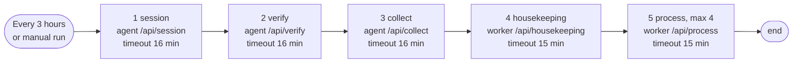
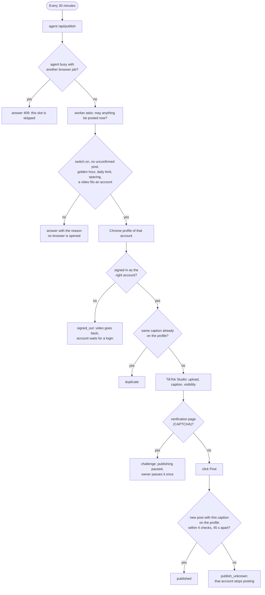
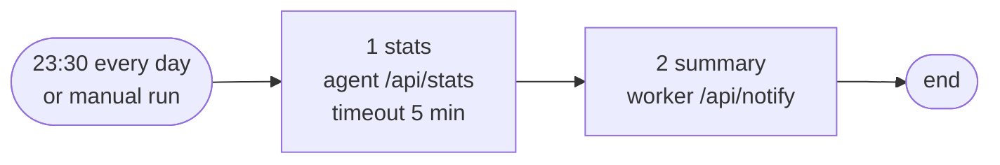
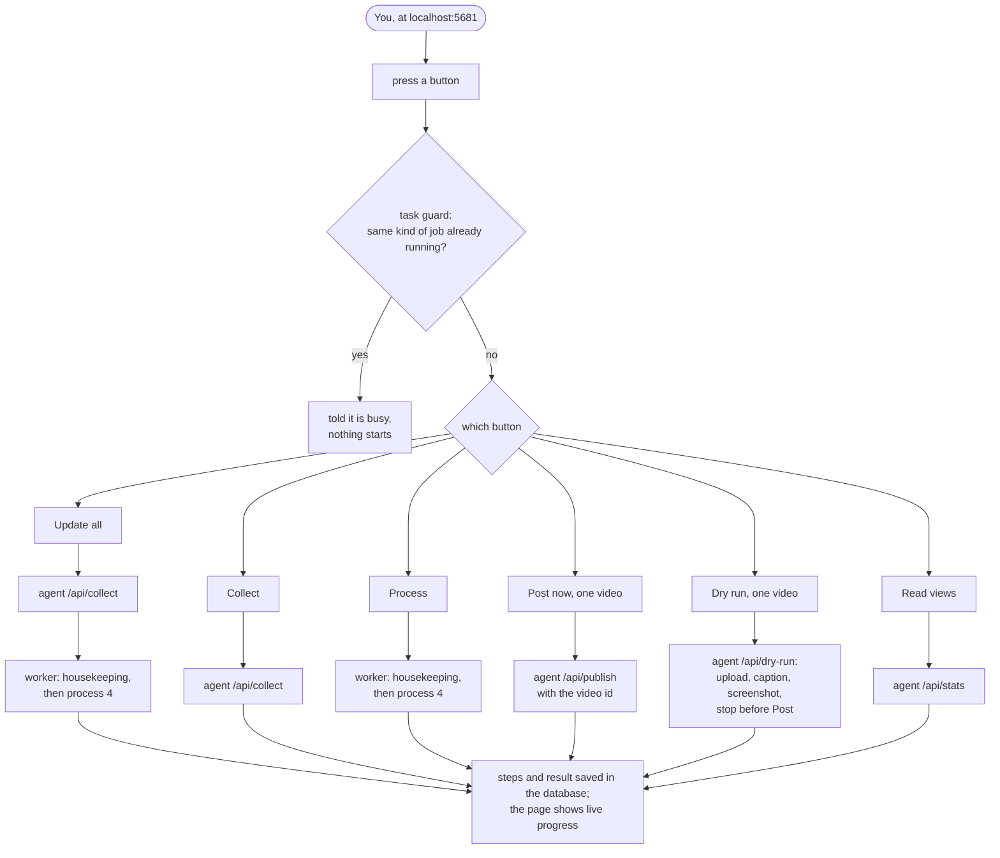

# Workflows: what runs by itself and what you press

Every way work starts in TrendVN, step by step: the three automatic n8n schedules, the dashboard buttons and the command line. For *why* the system is split into worker, agent and n8n see [ARCHITECTURE.md](ARCHITECTURE.md); for *how n8n is built* see [N8N.md](N8N.md); for what to do when something fails see [OPERATIONS.md](OPERATIONS.md).

Sources: `n8n/build.py` (the workflows), `services/worker/src/trendvn_worker/tasks.py` (dashboard buttons), `services/agent/src/trendvn_agent/server.py` and `publisher/jobs.py` (agent jobs). The diagrams are Mermaid, so GitHub draws them and an agent can read and edit them as text.

## 1. Who can start work

| Trigger | What it starts | Uses the browser (agent) | Uses Gemini (worker) |
|---|---|---|---|
| n8n 01, every 3 hours | session check, verify, collect, housekeeping, process | yes | yes |
| n8n 02, every 30 minutes | publish one video if the worker allows it | yes | no |
| n8n 03, 23:30 | read views, send the day's summary | yes | no |
| n8n 00, 10, 20 | readiness check, observation intake (webhook), processing run (all by hand) | 00: health only | 20: yes |
| Dashboard buttons | update all, collect, process, post now, dry run, read views | all except process | process and update |
| Command line | `./trendvn tiktok login`, `trust`, `dry-run`, `verify`, `stats` | yes | no |

Only workflows 01, 02 and 03 are scheduled; `./trendvn n8n activate` turns them on.

## 2. Automatic workflows

### 2.1 Workflow 01: collect and process (every 3 hours)

| Step | Executed by | What it does |
|---|---|---|
| 1 session | agent (Chrome, one launch per account) | Is each account still signed in as the right user? Reports it to the worker as a heartbeat; an expired session is reported once per account with the command to sign in again. |
| 2 verify | agent (Chrome, one launch per account) | Posts whose outcome was unknown are looked for on the public profile and resolved as published. It never posts again. |
| 3 collect | agent (Chrome, yt-dlp) | Scans every source, keeps videos that pass the gates, hands the list to the worker, then downloads the best ones (at most 3 per run, queue at most 4, disk at least 1 GB free). |
| 4 housekeeping | worker | Puts videos a crash left in `processing` back in the queue, turns posts claimed more than 45 minutes ago into `publish_unknown`, deletes old files and history, warns when the disk is low. |
| 5 process | worker | Up to 4 queued videos, 2 at a time: fingerprint, Gemini analysis, ffmpeg render, quality check. Result: `ready`, `awaiting_approval` or `needs_review`. |

Every HTTP node of the three schedules continues on its *error output*: if a call fails, the failure goes to the worker (`/api/alert`, one phone message per step per 6 hours) and the next node still runs, so the n8n execution stays green. The status bar of the dashboard also turns orange when a department has not reported for 7 hours. The timeouts come from `services/agent/src/trendvn_agent/limits.py`: the agent's own limit for the job plus one minute.

### 2.2 Workflow 02: publish (every 30 minutes)

The worker's checks, in order (`store/publishing.py::publish_claim`): the Auto switch, no unconfirmed post for the account, golden hour (default 11:00-14:00 and 19:00-23:00), the account's daily limit (default 2), spacing from the previous post (default 3 hours), then the highest-scoring `ready` video whose topic the account takes. The result of every attempt goes back to the worker (`/api/publish/finish`) *before* any bookkeeping, and a result that cannot be sent is retried 3 times. n8n waits 33 minutes for the whole call (the agent's own limit is 32); a post that runs longer is reported.

### 2.3 Workflow 03: end of day (23:30)

`agent /api/stats` (timeout 11 minutes) reads the views of posted videos from each account's profile, then `worker /api/notify` sends the summary. The views feed the source weights once at least 8 posts are older than 24 hours.

### 2.4 Support workflows (by hand)

| Workflow | Purpose |
|---|---|
| 00 readiness check | Reads the worker status and the agent health and lists what is still missing before unattended posting. Changes nothing. |
| 10 observation intake | Authenticated webhook that feeds a list of videos to `/api/ingest` from another tool. The automatic collector does not use it. |
| 20 processing run | `housekeeping` then `process` (max 4), the same as the dashboard Process button. |

## 3. Manual flows

### 3.1 Dashboard buttons

Browser buttons (collect, post, dry run, read views) cannot overlap each other; process and update cannot overlap another process. A button that finds the agent busy says so; the schedule keeps its own slot. Progress is saved after every step, and a worker restart marks unfinished tasks as errors so none stays "running" forever.

| Button | What it runs | Differs from the schedule |
|---|---|---|
| Update all | collect, then process | skips the TikTok session check and verify |
| Collect | collect only | the same call as workflow 01 step 3 |
| Process | housekeeping inside the process lock, then up to 4 videos | the schedule runs housekeeping as a separate node (see section 5) |
| Post now | one chosen video, only the account-protecting rails apply | ignores golden hour, daily limit and spacing: your click is the consent |
| Dry run | everything except the final Post click | n/a |
| Read views | the same as workflow 03 step 1 | n/a |

### 3.2 Decisions on a video card

| Action | Effect |
|---|---|
| Approve (needs review) | the video is processed again with the checks waived; the deferral and voice counters start afresh |
| Approve (awaiting approval) | becomes `ready` |
| Reject | becomes `rejected`; files are removed later by housekeeping |
| Bring back ready to post | a video parked after repeated posting failures returns to `ready` without a new Gemini call |
| Edit or reset caption | your text replaces the generated caption until you reset it |
| Confirm an unconfirmed post | marks it `published` or sends it back to `ready`; only you or `verify` can clear `publish_unknown` |

Other forms: settings, Gemini key, accounts (add, save, delete), notification channel and test, test voice, observation import.

### 3.3 Command line

`./trendvn tiktok login [--account ID]` signs an account in (you type the password in the Chrome window), `trust` passes a verification page once, `dry-run`, `verify` and `stats` run the same agent jobs as the buttons. They open the same Chrome profile as the agent service, so run them when no job is running.

## 4. Locks and what happens on a collision

| Lock | Held by | A second request gets |
|---|---|---|
| n8n concurrency limit 1 | the n8n instance | queued: workflows 01, 02 and 03 never run at the same time |
| agent `browser_lock` | one Chrome job (collect, publish, session, verify, dry run, stats) | HTTP 409 at once; no waiting. A job past its limit is reported (`/api/alert`), not killed, and `/health` names it |
| worker `process_lock` | `/api/process` and the dashboard Process | refused as busy |
| task guard (worker) | dashboard buttons | a message that names what is running |

## 5. Evaluation (2026-10-28): is it optimal?

**It was not**, and phase K ([ROADMAP.md](ROADMAP.md)) fixed what the evidence supported. The core is sound (state machine, leases, locks, safety rails: review log in the roadmap, phase J); the workflow layer had gaps. Facts were read in the code; estimates are marked. "Status" is what the code does now.

| # | Finding | Evidence | Severity | Status |
|---|---|---|---|---|
| 1 | Failures were invisible in n8n: every HTTP node continued on error, so each run was green and a stale credential showed only after 7 hours. | `n8n/build.py` | medium | **fixed (K1)**: the error output reports to `/api/alert`; checked in the pinned n8n 2.38.7 against fake services |
| 2 | An agent job had no deadline and n8n's timeouts were shorter than the agent's worst case: n8n moved on, the agent kept its lock, the next call got 409 and was skipped without a trace. | `server.py`, `build.py` | medium | **mostly fixed (K2)**: n8n now waits as long as the agent's limit table allows, and a job past its limit is reported. It is still not killed, so a truly stuck Chrome holds the browser until the agent restarts |
| 3 | Workflow 01 called `/api/housekeeping` without `process_lock` and could put a video that was still being processed back in the queue (arithmetic on the timeouts, not reproduced). | `web/api.py` | low | **fixed (K3)** |
| 4 | One platform error ended the rest of the collect session; parsers dropped a whole response for one odd item; `data/agent/shots` was never cleaned; the `tiktok` commands ignore the browser lock. | agent review, phase J | medium | **fixed except the last (K4 a-c)**; the command-line lock is open |
| 5 | Worst case, workflow 01 holds the n8n queue for about 78 minutes now (the timeouts add up: 16+16+16+15+15) and delays a publish slot; typical runs are far shorter (unmeasured here) and golden hours are 3-4 hours wide. | `build.py`, `compose.yaml` | low | open, accepted: only when jobs hang, and the owner is told |
| 6 | The manual Update skips the session check and verify, so only the schedule notices an expired TikTok session. | `tasks.py` | low | open (K5): a product choice, it costs a Chrome launch per account per press |
| 7 | n8n costs about 2 GB of image and ~380 MiB of RAM idle, a second secret store, and called `api.n8n.io` with diagnostics off. | phase J | decision | partly (K6): the calls are switched off in `compose.yaml`; replacing n8n (K7) is the owner's call |
