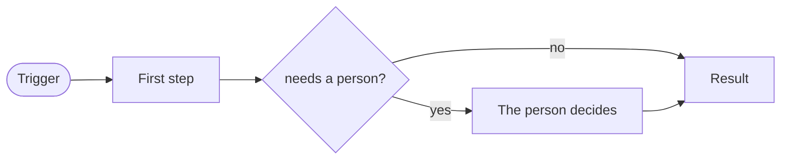
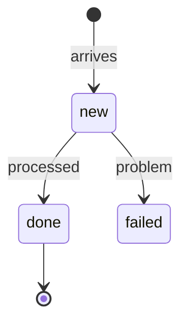

# Flows: what happens, and what you do

<!-- FILL: two sentences. What this document covers, then: "This document has no technology: no ports, tools, routes or file names. For what the parts are made of, why, and how to extend them, read [TECH.md](TECH.md). For installing, running and fixing, read [OPERATIONS.md](OPERATIONS.md)." Keep the technology ban: the linter fails this file on technology terms. -->

Actors:

| Actor | Role |
|---|---|
| **<!-- FILL: first actor -->** | <!-- FILL: what it does, and the constraint on it ("decides nothing") --> |
| **You** | <!-- FILL: what the person sets, reviews and presses --> |

## 1. The whole system in one flow

<!-- FILL: one flowchart, left to right, about 12 nodes: triggers, main steps, decisions, end. Replace the skeleton. -->

## 2. Life of one <!-- FILL: main entity -->

<!-- FILL: the entity the system exists to move. State names exactly as the code names them. -->

| State | Meaning |
|---|---|
| `new` | <!-- FILL: one row per state --> |

Guarantees that never change:
1. <!-- FILL: an invariant phrased as always/never. Each one must be backed by a test; TECH.md says where it is enforced. -->

## 3. Automatic flows

### 3.1 <!-- FILL: trigger, for example "Every 3 hours: collect and process" -->

| Step | What happens | If it fails |
|---|---|---|
| 1 <!-- FILL --> | <!-- FILL --> | <!-- FILL --> |

<!-- FILL: one subsection per trigger. For branching logic add a flowchart TD whose decisions are the real checks, in order. End with what a failing step does to the next one. -->

## 4. Manual flows

### 4.1 First run

<!-- FILL: flowchart of the first-run order. Explain in one sentence any ordering that is not obvious. -->

### 4.2 Buttons and commands

| Action | What it does | Compared with the automatic flow |
|---|---|---|
| <!-- FILL --> | <!-- FILL --> | <!-- FILL: say which checks it skips and which stay --> |

### 4.3 Decisions on one <!-- FILL: entity -->

| You choose | Result |
|---|---|
| <!-- FILL --> | <!-- FILL --> |

## 5. When something goes wrong

| Situation | What the system does by itself | What you do |
|---|---|---|
| <!-- FILL: every place the code alerts the user or stops --> | <!-- FILL --> | <!-- FILL --> |

<!-- FILL: close with what never runs together, in plain words. -->
