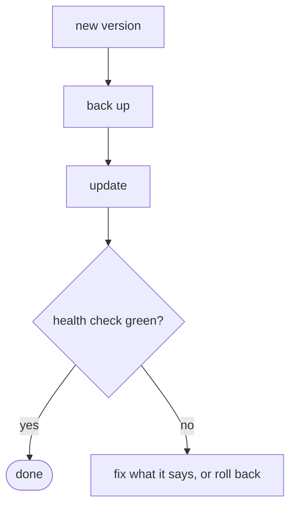

# Operations: install, run, update, fix

<!-- FILL: one line. For whoever installs and runs it. What the system does is in [FLOWS.md](FLOWS.md); what it is made of is in [TECH.md](TECH.md). How commands are run. -->

## 1. Install

| Need | Detail |
|---|---|
| <!-- FILL: system, runtimes with versions, disk, accounts --> | <!-- FILL: and why, when it is not obvious --> |

**1. Get the code.**

```bash
<!-- FILL: the one command -->
```

<!-- FILL: what it does, what is safe to repeat, what good looks like. -->

**2. Install.**

```bash
<!-- FILL -->
```

**3. Check.**

```bash
<!-- FILL: the health or doctor command -->
```

**4. Rehearse before real use.** <!-- FILL: the dry run, and who turns on anything that acts on the world -->

## 2. Daily use

| Command | Purpose |
|---|---|
| <!-- FILL --> | <!-- FILL --> |

**Settings** (every value range-checked):

| Setting | Default |
|---|---|
| <!-- FILL: copy from the code's defaults --> | |

## 3. Update, back up, move

```bash
<!-- FILL: backup command -->
```

```bash
<!-- FILL: update command -->
```



<!-- FILL: which changes cannot be rolled back (migrations) and how the changelog flags them. Moving to another machine in an order that avoids two machines acting at once. Uninstall and its destructive flag. -->

## 4. When something is wrong

| Symptom | Likely cause | Do |
|---|---|---|
| <!-- FILL: the exact message the user sees --> | <!-- FILL --> | <!-- FILL: a command or a click path --> |

<!-- FILL: how to stop the system acting at once. -->

## 5. Keeping it healthy

<!-- FILL: cleanup, retention, platform quirks, disk. -->

## 6. Command reference

| Command | Purpose |
|---|---|
| <!-- FILL: every command the front door has --> | |
