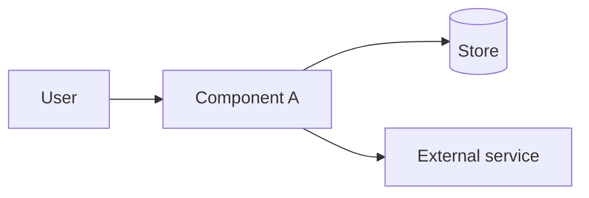

# Technology and design

<!-- FILL: one paragraph. What the parts are made of, why they are built this way, how to extend them. Link: what happens step by step is in [FLOWS.md](FLOWS.md); installing and fixing is in [OPERATIONS.md](OPERATIONS.md). -->

## 1. Components and topology



| Component | Runs | Technology | Responsibility |
|---|---|---|---|
| <!-- FILL --> | <!-- FILL: where --> | <!-- FILL: language, runtime, key libraries, pinned versions --> | <!-- FILL: one phrase; what it never does --> |

<!-- FILL: ports, bind addresses, trust boundaries, shared secrets (names only, never values). -->

## 2. Design decisions

| Decision | Why | Cost |
|---|---|---|
| <!-- FILL: a decision a newcomer might question --> | <!-- FILL: the reason --> | <!-- FILL: the honest price -->  |

## 3. Code layout and extension points

```text
<!-- FILL: directory tree, one line per directory with its job -->
```

| To change | Do |
|---|---|
| <!-- FILL: add X --> | <!-- FILL: the files and the one registration line --> |

**Where each rule lives.**

| Question | Where |
|---|---|
| <!-- FILL: a question people ask --> | <!-- FILL: path and symbol, no line numbers --> |

## 4. Data, state and concurrency

<!-- FILL: stores and schema versioning, retention, locks and leases, idempotency, ordering. Say where each guarantee from FLOWS.md section 2 is enforced. -->

## 5. Interfaces

| Method or command | Path | Auth | Purpose |
|---|---|---|---|
| <!-- FILL --> | <!-- FILL --> | <!-- FILL --> | <!-- FILL --> |

## 6. <!-- FILL: the domain-specific section (AI usage, rendering, payments...). Rename the heading; write "None" and why if there is nothing. -->

## 7. Performance

| Measure | Value | How measured |
|---|---|---|
| <!-- FILL: number with date and conditions, or "not measured" --> | | |

## 8. Security and privacy

| Risk | Control | Where enforced |
|---|---|---|
| <!-- FILL --> | <!-- FILL --> | <!-- FILL --> |

Not covered: <!-- FILL: the gaps, stated plainly -->

## 9. Deployment and configuration

| Variable | Default | Meaning |
|---|---|---|
| <!-- FILL: copy from the example env file and the settings defaults --> | | |

<!-- FILL: build, pinning, run modes, remote access, running two instances. -->

## 10. Quality gates

<!-- FILL: the test ladder and what each level catches, the lint set, the CI gate, the review process; the commands. -->
